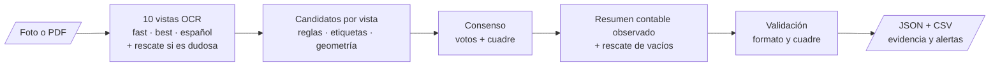

# Lector de Facturas — extracción y validación de comprobantes con OCR


-informational)


[](https://colab.research.google.com/github/Jesusl2202/Document-Scanner/blob/main/notebooks/05_evaluacion.ipynb)

Sistema que lee una **foto o un PDF de una factura o recibo impreso** y devuelve seis campos estructurados —identificador fiscal (RUC), fecha, número de comprobante, subtotal, impuesto (IVA) y total— con la evidencia de dónde salió cada valor y alertas para revisión humana. Usa Tesseract preentrenado en CPU, un consenso de 10 lecturas de la misma imagen y un **resumen contable observado** que solo corrige un monto cuando los descuentos o cargos visibles lo respaldan.

Proyecto integrador de la Maestría en Inteligencia Artificial — Universidad Espíritu Santo.

## Tabla de contenidos

1. [Descripción del problema](#1-descripción-del-problema)
2. [Dataset](#2-dataset)
3. [Metodología](#3-metodología)
4. [Resultados](#4-resultados)
5. [Instalación y uso](#5-instalación-y-uso)
6. [Interfaz de usuario](#6-interfaz-de-usuario)
7. [Estructura del proyecto](#7-estructura-del-proyecto)
8. [Consideraciones éticas y limitaciones](#8-consideraciones-éticas-y-limitaciones)
9. [Autores y contribuciones](#9-autores-y-contribuciones)
10. [Licencia](#10-licencia)
11. [Agradecimientos y referencias](#11-agradecimientos-y-referencias)
12. [Videos](#12-videos)

---

## 1. Descripción del problema

**¿Qué resuelve?** En muchas pequeñas y medianas empresas los datos de cada factura se copian a mano al sistema contable: fecha, RUC, número de comprobante y montos. Es lento, repetitivo y un dígito mal copiado genera descuadres difíciles de rastrear. Cada proveedor usa un formato distinto, así que una plantilla fija no sirve.

**¿Por qué es importante?** Automatizar la primera captura libera tiempo para revisar en vez de transcribir, y la validación de coherencia (subtotal + impuesto = total) detecta errores que a mano pasan desapercibidos. Todo corre en CPU, sin costo ni servicios de pago, y las imágenes no salen del equipo donde se procesan.

**¿Para quién?** Personal de contabilidad y digitación de PYMES, dueños de pequeños negocios y estudiantes o desarrolladores que quieran un pipeline de extracción de documentos auditable.

> ⚠️ **Limitación importante: solo comprobantes impresos o digitales.** Las facturas y recibos **no deben tener campos escritos a mano** (fecha, montos, RUC o número completados con bolígrafo). El reconocimiento de texto manuscrito con Tesseract no es confiable: esos campos pueden quedar vacíos o, peor, leerse con un valor equivocado sin que el sistema lo detecte. Si un comprobante tiene datos manuscritos, esos campos deben digitarse manualmente.

## 2. Dataset

| Dataset | Tipo | Tamaño | Campos que permite evaluar | Fuente y licencia |
|---|---|---|---|---|
| **SROIE** (ICDAR 2019) | Recibos escaneados de Malasia | 973 imágenes (626 train + 347 test) | `date`, `total` | [Kaggle `urbikn/sroie-datasetv2`](https://www.kaggle.com/datasets/urbikn/sroie-datasetv2); uso académico, sin licencia explícita de redistribución |
| **WildReceipt** (Sun et al., 2021) | Recibos fotografiados en condiciones reales, 25 categorías | 1.739 imágenes (1.267 train + 472 test) | `date`, `subtotal`, `tax`, `total` | [MMOCR `wildreceipt.tar`](https://download.openmmlab.com/mmocr/data/wildreceipt.tar); publicado para investigación |
| **Muestra propia** | Comprobantes reales impresos de ≥ 3 emisores | 30–50 documentos (en recolección) | Los seis, incluidos `tax_id` y `document_number` | Privada; anonimizada y no publicada |

**Características principales.** Tras la partición por hash (semilla 42) quedan 1.517 documentos de entrenamiento, 364 de validación, 816 del test oficial y 15 en cuarentena por duplicados. Cada documento tiene ancho, alto, regiones de texto anotadas y, por campo, un estado (`annotated`, `unannotated`, `ambiguous`, `absent`). Las fotos de WildReceipt son muy pequeñas (mediana 0,2 MP frente a 1,44 MP de SROIE) y su CER es más del doble; 80,6 % de los recibos con los tres montos cumple subtotal + impuesto = total. **Ninguna base pública anota `tax_id` ni `document_number`**: esos campos solo se miden con la muestra propia.

Las imágenes **no se redistribuyen**: se descargan de su fuente con `scripts/download_data.py`. Detalle en [`data/README.md`](data/README.md) y en el [análisis de datos](docs/analisis_datos.md).

## 3. Metodología

**Tipo de modelo y justificación.** Extracción de información clave en dos etapas: (1) OCR con **Tesseract 5** y sus redes LSTM preentrenadas (`eng` de `tessdata_fast` y `tessdata_best`, `spa`), y (2) un **extractor de reglas, geometría y consenso**. Se eligió frente a CRF, SDMG-R, LayoutLMv3 y Donut porque las bases no anotan RUC ni número de comprobante (un modelo entrenado no podría aprenderlos), porque cada valor debe ser trazable hasta su texto y su posición, y por los recursos disponibles (CPU, costo cero). Detalle en [arquitectura](docs/arquitectura.md).



**Preprocesamiento.** Escala de grises y autocontraste; ampliación al lado mayor de 2.200 px (máx. ×3) porque las imágenes pequeñas se leen peor; tope de 25 MP; binarización Otsu, corrección de iluminación y filtro de ruido en vistas distintas; binarización local (Sauvola) solo en el rescate; coordenadas devueltas al tamaño original. Normalización de fechas a ISO (sin adivinar día/mes ambiguo) y de montos a decimal. Ver [`02_preprocesamiento.ipynb`](notebooks/02_preprocesamiento.ipynb).

**Técnicas de optimización.** (1) Iteración guiada por análisis de errores: de la línea base V1 (35 %) a V7 (70,5 %) y al modelo «resumen contable». (2) Búsqueda de hiperparámetros del Workshop S5 en [`04_optimizacion.ipynb`](notebooks/04_optimizacion.ipynb): 13 hiperparámetros (pesos del consenso, etapas del extractor y grupos de vistas OCR), sensibilidad uno a uno, búsqueda aleatoria, sustituto Random Forest con PDP, importancia e interacciones, y antes/después en una muestra de control con bootstrap pareado. Ver [optimización](docs/optimizacion.md).

**Métricas.** Exactitud por campo (meta ≥ 70 %), precisión, recall y F1 por campo y dataset, porcentaje de documentos procesados sin error (meta ≥ 90 %), CER del OCR y tiempo por documento. Un valor equivocado cuenta como falso positivo y falso negativo; un campo sin anotación no cuenta.

## 4. Resultados

**Resultados de desarrollo** (mediciones usadas para elegir el modelo; no son una evaluación independiente):

| Modelo | Muestra | Exactitud por campo |
|---|---|---:|
| Línea base V1 (reglas simples, 1 lectura) | 40 docs de validación | 35,0 % (36/103) |
| V6 (consenso de lecturas) | 60 docs de validación | 62,75 % (96/153) |
| V7 (5 vistas, entrega anterior) | 120 docs de selección | 70,53 % (213/302) |
| Actual sin resumen contable | Grupo más reciente del test oficial (con reutilización) | 75,93 % (183/241) |
| **Resumen contable (final)** | Mismo grupo, mismo OCR | **76,35 % (184/241)** |

En tres grupos aleatorios del test oficial el modelo final obtuvo **75,0–77,6 %**, siempre igual o mejor que la versión sin resumen contable y sin perder ningún campo. Los campos más débiles siguen siendo subtotal, impuesto y fecha de WildReceipt. Detalle en [`results/reports/resultados_desarrollo.md`](results/reports/resultados_desarrollo.md).


**Comparación con baseline y evaluación final.** [`05_evaluacion.ipynb`](notebooks/05_evaluacion.ipynb) mide el modelo final en 50 documentos por dataset del test oficial con intervalos de confianza, lo compara con la línea base (reglas iniciales, V7 y la versión sin resumen contable) sobre las mismas lecturas, analiza errores por tipo de imagen y evalúa una **prueba externa** de facturas propias anotadas. Sus tablas y figuras se copian a [`results/`](results/) con `python -m src.evaluate importar <zip>`, que además regenera [`results/reports/reporte_resultados.md`](results/reports/reporte_resultados.md).

> **Honestidad sobre el test.** Durante el desarrollo se revisaron 1.461 documentos, incluido casi todo el test oficial ([`data/processed/documentos_revisados.csv`](data/processed/documentos_revisados.csv)). Las cifras sobre el test sirven para comparar versiones; la evidencia de generalización es la prueba externa.

| Referencia | Exactitud / F1 |
|---|---|
| Meta del proyecto | ≥ 70 % por campo · ≥ 90 % procesados |
| Sistemas del estado del arte en SROIE / WildReceipt (modelos entrenados en esos datos) | F1 > 85–90 % |
| Este proyecto (desarrollo) | 75,0–77,6 % por campo, sin entrenamiento |

## 5. Instalación y uso

**Requisitos del sistema:** Python ≥ 3.10, [Tesseract OCR 5](https://github.com/tesseract-ocr/tesseract) en el PATH (`tesseract --version`), ~25 MB para los pesos y conexión a Internet solo la primera vez. No necesita GPU.

**Opción A — Google Colab (sin instalar nada).** Abre cualquier notebook de [`notebooks/`](notebooks/) con el botón de Colab y ejecuta las celdas en orden. La sección 9 de [`05_evaluacion.ipynb`](notebooks/05_evaluacion.ipynb) lee una factura propia.

**Opción B — local:**

```bash
git clone https://github.com/Jesusl2202/Document-Scanner.git
cd Document-Scanner
python -m venv .venv
# Windows PowerShell: .venv\Scripts\Activate.ps1   |   Linux/macOS: source .venv/bin/activate
python -m pip install -r requirements.txt
# Ubuntu: sudo apt-get install tesseract-ocr   |   Windows: instalar Tesseract y agregarlo al PATH
```

**Ejemplos de uso:**

```bash
# Recibo sintético del repositorio (comprueba la instalación)
python -m src.model samples/synthetic_receipt.png --salida outputs/ejemplo

# Una factura propia (imagen o PDF)
python -m src.model mi_factura.pdf --salida outputs/mi_factura
```

```text
RUC / identificador fiscal   1234567890           confianza: alta
Fecha de emisión             2026-09-27           confianza: alta
Número de comprobante        001-002-000123       confianza: alta
Subtotal                     100.00               confianza: alta
Impuesto (IVA)               12.00                confianza: alta
Total                        112.00               confianza: alta
```

Desde Python:

```python
from src.model import LectorFacturas
resultado = LectorFacturas().leer("mi_factura.pdf")
print(resultado.campos())     # {'tax_id': ..., 'date': ..., 'total': ...}
print(resultado.tabla())      # valor, nivel de confianza y alertas por campo
```

La primera lectura descarga los pesos en `models/` y verifica su SHA-256. En la carpeta de salida quedan `campos.csv` (una fila por página) y `resultado.json` (texto, cajas, evidencia, confianza, validaciones y alertas). La configuración (rutas relativas, límites de entrada, metas, registro) está en [`configs/config.yaml`](configs/config.yaml) y se puede ajustar con un `.env` ([`.env.example`](.env.example)). `scripts/leer_documento.py` sigue disponible y produce la misma salida:

```csv
page,status,tax_id,date,document_number,subtotal,tax,total,revision
1,ok,1234567890,2026-09-27,001-002-000123,100.00,12.00,112.00,Resumen comprobado con descuentos/cargos observados: {}
```

**Pruebas y datos:**

```bash
python -m pip install -e .                         # habilita el comando `lector archivo.pdf --out carpeta`
python -m unittest discover -s tests -v            # 153 pruebas (ver tests/README.md)
python -m flake8 src tests                         # estilo PEP 8
python scripts/download_data.py wildreceipt --out data/raw
python scripts/download_data.py sroie --out data/raw   # Kaggle puede pedir descarga manual
python -m src.evaluate test --datos data/raw --por-base 50     # evaluación en el test oficial
python -m src.train --datos data/raw --salida outputs/optimizacion   # optimización de la configuración
```

Guía completa en el [manual de usuario](docs/manual_usuario.md).

## 6. Interfaz de usuario

⏳ **En construcción** en [`app/`](app/): carga de imagen o PDF con validación, procesamiento con indicador de carga, campos con evidencia y alertas, sección "Acerca de" con métricas y limitaciones, y ejemplos precargados. Aquí se agregarán las capturas de pantalla, el enlace a la aplicación desplegada y las instrucciones. Mientras tanto, el lector se usa desde Colab o la terminal (sección 5).

## 7. Estructura del proyecto

```text
Document-Scanner/
├── README.md                 # Este documento
├── requirements.txt          # Dependencias de Python
├── pyproject.toml            # Paquete instalable `lector-facturas` (comando `lector`)
├── .gitignore                # Excluye datasets, pesos, salidas, cachés y documentos privados
├── LICENSE                   # MIT
├── docs/                     # planificación, análisis de datos, arquitectura, optimización,
│                             # consideraciones éticas, manual de usuario y protocolo de anotación
├── data/                     # raw/ (descargas, no versionadas), processed/ (inventario de hashes), README
├── notebooks/                # 01 EDA · 02 preprocesamiento · 03 modelado · 04 optimización · 05 evaluación
├── src/                      # __init__, data_processing, model, train, evaluate, utils
│   └── lector_facturas/      # Motor: OCR, extractor de reglas y consenso, métricas
├── configs/                  # config.yaml (app), definitivo.json (modelo final), documentos_revisados.json
├── models/                   # Ficha del modelo; los pesos de Tesseract se descargan aquí (no versionados)
├── app/                      # Interfaz de usuario (en construcción)
├── tests/                    # 153 pruebas: test_data_processing, test_model, test_app y las del motor
├── results/                  # figures/, metrics/ y reports/ (EDA, desarrollo; 04 y 05 al importarlos)
├── scripts/                  # Lectura por línea de comandos, descarga de datos, ejemplos sintéticos
└── samples/                  # Recibo sintético (PNG, PDF y referencia) para probar la instalación
```

| Carpeta | Qué contiene |
|---|---|
| [`src/`](src/) | `data_processing.py` (validación de entrada, PDF, preprocesamiento, normalización, datasets), `model.py` (clase `LectorFacturas`, confianza por campo), `train.py` (optimización de la configuración: el modelo no entrena pesos), `evaluate.py` (métricas, test, prueba externa, importación de resultados y reporte), `utils.py` (configuración, rutas, registro, errores). El motor `lector_facturas/` es el modelo tal como se evaluó. Ver [`src/README.md`](src/README.md). |
| [`models/`](models/) | En lugar de `best_model.pkl`: `ficha_modelo.json` + `configs/definitivo.json` + pesos verificados por hash. Versiones anteriores en el historial de Git. |
| [`tests/`](tests/) | `test_data_processing.py`, `test_model.py`, `test_app.py` y las pruebas del motor. Ver [`tests/README.md`](tests/README.md). |
| [`results/`](results/) | `figures/`, `metrics/` y `reports/`. Ver [`results/README.md`](results/README.md). |

## 8. Consideraciones éticas y limitaciones

**Aspectos éticos.** El riesgo principal es la **privacidad**: las facturas contienen nombres, cédulas/RUC, direcciones y hábitos de consumo. Por eso el procesamiento es local, el repositorio no guarda imágenes ni textos de facturas, el notebook de evaluación excluye los documentos propios de los resultados y el inventario de documentos vistos solo guarda hashes. El sistema no decide sobre personas; los sesgos son de origen (recibos de Malasia y en inglés, escaneos frente a fotos de celular) y se reportan métricas por dataset y tipo de imagen. Cada campo es explicable: texto, posición, vista y regla que lo produjo. Análisis completo en [consideraciones éticas](docs/consideraciones_eticas.md).

**Limitaciones conocidas.**

- **Campos escritos a mano:** no se reconocen de forma confiable y están fuera del alcance (ver sección 1).
- Exactitud de ~75 % por campo en desarrollo: **siempre hay que revisar** los valores, sobre todo los que tienen alertas.
- `tax_id` y `document_number` aún no tienen exactitud medida (las bases públicas no los anotan).
- Peor desempeño con fotos pequeñas, borrosas o con sombras y con etiquetas en idiomas o formatos poco comunes.
- Fechas como `05/03/18` quedan ambiguas si no se configura el orden día/mes.
- 10 lecturas por página: más lento que una sola lectura (del orden de segundos a decenas de segundos por página en CPU).
- Cada página de un PDF se procesa por separado.

**Advertencias de uso.** No usar para verificar la autenticidad o la validez tributaria de un comprobante (`valid_format` solo revisa la forma), para procesar facturas ajenas sin autorización, para construir bases de datos de personas ni para tomar decisiones automáticas sin revisión humana. Los archivos de salida contienen el texto completo de la factura: trátelos como información confidencial.

## 9. Autores y contribuciones

| Integrante | Rol |
|---|---|
| **Sebastián Rojas** | Co-desarrollo del lector, la evaluación y la documentación. ⏳ *Detallar aportes específicos.* |
| **Jesús López** | Co-desarrollo del lector, la evaluación y la documentación. ⏳ *Detallar aportes específicos.* |

Ambos integrantes rotaron el rol de Scrum Master durante los cuatro sprints ([planificación](docs/planificacion.md)).

## 10. Licencia

El código y la documentación del equipo se publican bajo licencia **MIT** ([`LICENSE`](LICENSE)). La licencia no cubre los datasets ni los pesos de terceros: SROIE y WildReceipt mantienen sus propias condiciones (no se redistribuyen) y Tesseract y sus pesos se distribuyen con licencia Apache 2.0.

## 11. Agradecimientos y referencias

Agradecemos a los docentes del programa por la guía del proyecto integrador y a los autores de los datasets y de Tesseract por publicarlos.

- Huang, Z. et al. (2019). ICDAR2019 Competition on Scanned Receipt OCR and Information Extraction. *ICDAR*.
- Sun, H. et al. (2021). Spatial Dual-Modality Graph Reasoning for Key Information Extraction. *arXiv:2103.14470*.
- Smith, R. (2007). An Overview of the Tesseract OCR Engine. *ICDAR*, 629–633.
- Otsu, N. (1979). A Threshold Selection Method from Gray-Level Histograms. *IEEE Trans. SMC*, 9(1), 62–66.
- Sauvola, J. y Pietikäinen, M. (2000). Adaptive document image binarization. *Pattern Recognition*, 33(2), 225–236.
- Tesseract OCR: <https://github.com/tesseract-ocr/tesseract> · pesos: [`tessdata_fast`](https://github.com/tesseract-ocr/tessdata_fast), [`tessdata_best`](https://github.com/tesseract-ocr/tessdata_best).
- MMOCR, documentación de *Key Information Extraction*: <https://mmocr.readthedocs.io/en/0.x/datasets/kie.html>
- Asamblea Nacional del Ecuador (2021). *Ley Orgánica de Protección de Datos Personales*.

## 12. Videos

- 🎬 **Video pitch (5 min):** ⏳ *enlace pendiente*
- 🎬 **Video de respuestas a las preguntas:** ⏳ *enlace pendiente*
