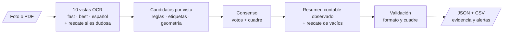
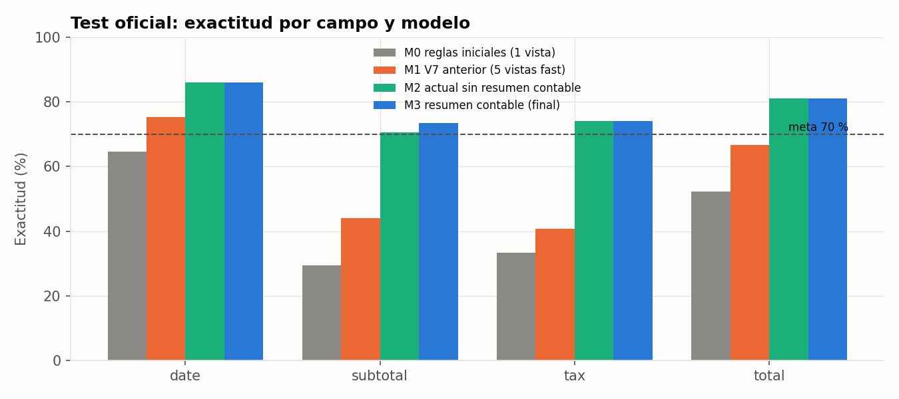
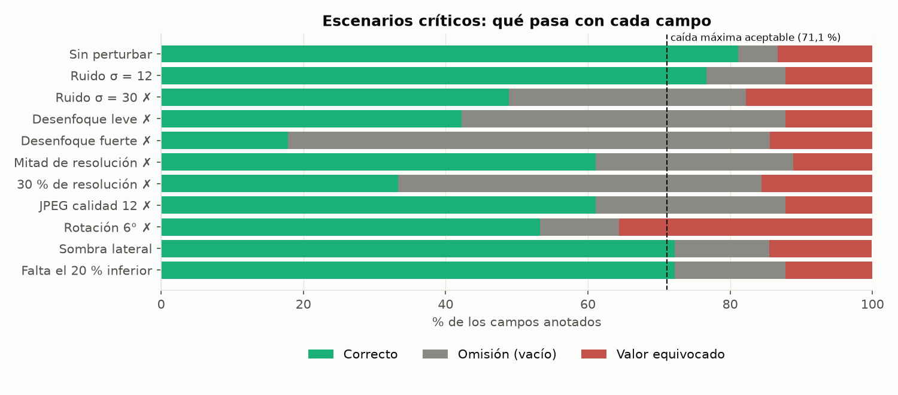
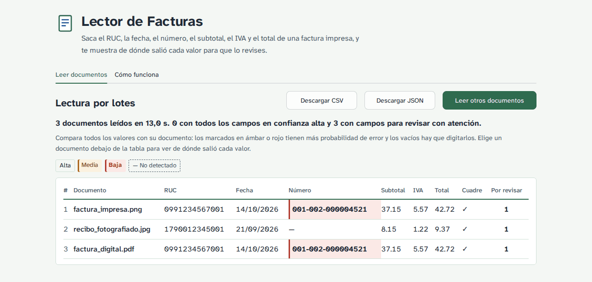

# Lector de Facturas — extracción y validación de comprobantes con OCR


[](https://github.com/Jesusl2202/Document-Scanner/actions/workflows/pruebas.yml)
-informational)


[](https://colab.research.google.com/github/Jesusl2202/Document-Scanner/blob/main/notebooks/05_evaluacion.ipynb)

Sistema que lee una **foto o un PDF de una factura o recibo impreso** y devuelve seis campos estructurados —identificador fiscal (RUC), fecha, número de comprobante, subtotal, impuesto (IVA) y total— con la evidencia de dónde salió cada valor y alertas para revisión humana. Usa Tesseract preentrenado en CPU, un consenso de 10 lecturas de la misma imagen y un **resumen contable observado** que solo corrige un monto cuando los descuentos o cargos visibles lo respaldan.

**Pruébalo en línea:** [document-scanner-project-uees.streamlit.app](https://document-scanner-project-uees.streamlit.app) (si la app estuvo un tiempo sin visitas, tarda alrededor de un minuto en despertar).

Proyecto integrador de la Maestría en Inteligencia Artificial — Universidad Espíritu Santo.

## Tabla de contenidos

1. [Descripción del problema](#1-descripción-del-problema)
2. [Dataset](#2-dataset)
3. [Metodología](#3-metodología)
4. [Resultados](#4-resultados)
5. [Instalación y uso](#5-instalación-y-uso)
6. [Interfaz de usuario](#6-interfaz-de-usuario)
7. [Estructura del proyecto](#7-estructura-del-proyecto)
8. [Consideraciones éticas y limitaciones](#8-consideraciones-éticas-y-limitaciones)
9. [Autores y contribuciones](#9-autores-y-contribuciones)
10. [Licencia](#10-licencia)
11. [Agradecimientos y referencias](#11-agradecimientos-y-referencias)
12. [Videos](#12-videos)

---

## 1. Descripción del problema

**¿Qué resuelve?** En muchas pequeñas y medianas empresas los datos de cada factura se copian a mano al sistema contable: fecha, RUC, número de comprobante y montos. Es lento, repetitivo y un dígito mal copiado genera descuadres difíciles de rastrear. Cada proveedor usa un formato distinto, así que una plantilla fija no sirve.

**¿Por qué es importante?** Automatizar la primera captura libera tiempo para revisar en vez de transcribir, y la validación de coherencia (subtotal + impuesto = total) detecta errores que a mano pasan desapercibidos. Todo corre en CPU, sin costo ni servicios de pago, y las imágenes no salen del equipo donde se procesan.

**¿Para quién?** Personal de contabilidad y digitación de PYMES, dueños de pequeños negocios y estudiantes o desarrolladores que quieran un pipeline de extracción de documentos auditable.

> ⚠️ **Limitación importante: solo comprobantes impresos o digitales.** Las facturas y recibos **no deben tener campos escritos a mano** (fecha, montos, RUC o número completados con bolígrafo). El reconocimiento de texto manuscrito con Tesseract no es confiable: esos campos pueden quedar vacíos o, peor, leerse con un valor equivocado sin que el sistema lo detecte. Si un comprobante tiene datos manuscritos, esos campos deben digitarse manualmente.

## 2. Dataset

| Dataset | Tipo | Tamaño | Campos que permite evaluar | Fuente y licencia |
|---|---|---|---|---|
| **SROIE** (ICDAR 2019) | Recibos escaneados de Malasia | 973 imágenes (626 train + 347 test) | `date`, `total` | [Kaggle `urbikn/sroie-datasetv2`](https://www.kaggle.com/datasets/urbikn/sroie-datasetv2); uso académico, sin licencia explícita de redistribución |
| **WildReceipt** (Sun et al., 2021) | Recibos fotografiados en condiciones reales, 25 categorías | 1.739 imágenes (1.267 train + 472 test) | `date`, `subtotal`, `tax`, `total` | [MMOCR `wildreceipt.tar`](https://download.openmmlab.com/mmocr/data/wildreceipt.tar); publicado para investigación |

**Características principales.** Tras la partición por hash (semilla 42) quedan 1.517 documentos de entrenamiento, 364 de validación, 816 del test oficial y 15 en cuarentena por duplicados. Cada documento tiene ancho, alto, regiones de texto anotadas y, por campo, un estado (`annotated`, `unannotated`, `ambiguous`, `absent`). Las fotos de WildReceipt son muy pequeñas (mediana 0,2 MP frente a 1,44 MP de SROIE) y su CER es más del doble; 80,6 % de los recibos con los tres montos cumple subtotal + impuesto = total. **Ninguna base pública anota `tax_id` ni `document_number`**: su exactitud no se ha podido medir. En la Semana 1 se planificó una muestra propia de 30–50 facturas ecuatorianas para medirlos, pero no se reunió (ver [planificación](docs/planificacion.md#53-desviaciones-y-por-qué-ocurrieron)); todas las cifras del proyecto provienen de SROIE y WildReceipt. El código para evaluar facturas anotadas a mano queda listo para esa prueba ([protocolo](docs/anotacion_propia.md)).

Las imágenes **no se redistribuyen**: se descargan de su fuente con `scripts/download_data.py`. Detalle en [`data/README.md`](data/README.md) y en el [análisis de datos](docs/analisis_datos.md).

## 3. Metodología

**Tipo de modelo y justificación.** Extracción de información clave en dos etapas: (1) OCR con **Tesseract 5** y sus redes LSTM preentrenadas (`eng` de `tessdata_fast` y `tessdata_best`, `spa`), y (2) un **extractor de reglas, geometría y consenso**. Se eligió frente a CRF, SDMG-R, LayoutLMv3 y Donut porque las bases no anotan RUC ni número de comprobante (un modelo entrenado no podría aprenderlos), porque cada valor debe ser trazable hasta su texto y su posición, y por los recursos disponibles (CPU, costo cero). La comparación con una red neuronal entrenada sobre las líneas del OCR lo confirma: con la misma lectura acierta 57,4 % frente a 51,9 % de las reglas iniciales, muy lejos del 81,1 % del modelo final (sección 4). Detalle en [arquitectura](docs/arquitectura.md).



**Preprocesamiento.** Escala de grises y autocontraste; ampliación al lado mayor de 2.200 px (máx. ×3) porque las imágenes pequeñas se leen peor; tope de 25 MP; binarización Otsu, corrección de iluminación y filtro de ruido en vistas distintas; binarización local (Sauvola) solo en el rescate; coordenadas devueltas al tamaño original. Normalización de fechas a ISO (sin adivinar día/mes ambiguo) y de montos a decimal. La decisión más importante fue **no elegir un único preprocesamiento sino leer varias versiones y combinarlas**: ninguna gana en todos los documentos (el CER medio por vista va de 0,34 a 0,47 y cambia de un recibo a otro), y quitar las vistas `best` o quedarse con las 5 vistas `fast` baja entre 3,6 y 4,0 puntos en validación ([ablación](results/metrics/modelado/ablacion.csv)). Ver [`02_preprocesamiento.ipynb`](notebooks/02_preprocesamiento.ipynb).

**Técnicas de optimización.** (1) Iteración guiada por análisis de errores: de la línea base V1 (35 %) a V7 (70,5 %) y al modelo «resumen contable». (2) Búsqueda de hiperparámetros del Workshop S5 en [`04_optimizacion.ipynb`](notebooks/04_optimizacion.ipynb): 13 hiperparámetros (pesos del consenso, etapas del extractor y grupos de vistas OCR), sensibilidad uno a uno, búsqueda aleatoria, sustituto Random Forest con PDP, importancia e interacciones, y antes/después en una muestra de control con bootstrap pareado. Ver [optimización](docs/optimizacion.md).

**Métricas.** Exactitud por campo (meta ≥ 70 %), precisión, recall y F1 por campo y dataset, porcentaje de documentos procesados sin error (meta ≥ 90 %), exactitud por documento (todos sus campos correctos), errores silenciosos (valor equivocado con confianza alta), CER del OCR y tiempo por documento. Un valor equivocado cuenta como falso positivo y falso negativo; un campo sin anotación no cuenta. La exactitud por campo es la adecuada porque cada campo se revisa y se corrige por separado; la meta del 70 % se justifica con el costo del error en las [consideraciones éticas](docs/consideraciones_eticas.md#6-meta-de-exactitud-y-costo-del-error).

## 4. Resultados

### Evaluación final

Modelo «resumen contable» en una muestra aleatoria del test oficial (semilla 42): **100 documentos** (50 de SROIE y 50 de WildReceipt) y **244 campos anotados**. La configuración quedó fija antes de leer la muestra ([`05_evaluacion.ipynb`](notebooks/05_evaluacion.ipynb)).

| Indicador | Resultado | Meta | |
|---|---:|---:|:---:|
| Exactitud por campo | **81,1 %** (IC95 75,0–86,9 %) | ≥ 70 % | ✅ |
| Documentos procesados sin error | **100 %** | ≥ 90 % | ✅ |
| Documentos con todos sus campos correctos | 67,7 % (2,5 campos anotados por documento) | — | |
| Tiempo por documento (CPU) | mediana 11,2 s en Colab (2 vCPU); 7,3 s en GitHub Actions (4 vCPU) | — | |

| Dataset | Fecha | Subtotal | Impuesto | Total | Exactitud (IC95) |
|---|---:|---:|---:|---:|---:|
| SROIE (escaneos) | 92,0 % | — | — | 86,0 % | 89,0 % (82,0–95,0) |
| WildReceipt (fotos) | 79,1 % | 73,5 % | 74,1 % | 75,0 % | 75,7 % (66,7–84,5) |

SROIE solo anota fecha y total; ninguno de los dos datasets anota RUC ni número de comprobante, así que esos campos no se miden. Precisión, recall y F1 por campo en el [reporte de resultados](results/reports/reporte_resultados.md).

**Comparación con la línea base** (mismas lecturas OCR para todos los modelos):

| Modelo | Exactitud | Mejora del modelo final (IC95, bootstrap pareado) |
|---|---:|---|
| M0 · reglas iniciales, 1 lectura | 51,6 % | +29,5 pp (23,9 a 35,5) |
| M1 · V7, 5 vistas `fast` | 63,9 % | +17,2 pp (12,0 a 22,7) |
| M2 · actual sin resumen contable | 80,7 % | +0,4 pp (0,0 a 1,2) |
| **M3 · resumen contable (final)** | **81,1 %** | — |



**Dónde funciona bien y dónde no.** El lector acierta el 94,2 % en imágenes grandes y el 92,9 % cuando el OCR lee limpio, pero baja al 74,7–77,0 % en imágenes pequeñas o medianas y al **68,8 %** cuando el OCR lee mal. De los 46 campos fallidos, 27 son **valores equivocados** y 19 **omisiones** (el campo queda vacío). En subtotal e impuesto predominan las omisiones; en fecha y total, los valores equivocados. En el total, 5 de los 14 valores equivocados son montos redondos (20, 50, 90 o 100): el efectivo entregado, no el total de la compra. Ver [`exactitud_por_factor.csv`](results/metrics/evaluacion/exactitud_por_factor.csv) y la [figura de errores](results/figures/evaluacion/07_errores_linea_base.png).

**Optimización de hiperparámetros.** La búsqueda sobre 13 hiperparámetros (81 configuraciones) encontró una alternativa con +0,9 pp en la muestra de optimización que en control perdió 3,1 pp (IC95 −7,1 a 0,0): era sobreajuste, así que se **mantiene la configuración actual**. Los factores que más pesan son el voto entre vistas y los pesos `best` de Tesseract. Ver [optimización](docs/optimizacion.md).

> **Sobre el test.** Durante el desarrollo se revisaron 1.461 documentos, incluido casi todo el test oficial ([`data/processed/documentos_revisados.csv`](data/processed/documentos_revisados.csv)); los 100 documentos de esta muestra estaban entre ellos. Las cifras sirven para comparar versiones con la misma muestra y método, pero no son una medición inédita. La medición con documentos nuevos es la siguiente.

### Validación con documentos nuevos y escenarios críticos (Workshop S5)

[`06_validacion_escenarios.ipynb`](notebooks/06_validacion_escenarios.ipynb) evalúa el mismo modelo, con criterios fijados antes de ejecutar, en **100 documentos que nadie revisó durante el desarrollo** (partición `train`; el modelo no se entrena, así que nunca influyeron en las reglas ni en los hiperparámetros):

| | Documentos nuevos | Test (ya revisado) |
|---|---:|---:|
| Exactitud por campo | **75,0 %** (IC95 67,9–81,6 %) ✅ | 81,1 % (75,0–86,9 %) |
| SROIE (escaneos) | 86,0 % | 89,0 % |
| WildReceipt (fotos) | 67,4 % | 75,7 % |
| Documentos con todos sus campos correctos | 61,6 % | 67,7 % |
| Exactitud de los campos con confianza alta | 95,4 % (54 % de los campos) | 97,6 % (51 % de los campos) |
| Errores silenciosos (equivocados con confianza alta) | 2,5 % de los campos | 1,2 % |

Los **6,1 puntos** de diferencia son el optimismo de haber ajustado reglas mirando documentos del test; con documentos nuevos el modelo sigue cumpliendo la meta, pero con fotos de celular queda por debajo. Con revisión completa se estima un **ahorro de 47 %** del tiempo de captura (11,7 s frente a 22,2 s por documento; entre 19 % y 61 % según los supuestos).

**Escenarios críticos.** Las mismas 40 imágenes, degradadas a propósito (caída máxima aceptable fijada de antemano: 10 puntos):



El sistema tolera ruido leve, sombras y la pérdida del pie del comprobante; falla con desenfoque, baja resolución, compresión fuerte y fotos torcidas. En casi todos los casos falla **dejando campos vacíos**; la rotación es la excepción peligrosa, porque produce valores equivocados con confianza alta.

### Comparación con una técnica aprendida

[`03_modelado.ipynb`](notebooks/03_modelado.ipynb) (sección 9) compara el modelo con una **red neuronal (MLP) que clasifica las líneas del OCR**, la versión liviana de LayoutLMv3 propuesta en la Ficha técnica, entrenada con 1.502 documentos, elegida con validación y evaluada una sola vez en el mismo test:

| Modelo | Lectura OCR | Exactitud en el test |
|---|---|---:|
| M0 · reglas iniciales | 1 vista | 51,9 % |
| Red MLP sobre líneas | 1 vista | 57,4 % (IC95 56,1–58,8 %, 5 semillas) |
| **M3 · resumen contable (final)** | 10 vistas | **81,1 %** |

Con la misma lectura, aprender a ubicar los campos mejora poco a las reglas (+4,5 puntos): el límite lo pone el OCR, porque en una sola lectura solo entre el 51 % y el 82 % de los documentos tiene el valor correcto escrito en alguna línea. Por eso el proyecto invirtió en **leer mejor** (10 vistas y consenso) y no en un clasificador. El diagnóstico de la red (curvas por época, de aprendizaje y de validación, cinco semillas) muestra sobreajuste sin regularización y un comportamiento adecuado con *early stopping*.

### Desarrollo del modelo

Mediciones usadas para elegir el modelo (no son una evaluación independiente):

| Modelo | Muestra | Exactitud por campo |
|---|---|---:|
| Línea base V1 (reglas simples, 1 lectura) | 40 docs de validación | 35,0 % (36/103) |
| V6 (consenso de lecturas) | 60 docs de validación | 62,75 % (96/153) |
| V7 (5 vistas, versión anterior) | 120 docs de selección | 70,53 % (213/302) |
| Actual sin resumen contable | Grupo del test oficial (con reutilización) | 75,93 % (183/241) |
| **Resumen contable (final)** | Mismo grupo, mismo OCR | **76,35 % (184/241)** |

Detalle en [`results/reports/resultados_desarrollo.md`](results/reports/resultados_desarrollo.md).


| Referencia | Exactitud / F1 |
|---|---|
| Meta del proyecto | ≥ 70 % por campo · ≥ 90 % procesados |
| Sistemas del estado del arte en SROIE / WildReceipt (modelos entrenados en esos datos) | F1 > 85–90 % |
| Este proyecto (sin entrenamiento) | 81,1 % por campo en el test y 75,0 % en documentos nuevos · F1 0,81–0,88 por campo en el test |

## 5. Instalación y uso

**Requisitos del sistema:** Python ≥ 3.10, [Tesseract OCR 5](https://github.com/tesseract-ocr/tesseract) en el PATH (`tesseract --version`), ~25 MB para los pesos y conexión a Internet solo la primera vez. No necesita GPU.

**Opción A — Google Colab (sin instalar nada).** Abre cualquier notebook de [`notebooks/`](notebooks/) con el botón de Colab y ejecuta las celdas en orden. La sección 9 de [`05_evaluacion.ipynb`](notebooks/05_evaluacion.ipynb) lee una factura propia.

**Opción B — local:**

```bash
git clone https://github.com/Jesusl2202/Document-Scanner.git
cd Document-Scanner
python -m venv .venv
# Windows PowerShell: .venv\Scripts\Activate.ps1   |   Linux/macOS: source .venv/bin/activate
python -m pip install -r requirements.txt
# Ubuntu: sudo apt-get install tesseract-ocr   |   Windows: instalar Tesseract y agregarlo al PATH
```

**Ejemplos de uso:**

```bash
# Recibo sintético del repositorio (comprueba la instalación)
python -m src.model samples/synthetic_receipt.png --salida outputs/ejemplo

# Una factura propia (imagen o PDF)
python -m src.model mi_factura.pdf --salida outputs/mi_factura
```

```text
RUC / identificador fiscal   1234567890           confianza: alta
Fecha de emisión             2026-09-27           confianza: alta
Número de comprobante        001-002-000123       confianza: alta
Subtotal                     100.00               confianza: alta
Impuesto (IVA)               12.00                confianza: alta
Total                        112.00               confianza: alta
```

Desde Python:

```python
from src.model import LectorFacturas
resultado = LectorFacturas().leer("mi_factura.pdf")
print(resultado.campos())     # {'tax_id': ..., 'date': ..., 'total': ...}
print(resultado.tabla())      # valor, nivel de confianza y alertas por campo
```

La primera lectura descarga los pesos en `models/` y verifica su SHA-256. En la carpeta de salida quedan `campos.csv` (una fila por página) y `resultado.json` (texto, cajas, evidencia, confianza, validaciones y alertas). La configuración (rutas relativas, límites de entrada, metas, registro) está en [`configs/config.yaml`](configs/config.yaml) y se puede ajustar con un `.env` ([`.env.example`](.env.example)). `scripts/leer_documento.py` produce la misma salida:

```csv
page,status,tax_id,date,document_number,subtotal,tax,total,revision
1,ok,1234567890,2026-09-27,001-002-000123,100.00,12.00,112.00,Resumen comprobado con descuentos/cargos observados: {}
```

**Pruebas y datos:**

```bash
python -m pip install -e .                         # habilita el comando `lector archivo.pdf --out carpeta`
python -m unittest discover -s tests -v            # 188 pruebas (ver tests/README.md)
python -m flake8 src app tests                     # estilo PEP 8
python scripts/download_data.py wildreceipt --out data/raw
python scripts/download_data.py sroie --out data/raw   # Kaggle puede pedir descarga manual
python -m src.evaluate test --datos data/raw --por-base 50     # evaluación en el test oficial
python -m src.train --datos data/raw --salida outputs/optimizacion   # optimización de la configuración
```

Guía completa en el [manual de usuario](docs/manual_usuario.md).

## 6. Interfaz de usuario

Aplicación web ([`app/`](app/)) con el mismo modelo evaluado, publicada en **Streamlit Community Cloud**: **[document-scanner-project-uees.streamlit.app](https://document-scanner-project-uees.streamlit.app)**.


- **Carga validada:** imagen JPG/PNG o PDF (hasta 10 MB y 3 páginas), arrastrando o eligiendo el archivo; se rechazan con un mensaje claro en español los formatos no admitidos, archivos vacíos o dañados, imágenes demasiado pequeñas y PDF largos.
- **Uno o varios documentos a la vez:** hasta 20 archivos por lote, leídos uno tras otro con una barra de avance. El resultado del lote es una tabla con todos los documentos, cada valor marcado por su confianza y la cantidad de campos por revisar, y un solo CSV para descargar; desde la tabla se abre cualquier documento con su evidencia. Un archivo con problemas no detiene el resto.
- **Procesamiento con indicador** mientras se hacen las 10 lecturas de cada página.
- **Resultado revisable:** los seis campos con su valor, la línea del documento de donde salió, el nivel de confianza (alta, media, baja, no detectado) y alertas en lenguaje claro; recuadros sobre la imagen que se resaltan al pasar por cada fila; comprobación de subtotal + IVA = total; aviso cuando el comprobante es una factura electrónica del SRI con XML disponible.
- **«Cómo funciona»:** métricas de la evaluación, resultados con imágenes degradadas, casos en que no debe usarse y privacidad.
- **Ejemplos precargados** (comprobantes sintéticos) y **descarga CSV/JSON** solo con los campos, sin el texto completo de la factura.
- **Privacidad:** el archivo se procesa en una carpeta temporal que se borra al terminar; la app avisa que la demostración corre fuera de Ecuador y que los documentos de terceros deben leerse en una instalación propia.



Hay dos versiones de la interfaz sobre la misma lógica ([`app/servicio.py`](app/servicio.py)), con el mismo modelo, límites y mensajes:

| Versión | Para qué | Cómo se ejecuta |
|---|---|---|
| **Streamlit** ([`app/streamlit_app.py`](app/streamlit_app.py)) | Demostración pública en Streamlit Community Cloud; lee un documento o un lote | `pip install -r app/requirements.txt` y `streamlit run app/streamlit_app.py` |
| **Flask + Docker** ([`app/app.py`](app/app.py), [`Dockerfile`](Dockerfile)) | Instalación en un equipo o servidor propio, para documentos con datos de terceros; lee un documento a la vez | `docker build -t lector-facturas .` y `docker run -p 7860:7860 lector-facturas` |

Detalle en [`app/README.md`](app/README.md) y en el [manual de usuario](docs/manual_usuario.md#2-usar-la-aplicación-web).

## 7. Estructura del proyecto

```text
Document-Scanner/
├── README.md                 # Este documento
├── requirements.txt          # Dependencias de Python
├── pyproject.toml            # Paquete instalable `lector-facturas` (comando `lector`)
├── .gitignore                # Excluye datasets, pesos, salidas, cachés y documentos privados
├── LICENSE                   # MIT
├── docs/                     # planificación, análisis de datos, arquitectura, optimización,
│                             # consideraciones éticas, manual de usuario y protocolo de anotación
├── data/                     # raw/ (descargas, no versionadas), processed/ (inventario de hashes), README
├── notebooks/                # 01 EDA · 02 preprocesamiento · 03 modelado · 04 optimización · 05 evaluación
│                             # · 06 validación en escenarios (Workshop S5)
├── src/                      # __init__, data_processing, model, train, evaluate, utils, validation, line_classifier
│   └── lector_facturas/      # Motor: OCR, extractor de reglas y consenso, métricas
├── configs/                  # config.yaml (app), definitivo.json (modelo final), documentos_revisados.json
├── models/                   # Ficha del modelo; los pesos de Tesseract se descargan aquí (no versionados)
├── app/                      # Interfaz web: streamlit_app.py (publicada), app.py (Flask), servicio.py,
│                             # presentacion.py, templates/, static/, assets/
├── tests/                    # 188 pruebas: interfaz pública, app, validación, comparador y motor
├── results/                  # Figuras, métricas y reportes
├── scripts/                  # Lectura, descarga de datos, ejemplos y ejecución de notebooks
├── samples/                  # Recibo sintético (PNG, PDF y referencia) para probar la instalación
├── Dockerfile                # Imagen de la versión Flask (Ubuntu 24.04 + Tesseract 5.3.4)
├── packages.txt              # Paquetes del sistema para Streamlit Community Cloud (Tesseract)
├── .streamlit/config.toml    # Tema, fuente y límites de la versión de Streamlit
└── .github/workflows/        # Pruebas (incluye la app y la imagen) y notebooks con datos completos
```

| Carpeta | Qué contiene |
|---|---|
| [`src/`](src/) | `data_processing.py` (validación de entrada, PDF, preprocesamiento, normalización, datasets), `model.py` (clase `LectorFacturas`, confianza por campo), `train.py` (optimización de la configuración: el modelo no entrena pesos), `evaluate.py` (métricas, test, prueba externa, importación de resultados y reporte), `validation.py` (datos nuevos, escenarios críticos, costo del error), `line_classifier.py` (red de comparación), `utils.py` (configuración, rutas, registro, errores). El motor `lector_facturas/` es el modelo tal como se evaluó. Ver [`src/README.md`](src/README.md). |
| [`app/`](app/) | Interfaz web: versión de Streamlit (publicada) y versión Flask (instalación propia) sobre el mismo servicio de lectura, probado sin servidor; ejemplos sintéticos. Ver [`app/README.md`](app/README.md). |
| [`notebooks/`](notebooks/) | Los seis notebooks se ejecutan con los datasets completos en GitHub Actions y se guardan con sus salidas; también se abren en Colab. |
| [`models/`](models/) | En lugar de `best_model.pkl`: `ficha_modelo.json` + `configs/definitivo.json` + pesos verificados por hash. Versiones anteriores en el historial de Git. |
| [`tests/`](tests/) | `test_data_processing.py`, `test_model.py`, `test_app.py`, `test_presentacion.py`, `test_validation.py`, `test_line_classifier.py` y las pruebas del motor. Ver [`tests/README.md`](tests/README.md). |
| [`results/`](results/) | `figures/`, `metrics/` y `reports/`. Ver [`results/README.md`](results/README.md). |

## 8. Consideraciones éticas y limitaciones

**Aspectos éticos.** El riesgo principal es la **privacidad**: las facturas contienen nombres, cédulas/RUC, direcciones y hábitos de consumo. Por eso el procesamiento es local, el repositorio no guarda imágenes ni textos de facturas, el notebook de evaluación excluye los documentos propios de los resultados y el inventario de documentos vistos solo guarda hashes. El sistema no decide sobre personas; los sesgos son de origen (recibos de Malasia y en inglés, escaneos frente a fotos de celular) y se reportan métricas por dataset y tipo de imagen. Cada campo es explicable: texto, posición, vista y regla que lo produjo. Análisis completo en [consideraciones éticas](docs/consideraciones_eticas.md).

**Limitaciones conocidas.**

- **Campos escritos a mano:** no se reconocen de forma confiable y están fuera del alcance (ver sección 1).
- Exactitud de 75 % por campo con documentos nuevos (86 % en escaneos, 67 % en fotos de celular) y 81 % en el test: solo el 62 % de los documentos sale completo, así que **siempre hay que revisar** los valores; la revisión guiada solo por la confianza dejaría pasar unos 6 errores por cada 100 facturas.
- Fotos movidas, de baja resolución, muy comprimidas o **torcidas** bajan mucho la exactitud; las torcidas producen valores equivocados con confianza alta.
- Las facturas electrónicas del SRI deben leerse desde su XML autorizado; la app avisa cuando detecta la clave de acceso.
- `tax_id` y `document_number` aún no tienen exactitud medida (las bases públicas no los anotan).
- Peor desempeño con fotos pequeñas, borrosas o con sombras y con etiquetas en idiomas o formatos poco comunes.
- Fechas como `05/03/18` quedan ambiguas si no se configura el orden día/mes.
- 10 lecturas por página: más lento que una sola lectura (mediana de 7–11 s por página en CPU).
- El número de comprobante solo se reconoce si su etiqueta («Factura No.», «Invoice No.») está en la misma línea o justo encima.
- Cada página de un PDF se procesa por separado.

**Advertencias de uso.** No usar para verificar la autenticidad o la validez tributaria de un comprobante (`valid_format` solo revisa la forma), para procesar facturas ajenas sin autorización, para construir bases de datos de personas ni para tomar decisiones automáticas sin revisión humana. Los archivos de salida contienen el texto completo de la factura: trátelos como información confidencial.

## 9. Autores y contribuciones

| Integrante | Rol |
|---|---|
| **Sebastián Rojas** | Co-desarrollo del lector, la evaluación y la documentación. |
| **Jesús López** | Co-desarrollo del lector, la evaluación y la documentación. |

Ambos integrantes rotaron el rol de Scrum Master durante los cuatro sprints ([planificación](docs/planificacion.md)).

## 10. Licencia

El código y la documentación del equipo se publican bajo licencia **MIT** ([`LICENSE`](LICENSE)). La licencia no cubre los datasets ni los pesos de terceros: SROIE y WildReceipt mantienen sus propias condiciones (no se redistribuyen) y Tesseract y sus pesos se distribuyen con licencia Apache 2.0.

## 11. Agradecimientos y referencias

Agradecemos a los docentes del programa por la guía del proyecto integrador y a los autores de los datasets y de Tesseract por publicarlos.

- Huang, Z. et al. (2019). ICDAR2019 Competition on Scanned Receipt OCR and Information Extraction. *ICDAR*.
- Sun, H. et al. (2021). Spatial Dual-Modality Graph Reasoning for Key Information Extraction. *arXiv:2103.14470*.
- Smith, R. (2007). An Overview of the Tesseract OCR Engine. *ICDAR*, 629–633.
- Otsu, N. (1979). A Threshold Selection Method from Gray-Level Histograms. *IEEE Trans. SMC*, 9(1), 62–66.
- Sauvola, J. y Pietikäinen, M. (2000). Adaptive document image binarization. *Pattern Recognition*, 33(2), 225–236.
- Tesseract OCR: <https://github.com/tesseract-ocr/tesseract> · pesos: [`tessdata_fast`](https://github.com/tesseract-ocr/tessdata_fast), [`tessdata_best`](https://github.com/tesseract-ocr/tessdata_best).
- MMOCR, documentación de *Key Information Extraction*: <https://mmocr.readthedocs.io/en/0.x/datasets/kie.html>
- Asamblea Nacional del Ecuador (2021). *Ley Orgánica de Protección de Datos Personales*.

## 12. Videos

- 🎬 **Video pitch (5 min):** (https://youtu.be/u1XMMjmgVQY)
- 🎬 **Video de respuestas a las preguntas:** próximamente
