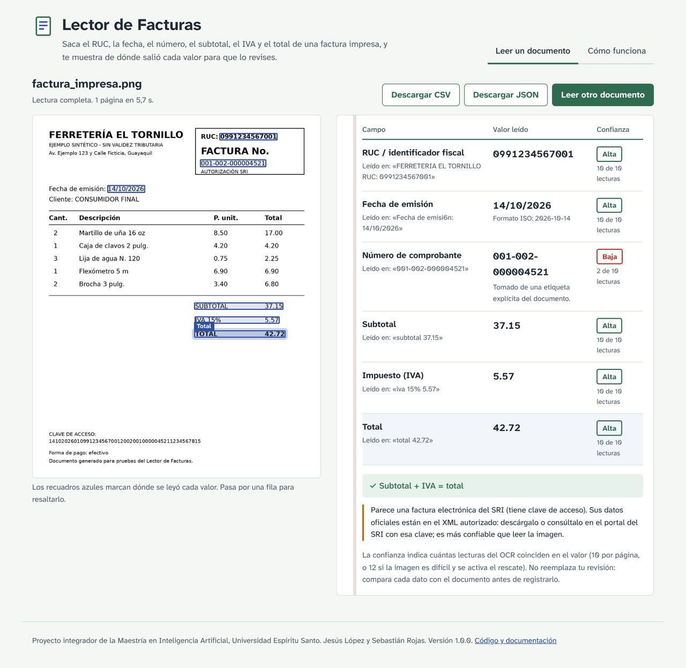

# app/ — interfaz web

Aplicación web del lector para que cualquier persona pruebe el modelo con sus propios documentos, sin instalar nada. Usa exactamente el mismo modelo que la terminal y los notebooks (`src.model.LectorFacturas` con `configs/definitivo.json`). La guía de uso está en el [manual de usuario](../docs/manual_usuario.md#2-usar-la-aplicación-web).



## Estructura

| Archivo | Contenido |
|---|---|
| [`app.py`](app.py) | Aplicación Flask: rutas, límites de tamaño y manejo de errores. |
| [`servicio.py`](servicio.py) | Lógica sin Flask (probada en `tests/test_app.py`): validación con los límites de la web, una lectura a la vez, evidencia de cada campo, alertas en lenguaje claro y aviso de factura electrónica del SRI. |
| [`templates/index.html`](templates/index.html), [`static/`](static/) | Página, estilos y comportamiento (JavaScript sin dependencias). La fuente Atkinson Hyperlegible Next se sirve desde la propia app (licencia SIL OFL 1.1). |
| [`assets/ejemplos/`](assets/ejemplos/) | Comprobantes **sintéticos** para el botón de ejemplos (generados con [`scripts/crear_ejemplos.py`](../scripts/crear_ejemplos.py)); también son la prueba de humo del despliegue. |
| [`assets/capturas/`](assets/capturas/) | Capturas de pantalla usadas en la documentación. |
| [`requirements.txt`](requirements.txt) | Dependencias de la app (Flask y gunicorn), además de las de la raíz. |

## Funcionalidades

| Requisito | Cómo se cumple |
|---|---|
| Carga de imagen o PDF con validación | Arrastrar y soltar o elegir archivo. Se valida en el navegador (formato, tamaño, archivo vacío) y en el servidor (imagen dañada, imagen demasiado pequeña, PDF con demasiadas páginas). |
| Procesamiento con indicador de carga | Barra de progreso, paso en curso y segundos transcurridos. |
| Resultados con confianza y alertas | Seis campos con valor, valor normalizado, línea de origen, nivel de confianza (alta, media, baja, no detectado) y alertas traducidas a lenguaje claro; cuadre subtotal + IVA = total. |
| Explicación de cada valor | Recuadros sobre la imagen que se resaltan al pasar por cada fila. |
| Mensajes de error claros | Cada error dice qué pasó y cómo seguir, sin detalles técnicos. |
| Sección «Cómo funciona» | Métricas de la evaluación, resultados en escenarios degradados, casos en que no debe usarse, privacidad y límites. |
| Ejemplos precargados | Tres comprobantes sintéticos: factura impresa, recibo fotografiado y PDF. |
| Exportación | CSV y JSON generados en el navegador, solo con los campos (sin el texto completo de la factura). |
| Accesibilidad | Navegación con teclado, foco visible, mensajes con `role="alert"`, diseño adaptable a celular y respeto de «reducir movimiento». |

## Decisiones de diseño

- **Revisar es parte del flujo.** La pantalla de resultado pone el documento junto a los valores para comparar sin cambiar de ventana, y los campos vacíos piden digitar el dato en lugar de mostrar «0».
- **Nada se guarda en el servidor.** El archivo se procesa en una carpeta temporal que se borra al terminar, y las descargas se generan en el navegador.
- **Una lectura a la vez.** El servidor gratuito tiene 2 CPU y cada página se lee 10 veces; con más lecturas simultáneas todas se volverían lentas. Si hay otra lectura en curso, la nueva espera su turno (hasta 2 minutos) y, si no lo obtiene, se le pide reintentar.
- **Límites propios de la web** (`interfaz` en [`configs/config.yaml`](../configs/config.yaml)): 10 MB y 3 páginas por PDF, frente a 20 MB y 20 páginas en la terminal.
- **Aviso de factura electrónica.** Si el texto muestra la clave de acceso de 49 dígitos, la app recomienda usar el XML autorizado del SRI, que es la fuente oficial de esos datos.

## Ejecutar y desplegar

```bash
python -m pip install -r requirements.txt -r app/requirements.txt
python -m app.app                       # http://127.0.0.1:7860
```

| Dónde | Cómo |
|---|---|
| **Hugging Face Spaces** (despliegue publicado) | Imagen Docker definida en el [`Dockerfile`](../Dockerfile) (Ubuntu 24.04, Tesseract 5.3.4, pesos descargados y verificados al construir). El workflow [`despliegue.yml`](../.github/workflows/despliegue.yml) publica la app en el Space con [`scripts/desplegar_hf.py`](../scripts/desplegar_hf.py) en cada cambio de `main`. |
| Cualquier servidor con Docker | `docker build -t lector-facturas .` y `docker run -p 7860:7860 lector-facturas`. |

El workflow [`pruebas.yml`](../.github/workflows/pruebas.yml) construye la imagen en cada cambio y la prueba de punta a punta: espera a que el modelo cargue, lee un ejemplo y comprueba los valores, y verifica que un archivo no admitido devuelva un mensaje de error.

Rutas: `GET /` (página), `POST /api/leer` (archivo en el campo `archivo`), `POST /api/ejemplo/<id>`, `GET /api/acerca` y `GET /salud`.
