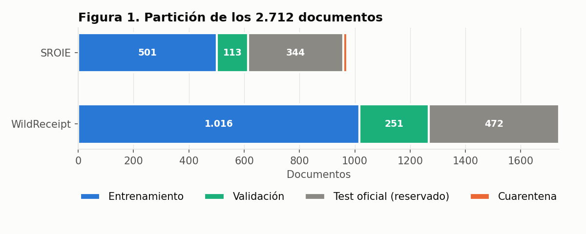
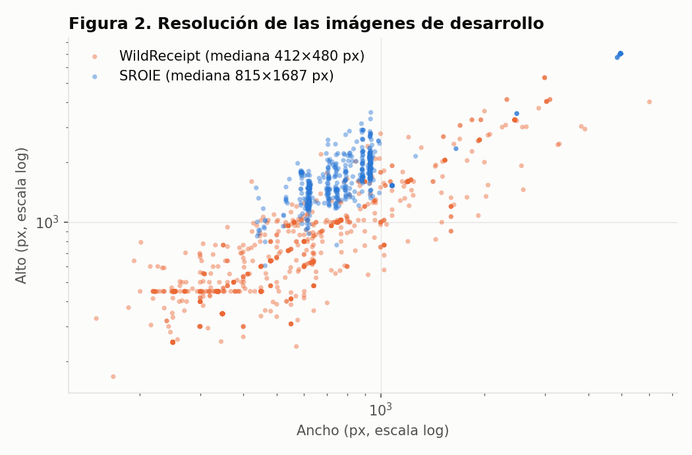
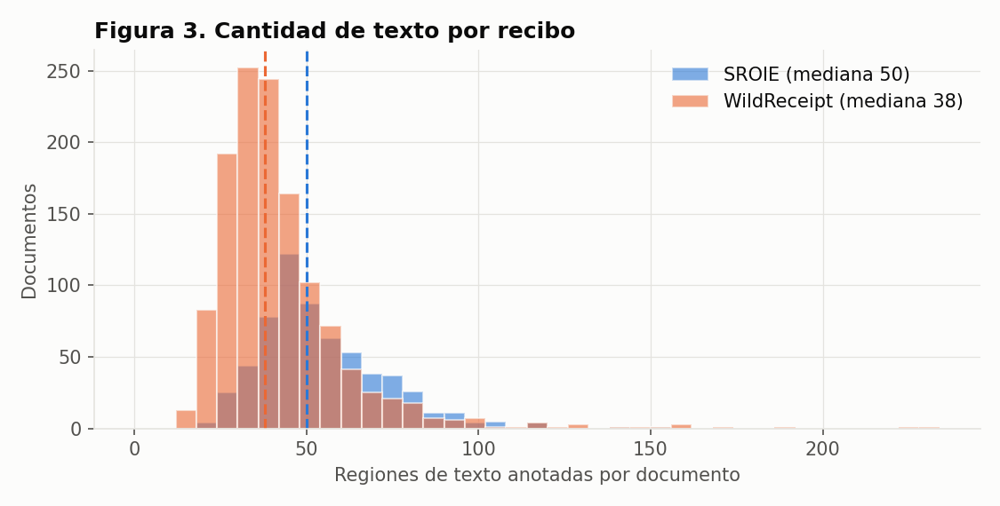
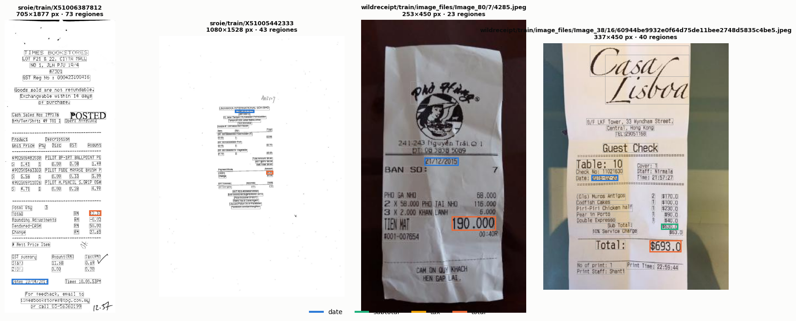
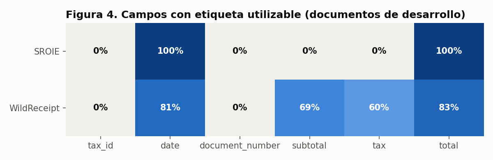
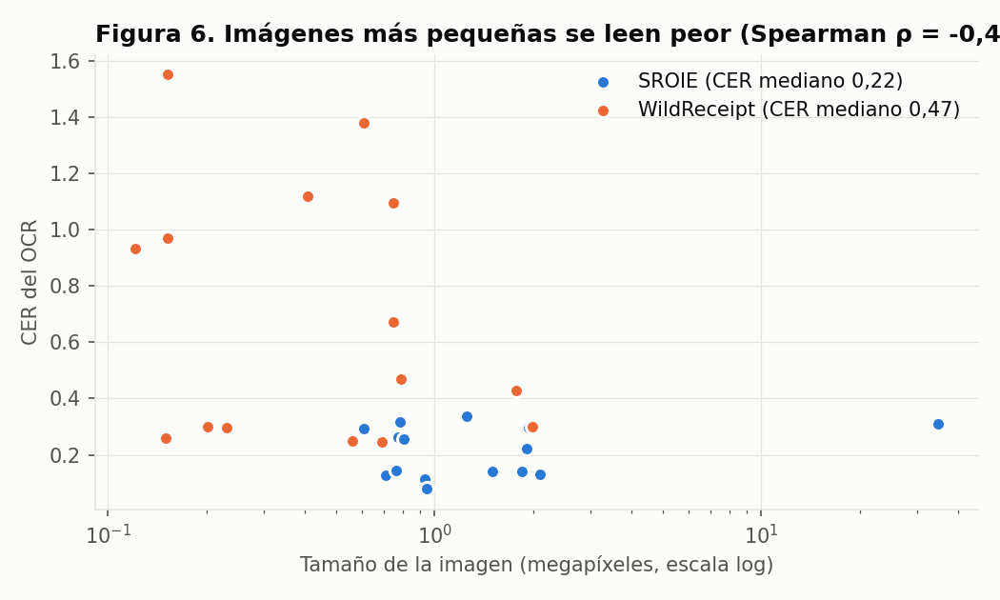
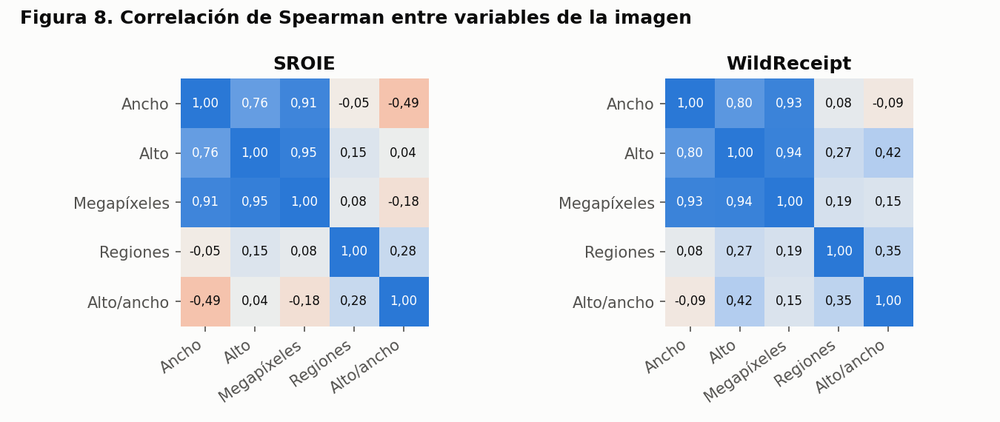
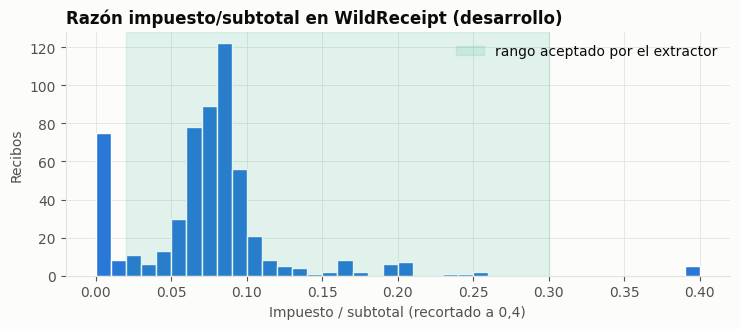
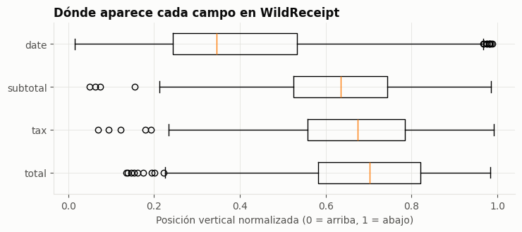

# Análisis exploratorio de datos (EDA)

**Proyecto:** Lector de Facturas — extracción y validación de datos de facturas y comprobantes de compra con OCR
**Equipo:** Sebastián Rojas y Jesús Antonio López Barahona
**Última actualización:** 21/10/2026

Este documento describe los datos del proyecto, lo que encontramos al explorarlos y cómo eso guió las decisiones de preprocesamiento. Las cifras salen de la ejecución del EDA ([`notebooks/01_exploracion.ipynb`](../notebooks/01_exploracion.ipynb), que usa `run_eda` de `src/lector_facturas/eda.py`), de la línea base de Semana 2 y del Reporte de Diagnóstico de Semana 3. Las figuras están en [`results/figures/eda/`](../results/figures/eda/). La descripción de fuentes, formatos y licencias está también en [`data/README.md`](../data/README.md).

> **Regla que seguimos en todo el EDA:** solo exploramos los documentos de **entrenamiento y validación**. Del test oficial únicamente revisamos integridad y duplicados; nunca miramos sus etiquetas.
>
> Esa regla se cumplió en el EDA, pero no durante todo el desarrollo: para mejorar el modelo se revisaron grupos aleatorios del test oficial (sección 2). Por eso la evaluación final se complementa con una prueba externa anotada.

## Contenido

1. [Descripción de los datasets](#1-descripción-de-los-datasets)
2. [Partición de los datos](#2-partición-de-los-datos)
3. [Estadísticas descriptivas](#3-estadísticas-descriptivas)
4. [Visualizaciones y hallazgos](#4-visualizaciones-y-hallazgos)
5. [Patrones, correlaciones y outliers](#5-patrones-correlaciones-y-outliers)
6. [Datos faltantes y desbalance](#6-datos-faltantes-y-desbalance)
7. [Decisiones de preprocesamiento](#7-decisiones-de-preprocesamiento)
8. [Limitaciones de los datos](#8-limitaciones-de-los-datos)

---

## 1. Descripción de los datasets

### 1.1 Qué tiene que extraer el sistema

El sistema extrae seis campos de cada documento: `tax_id` (identificador fiscal), `date`, `document_number`, `subtotal`, `tax` y `total`. Cada dataset anota solo una parte de ellos, así que el EDA empezó por saber **qué se puede evaluar con cada fuente**.

### 1.2 Fuentes utilizadas

| Dataset | Qué es | Fuente | Licencia / condiciones | Rol en el proyecto |
|---|---|---|---|---|
| **SROIE** (Huang et al., 2019) | Recibos **escaneados** de comercios de Malasia, del reto ICDAR 2019. Cada imagen trae cajas de texto con su transcripción y cuatro entidades: empresa, fecha, dirección y total. | [Kaggle `urbikn/sroie-datasetv2`](https://www.kaggle.com/datasets/urbikn/sroie-datasetv2) | Uso académico; no encontramos una licencia explícita de redistribución. | Desarrollo y evaluación de `date` y `total`. |
| **WildReceipt** (Sun et al., 2021) | Recibos **fotografiados** en condiciones reales (pliegues, ángulos, poca luz), con 25 categorías de información clave. | [MMOCR `wildreceipt.tar`](https://download.openmmlab.com/mmocr/data/wildreceipt.tar) | Publicado para investigación; la licencia de MMOCR no cubre las imágenes. | Desarrollo y evaluación de `date`, `subtotal`, `tax` y `total`. |
| **Muestra propia** | 30–50 comprobantes reales de al menos tres emisores, anotados por los dos integrantes. | Recolección del equipo | Privada; no se publica. | Test final de los seis campos, incluidos `tax_id` y `document_number`. |
| **Ejemplos sintéticos** | Una imagen y un PDF generados por el equipo (`samples/`). | `scripts/make_demo.py` | Propios | Probar la instalación; no son evidencia de precisión. |

Por las condiciones de licencia, **el repositorio no redistribuye imágenes** de SROIE ni de WildReceipt. Cada persona las descarga de la fuente original con `scripts/download_data.py`, que guarda la URL, el SHA-256 y la fecha de descarga.

### 1.3 Variables disponibles por documento

Después de pasar por los adaptadores (`src/lector_facturas/datasets.py`), cada documento queda en un manifiesto con esta estructura:

| Variable | Tipo | Descripción |
|---|---|---|
| `id` | texto | `<dataset>/<split_origen>/<documento>` |
| `dataset` | categórica | `sroie` o `wildreceipt` |
| `split` | categórica | `train`, `validation`, `test` o `quarantine` |
| `sha256` | texto | Hash de la imagen; sirve para detectar duplicados y fugas |
| `width`, `height` | numérica (px) | Tamaño real de la imagen |
| `regions` | lista | Cajas de texto anotadas: coordenadas, texto y etiqueta |
| `gold` | diccionario | Para cada uno de los seis campos: `status` y `value` |
| `issues` | lista | Incidencias encontradas al cargar el documento |

El `status` de cada campo puede ser `annotated` (hay un valor de referencia), `unannotated` (el dataset no lo anota), `ambiguous` (hay varios valores distintos) o `absent` (ausencia confirmada, solo en la muestra propia).

### 1.4 Mapeo de etiquetas al esquema del proyecto

| Campo del proyecto | SROIE | WildReceipt |
|---|---|---|
| `tax_id` | — (la empresa **no** se usa como identificador fiscal) | — |
| `date` | `date` | `Date_value` |
| `document_number` | — | — |
| `subtotal` | — | `Subtotal_value` |
| `tax` | — | `Tax_value` |
| `total` | `total` | `Total_value` |

## 2. Partición de los datos

Descargamos **2.712 documentos**: 973 de SROIE (626 de entrenamiento y 347 de prueba oficiales) y 1.739 de WildReceipt (1.267 y 472). La partición se hace en `prepare()` con estas reglas:

1. El **test oficial** de cada dataset se reserva completo.
2. Del entrenamiento oficial, cerca del **20 % pasa a validación**. La asignación depende del SHA-256 de la imagen con semilla fija (`seed = 42`), así que siempre da el mismo resultado.
3. Las imágenes **duplicadas** (mismo hash) o que también aparecen en el test oficial van a **cuarentena** y no se usan.

| Partición | SROIE | WildReceipt | Total |
|---|---:|---:|---:|
| Entrenamiento | 501 | 1.016 | 1.517 |
| Validación | 113 | 251 | 364 |
| Test oficial (reservado) | 344 | 472 | 816 |
| Cuarentena | 15 | 0 | 15 |
| **Total** | **973** | **1.739** | **2.712** |

Los **1.881 documentos de desarrollo** (entrenamiento + validación) son la base de todo el análisis que sigue. Los 15 documentos en cuarentena son todos de SROIE; 7 de ellos además estaban repetidos en su test oficial, lo que habría sido una fuga de datos si no se controlaba.

Además, [`data/processed/documentos_revisados.csv`](../data/processed/documentos_revisados.csv) lista por hash los documentos que ya se miraron mientras se ajustaban las reglas. En la entrega V7 eran **350** (179 SROIE y 171 WildReceipt, todos de entrenamiento). Con el modelo «resumen contable» son **1.461**: 650 de entrenamiento, **809 del test oficial** (337 SROIE y 472 WildReceipt) y 2 externos. El test oficial ya no es inédito y así se reporta en la [evaluación](../notebooks/05_evaluacion.ipynb).

## 3. Estadísticas descriptivas

### 3.1 Imágenes

| Estadístico | SROIE ancho (px) | SROIE alto (px) | WildReceipt ancho (px) | WildReceipt alto (px) |
|---|---:|---:|---:|---:|
| Documentos | 614 | 614 | 1.267 | 1.267 |
| Media | 1.338 | 2.373 | 633 | 820 |
| Desviación estándar | 1.425 | 1.854 | 548 | 713 |
| Mínimo | 436 | 605 | 150 | 168 |
| Percentil 25 | 623 | 1.399 | 338 | 450 |
| **Mediana** | **815** | **1.687** | **412** | **480** |
| Percentil 75 | 936 | 2.143 | 750 | 1.000 |
| Máximo | 4.961 | 7.016 | 6.016 | 5.312 |

| Estadístico | SROIE | WildReceipt |
|---|---:|---:|
| Megapíxeles (mediana) | 1,44 | 0,20 |
| Megapíxeles (máximo) | 34,81 | 24,16 |
| Relación alto/ancho (mediana) | 1,99 | 1,33 |
| Regiones de texto por documento (media ± d.e.) | 53,8 ± 18,0 | 42,0 ± 20,3 |
| Regiones de texto (mediana; mín.–máx.) | 50 (18–153) | 38 (12–234) |
| Imágenes que se pudieron abrir | 614/614 | 1.267/1.267 |

### 3.2 Etiquetas

| Dataset | Campo | Anotados | No anotados | Ambiguos | Cobertura |
|---|---|---:|---:|---:|---:|
| SROIE | `date` | 614 | 0 | 0 | 100,0 % |
| SROIE | `total` | 613 | 1 | 0 | 99,8 % |
| WildReceipt | `date` | 1.025 | 195 | 47 | 80,9 % |
| WildReceipt | `subtotal` | 876 | 374 | 17 | 69,1 % |
| WildReceipt | `tax` | 764 | 414 | 89 | 60,3 % |
| WildReceipt | `total` | 1.057 | 149 | 61 | 83,4 % |
| Ambos | `tax_id`, `document_number` | 0 | 1.881 | 0 | 0,0 % |

## 4. Visualizaciones y hallazgos

### 4.1 Resolución de las imágenes

Los dos datasets son muy distintos. SROIE son escaneos altos y angostos (mediana 815 × 1.687 px), mientras que la mitad de las fotos de WildReceipt mide menos de 412 × 480 px, es decir, apenas 0,2 megapíxeles. Para un OCR eso es poco, sobre todo en recibos con letra pequeña.

**Qué decidimos:** ampliar la imagen antes del OCR (ver sección 7).

### 4.2 Cantidad de texto por recibo

Un recibo típico tiene entre 30 y 63 regiones de texto, pero hay recibos largos con más de 150. Casi todo ese texto no es ninguno de los seis campos: son productos, direcciones, teléfonos y mensajes. El problema es encontrar 4 o 6 valores entre unas 50 líneas.

*Recibos de entrenamiento con sus regiones de texto; en color, las que corresponden a fecha, subtotal, impuesto y total.*

### 4.3 Qué campos se pueden evaluar

Este fue el hallazgo más importante del EDA: **ninguno de los dos datasets anota el identificador fiscal ni el número de comprobante**. SROIE solo permite evaluar fecha y total; WildReceipt suma subtotal e impuesto, aunque con menos cobertura (60–69 %).

**Qué decidimos:** medir cada campo solo donde tiene etiqueta y reservar la muestra propia para `tax_id` y `document_number`. Un campo sin etiqueta no cuenta como acierto ni como error.

### 4.4 Desbalance entre texto útil y texto de relleno

*(Figura 5 del Reporte de Diagnóstico de Semana 3; no se regenera en los notebooks porque viene del clasificador de líneas de esa semana.)*

En el diagnóstico de Semana 3 etiquetamos cada línea leída en los 438 recibos de entrenamiento de SROIE. **El 86,3 % de las líneas no es ningún campo**, y la fecha y el nombre de la empresa no llegan al 2,5 % cada uno.

**Qué decidimos:** no usar accuracy como métrica principal. Un modelo que diga "otro texto" en todas las líneas ya tendría 86 % de accuracy sin servir para nada. Por eso reportamos exactitud y F1 **por campo** y, en Semana 3, F1 macro y pérdida.

### 4.5 La calidad del OCR depende del tamaño de la imagen

Para la línea base pasamos 40 documentos de validación (20 por dataset) por Tesseract y comparamos su texto con la transcripción anotada (CER, porcentaje de caracteres errados). El CER mediano de WildReceipt (0,48) es más del doble que el de SROIE (0,19), y en los 40 documentos el CER baja a medida que la imagen es más grande (ρ de Spearman = −0,47; −0,57 si se usa solo el alto). La figura repite la medición en el notebook 02 con otros 30 documentos de validación y la vista principal: CER mediano 0,22 en SROIE y 0,47 en WildReceipt, con la misma tendencia. Algunas fotos de WildReceipt superan un CER de 1: el OCR produjo más caracteres errados que los que tenía el texto.

**Qué decidimos:** esto confirma que vale la pena ampliar las imágenes pequeñas y probar varias formas de leer la misma imagen.

### 4.6 Dónde falla la línea base

*(Figura de la Ficha de Semana 2. Los notebooks 03 y 05 generan la misma figura, `07_errores_linea_base.png`, para el modelo final.)*

La primera versión del extractor acertó 36 de 103 campos anotados (35,0 %), procesó 40/40 documentos sin error de ejecución y tardó una mediana de 0,70 s por documento. Al separar los errores encontramos que:

- **56 de los 67 errores fueron omisiones**: el extractor no devolvió ningún valor.
- Solo 11 fueron valores equivocados.
- La fecha de SROIE ya funcionaba bien (16/20), pero el total de SROIE se omitió en 15 de 20 recibos.

**Qué decidimos:** el problema principal era de **recall**, no de precisión. Por eso el extractor final genera más candidatos, lee la imagen de 10 formas distintas (más un rescate cuando la lectura es dudosa) y combina los resultados, en vez de abstenerse ante la primera duda.

## 5. Patrones, correlaciones y outliers

### 5.1 Correlaciones

- **Ancho, alto y megapíxeles están muy correlacionados** (ρ entre 0,76 y 0,95), lo esperado porque los recibos tienen formas parecidas dentro de cada dataset. Por eso basta un solo parámetro de escala (el lado más largo de la imagen) para controlar la resolución.
- **El tamaño de la imagen casi no dice cuánto texto tiene** (ρ entre −0,05 y 0,27): un recibo grande puede ser solo un escaneo con mayor resolución.
- En WildReceipt los recibos más alargados tienen más regiones de texto (ρ = 0,35), lo cual tiene sentido: los recibos largos traen más productos.
- **CER y tamaño** tienen correlación negativa (sección 4.5), que es la relación más útil para el preprocesamiento.

### 5.2 Patrones en los valores

- **Fechas en muchos formatos.** En las etiquetas de los 626 recibos de entrenamiento oficial de SROIE encontramos **17 formatos distintos** (Figura 9): `25/12/2018`, `12-01-19`, `23-01-2019`, `05 MAR 2018`, `2018-03-23`, `20180304`, `OCT 3, 2016`, entre otros. Además, **202 recibos (32,3 %)** tienen una fecha numérica en la que el día y el mes son ambos ≤ 12, como `05/03/18`: solo con el texto no se sabe si es 5 de marzo o 3 de mayo. El normalizador no adivina; la marca como `AMBIGUOUS` salvo que se configure el orden (`date_order`).

  En los 1.881 documentos de desarrollo el notebook 01 encuentra el mismo patrón: 17 formatos en SROIE y 92 en WildReceipt, con 32,7 % y 27,1 % de fechas numéricas ambiguas; solo 0,5 % y 4,6 % de las fechas de referencia no se pueden normalizar.

  *La Figura 9 del Reporte de Semana 3 usó las etiquetas de entrenamiento de SROIE del repositorio público `zzzDavid/ICDAR-2019-SROIE`; el test oficial no se incluyó.*

- **Montos con distintos separadores y prefijos de moneda.** SROIE usa ringgit (`RM`) y punto decimal; en otros países se usa coma decimal o punto de miles. Por eso el normalizador acepta formatos como `43.90`, `43,90` o `1,234.50` y trata como ambiguo un separador seguido de exactamente tres dígitos (`1.234` puede ser mil doscientos o uno punto dos).
- **Los montos suelen cuadrar, pero no siempre.** En los 571 recibos de WildReceipt con subtotal, impuesto y total anotados, **460 (80,6 %) cumplen subtotal + impuesto = total** (±0,02) y en 82,8 % la razón impuesto/subtotal está entre 0,02 y 0,30. El 19 % restante tiene descuentos, propinas, cargos o impuestos incluidos: por eso el modelo final premia el cuadre pero solo corrige un importe con el **resumen contable observado** (ajustes visibles y corroborados), nunca forzando la ecuación.

  

- **El mismo monto aparece varias veces:** total, efectivo pagado, total redondeado. En Semana 3 esto fue lo que más bajó el F1 del total (0,545), porque todas esas líneas tienen el mismo número.
- **Posición:** en SROIE el nombre de la empresa y la dirección están arriba al centro y el total abajo a la derecha (Figura 1 del Reporte de Semana 3). En WildReceipt la fecha aparece en la mitad superior (posición vertical mediana 0,35) y subtotal, impuesto y total abajo a la derecha (0,64, 0,67 y 0,70; horizontal ≈ 0,74). La posición ayuda, pero no basta para separar un monto de otro; por eso el modelo asocia cada importe con la etiqueta más cercana por geometría.

  

### 5.3 Outliers

Usamos el criterio de 1,5 × rango intercuartílico (IQR) por dataset:

| Variable | Outliers SROIE | Outliers WildReceipt |
|---|---:|---:|
| Ancho | 86 / 614 (14,0 %) | 98 / 1.267 (7,7 %) |
| Alto | 86 / 614 (14,0 %) | 89 / 1.267 (7,0 %) |
| Megapíxeles | 86 / 614 (14,0 %) | 152 / 1.267 (12,0 %) |
| Regiones de texto | 15 / 614 (2,4 %) | 65 / 1.267 (5,1 %) |

En SROIE, los outliers de tamaño son escaneos a muy alta resolución (hasta 4.961 × 7.016 px, 34,8 MP); en WildReceipt hay fotos grandes y otras de apenas 150 px de ancho.

**Decisión:** **no eliminamos outliers**. Son documentos reales y el sistema tiene que poder leerlos. En lugar de quitarlos, el preprocesamiento limita el tamaño máximo (25 millones de píxeles) y amplía solo las imágenes pequeñas.

### 5.4 Incidencias de calidad de anotación

| Incidencia | SROIE | WildReceipt | Qué hicimos |
|---|---:|---:|---|
| Imagen duplicada (mismo SHA-256) | 15 | 0 | Cuarentena |
| Duplicada también en el test oficial | 7 | 0 | Cuarentena (se superpone con la anterior) |
| Dimensiones anotadas ≠ imagen real | 0 | 16 | Registrada, sin corregir coordenadas |
| Caja inválida (fuera de la imagen) | 1 | 1 | Registrada |
| Línea de caja mal formada | 1 | 0 | Registrada |
| Archivo leído con codificación CP1252 | 1 | 0 | Registrada |

No corregimos las coordenadas automáticamente porque no había forma segura de saber cuál era el valor correcto; preferimos registrar el caso.

## 6. Datos faltantes y desbalance

### 6.1 Datos faltantes

Distinguimos tres situaciones que es fácil confundir:

| Situación | Ejemplo | Tratamiento |
|---|---|---|
| **No anotado** | SROIE no trae subtotal | Se excluye de las métricas. No se interpreta como "el recibo no tiene subtotal". |
| **Ambiguo** | WildReceipt marca dos valores distintos como `Total_value` (61 casos en total, 89 en impuesto) | Se excluye de las métricas. No sumamos impuestos ni escogemos un total al azar. |
| **Ausente** | Comprobante propio sin número de comprobante | Solo en la muestra propia, confirmado por dos revisores. |

Si el extractor **no devuelve** un valor para un campo que sí está anotado, eso cuenta como error (falso negativo). Los documentos que fallan al procesarse siguen en el denominador.

### 6.2 Desbalance

Encontramos tres tipos de desbalance:

1. **Entre datasets:** WildReceipt aporta el doble de documentos que SROIE (1.267 vs. 614). Para que un dataset no tape al otro, reportamos métricas **por dataset y por campo**, además del total.
2. **Entre campos:** fecha y total tienen mucho más soporte que subtotal e impuesto, y `tax_id` / `document_number` no tienen ninguno. Por eso reportamos el soporte junto a cada métrica.
3. **Entre clases de líneas:** 86,3 % de "otro texto" (sección 4.4). Usamos F1 por campo y F1 macro en vez de accuracy.

El extractor final no se entrena, así que no aplicamos sobremuestreo ni pesos por clase. En el clasificador de líneas de Semana 3 sí probamos aumento de datos con errores típicos del OCR (confundir 0/O, 1/l, 5/S), que subió el F1 macro con ruido de OCR de 0,725 a 0,843.

## 7. Decisiones de preprocesamiento

| Decisión | Valor configurado | Por qué (evidencia del EDA) |
|---|---|---|
| Escala de grises y autocontraste | `grayscale: true`, `autocontrast: true` | Las fotos de WildReceipt tienen iluminación irregular; el color no aporta información a los campos. |
| Ampliar imágenes pequeñas | Lado mayor a **2.200 px**, máximo ×3 | Mitad de WildReceipt mide < 0,2 MP y el CER empeora en imágenes pequeñas (ρ = −0,47). |
| Tope de tamaño | 25 millones de píxeles | Hay escaneos de hasta 34,8 MP; se limitan en vez de descartarlos. |
| Borde blanco | 20 px | Tesseract puede perder texto que queda pegado al borde de la imagen. |
| Binarización Otsu (como una de las lecturas) | Umbral automático | Ayuda en fotos con fondo gris o sombras; no se aplica a todas porque puede borrar texto tenue. |
| Corrección de iluminación y filtro de ruido (una lectura cada uno) | Fondo estimado con desenfoque gaussiano; mediana 3×3 | Fotos con sombras y recibos térmicos con grano. |
| Varias lecturas de la misma imagen | 10 combinaciones de preprocesamiento, modo de página (PSM 3, 6 y 11) y pesos (`fast`, `best`, español) | Las omisiones fueron el 84 % de los errores de la línea base; más lecturas dan más candidatos. |
| Rescate con binarización local | 2 lecturas extra (Sauvola, 2.800 px) solo si la lectura base es dudosa | Papel arrugado o manchado, sin pagar ese costo en todos los documentos. |
| Coordenadas en tamaño original | Se deshace la escala y el borde | Permite mostrar al usuario de qué parte de la imagen salió cada valor. |
| PDF a imagen | 200 dpi, una imagen por página, máximo 20 páginas | El sistema recibe PDF; no se unen páginas para no mezclar documentos. |
| Fechas | `date_order: auto`; ambiguas se marcan | 17 formatos en SROIE y 32,3 % de fechas en las que no se distingue día de mes. |
| Montos | `decimal_separator: auto`; conversión a decimal con 2 cifras | Conviven `43.90`, `43,90` y separadores de miles. |
| Partición | Por hash, `seed = 42`, 20 % validación, duplicados a cuarentena | Evita fugas entre entrenamiento, validación y test. |

## 8. Limitaciones de los datos

- **Sesgo geográfico y de idioma.** SROIE viene de comercios de Malasia y WildReceipt de imágenes en inglés obtenidas con buscadores. Ninguno tiene comprobantes ecuatorianos (RUC, IVA, número de establecimiento-punto de emisión-secuencial), y el OCR usa el modelo en inglés. Los resultados en estas bases **no garantizan** el mismo desempeño con facturas de Ecuador.
- **Recibos, no facturas formales.** Ambos datasets son recibos de comercio minorista; las facturas entre empresas (B2B) casi no están representadas.
- **Partición por imagen, no por emisor.** Recibos de un mismo comercio pueden quedar en entrenamiento y en validación, lo que hace que la validación se vea mejor de lo que será con emisores nuevos.
- **Duplicados solo exactos.** El hash no detecta fotos casi iguales del mismo recibo.
- **CER con muestra pequeña.** La correlación entre CER y tamaño se calculó con 40 documentos; es una señal útil, no una medición definitiva.
- **Sin texto manuscrito.** Ambos datasets son recibos impresos. El sistema no se diseñó ni se evaluó para campos escritos a mano, y no debe usarse con ellos.
- **Datos personales.** Algunos recibos muestran nombres de comercios, direcciones, teléfonos o parte de números de tarjeta. Por eso no se publican imágenes ni textos transcritos en el repositorio (ver [Consideraciones éticas](consideraciones_eticas.md)).

---

### Cómo reproducir este análisis

1. Descargar los datos: `python scripts/download_data.py wildreceipt --out data/raw` y `python scripts/download_data.py sroie --out data/raw`.
2. Ejecutar [`notebooks/01_exploracion.ipynb`](../notebooks/01_exploracion.ipynb), que llama a `prepare()` y `run_eda()`, genera `documents.csv`, `coverage.csv`, `incidents.csv` y `summary.json`, y dibuja las figuras.
3. Copiar las figuras del ZIP `figuras_eda.zip` a [`results/figures/eda/`](../results/figures/eda/). La Figura 6 sale del notebook 02 ([`results/figures/preprocesamiento/`](../results/figures/preprocesamiento/)).

### Referencias

- Huang, Z., Chen, K., He, J., Bai, X., Karatzas, D., Lu, S., y Jawahar, C. V. (2019). ICDAR2019 competition on scanned receipt OCR and information extraction. En *Proceedings of the International Conference on Document Analysis and Recognition (ICDAR)*.
- Sun, H., Kuang, Z., Yue, X., Lin, C., y Zhang, W. (2021). Spatial dual-modality graph reasoning for key information extraction. *arXiv*. https://arxiv.org/abs/2103.14470
- Otsu, N. (1979). A threshold selection method from gray-level histograms. *IEEE Transactions on Systems, Man, and Cybernetics, 9*(1), 62–66.
- Smith, R. (2007). An overview of the Tesseract OCR engine. En *Proceedings of the Ninth International Conference on Document Analysis and Recognition (ICDAR)* (pp. 629–633).

---

**Documentos relacionados:** [Planificación](planificacion.md) · [Arquitectura](arquitectura.md) · [Optimización](optimizacion.md) · [Consideraciones éticas](consideraciones_eticas.md) · [Manual de usuario](manual_usuario.md)
