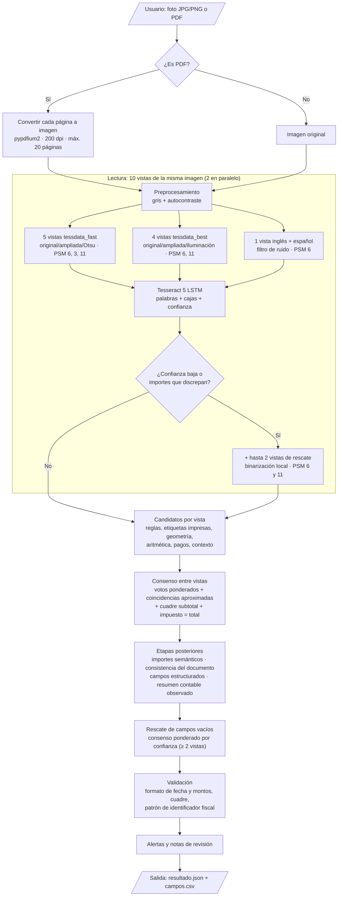
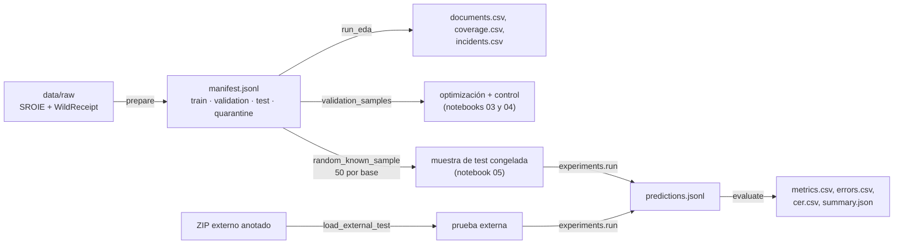

# Arquitectura del sistema

**Proyecto:** Lector de Facturas — extracción y validación de datos de facturas y comprobantes de compra con OCR
**Equipo:** Sebastián Rojas y Jesús Antonio López Barahona
**Última actualización:** 21/10/2026

Este documento explica qué modelo usa el sistema, por qué lo elegimos, cómo está construido por dentro y cómo viajan los datos desde la imagen hasta el JSON final. Describe la versión actual de la rama `main`: el modelo **«resumen contable»**, definido por [`configs/definitivo.json`](../configs/definitivo.json) y el código de [`src/lector_facturas/`](../src/lector_facturas/).

## Contenido

1. [Tipo de modelo y justificación](#1-tipo-de-modelo-y-justificación)
2. [Diagrama de flujo del sistema](#2-diagrama-de-flujo-del-sistema)
3. [Arquitectura detallada por componente](#3-arquitectura-detallada-por-componente)
4. [Pipeline de datos: de la imagen al JSON](#4-pipeline-de-datos-de-la-imagen-al-json)
5. [Organización del código](#5-organización-del-código)
6. [Tecnologías y versiones](#6-tecnologías-y-versiones)
7. [Reproducibilidad](#7-reproducibilidad)
8. [Limitaciones de la arquitectura](#8-limitaciones-de-la-arquitectura)

---

## 1. Tipo de modelo y justificación

### 1.1 Qué tipo de problema es

Es un problema de **extracción de información clave (Key Information Extraction, KIE)** sobre documentos no estructurados. Tiene dos partes:

1. **Reconocer el texto** de la imagen y su posición (OCR).
2. **Decidir qué texto corresponde a cada campo**: identificador fiscal, fecha, número de comprobante, subtotal, impuesto y total. En el fondo es una clasificación de cada palabra o línea en una de siete clases (los seis campos u "otro").

### 1.2 Solución elegida

El sistema combina **modelos de deep learning preentrenados** para leer el texto con un **extractor basado en reglas, geometría y consenso** para asignar los campos:

| Parte | Técnica | ¿Se entrena? |
|---|---|---|
| Lectura del texto | **Tesseract 5** con sus reconocedores LSTM preentrenados: `eng` de `tessdata_fast`, `eng` de `tessdata_best` y `spa` de `tessdata_fast` | No. Se usan los pesos oficiales, descargados de revisiones fijas y verificados por SHA-256. |
| Asignación de campos | Reglas con expresiones regulares, agrupación espacial de palabras, asociación etiqueta–importe por geometría, comprobaciones aritméticas, **resumen contable observado** y **votación entre 10 lecturas** del mismo documento | No. Las reglas y pesos se ajustaron con documentos de desarrollo; los pesos del consenso se optimizan en el notebook 04. |
| Validación | Reglas configurables de formato y cuadre de montos | No. |

### 1.3 Por qué esta solución

En la Ficha de Decisión Técnica (Semana 2) comparamos cinco familias de técnicas: OCR con reglas, OCR con ML clásico (CRF, Random Forest), redes de grafos (SDMG-R), Transformers multimodales (LayoutLMv3) y modelos sin OCR (Donut). Elegimos OCR con reglas por estos criterios:

| Criterio | Qué pesó en la decisión |
|---|---|
| **Datos disponibles** | Ningún dataset público anota `tax_id` ni `document_number` (ver [Análisis de datos](analisis_datos.md)). Un modelo entrenado no podría aprender esos dos campos; las reglas sí pueden buscarlos por su etiqueta (RUC, NIT, Invoice No.). |
| **Interpretabilidad** | Un usuario de contabilidad necesita saber de dónde sale cada valor. Con reglas, cada campo guarda el texto, la zona de la imagen, la vista y la regla que lo produjo. LayoutLMv3 y Donut son menos transparentes, y Donut puede generar valores que no están en la imagen. |
| **Recursos** | Dos personas, seis semanas y Colab gratuito. Tesseract corre en **CPU** y no necesita GPU ni entrenamiento. |
| **Costo** | USD 0. No depende de una API de pago y las imágenes no salen del equipo donde se procesan. |
| **Riesgo de sobreajuste** | Al no entrenar pesos no hay curvas de entrenamiento que sobreajustar. El riesgo que sí existe es **ajustar las reglas a los documentos vistos**; lo controlamos separando desarrollo, optimización, control y test (sección 7). |

El costo de esta elección es que las reglas dependen de que el OCR lea bien y de que las etiquetas del documento ("TOTAL", "IVA", "RUC") aparezcan de alguna forma reconocible. Para reducir esa fragilidad, el modelo lee cada imagen **10 veces con configuraciones y pesos distintos**, añade lecturas de rescate cuando la calidad es baja y solo corrige un importe cuando el resumen contable observado lo respalda.

### 1.4 Cómo llegamos a esta versión

| Versión | Qué cambió | Exactitud medida |
|---|---|---|
| Línea base V1 (Semana 2) | Una lectura OCR, reglas de cercanía simples; se abstenía ante cualquier duda. | 35,0 % (36/103 campos, 40 documentos de validación) |
| V2–V6 | Más etiquetas reconocidas, agrupación geométrica de líneas, corrección de errores típicos del OCR, consenso entre lecturas. | V6: 62,75 % (96/153) en 60 documentos de validación |
| V7 (entrega anterior) | Cinco lecturas OCR (`fast`), votación ponderada, coincidencias aproximadas, reglas aritméticas y de pago. | 70,53 % (213/302 campos, 120 documentos usados para seleccionarla) |
| **Resumen contable (actual)** | 10 vistas (pesos `fast` y `best`, corrección de iluminación, vista inglés + español), rescate OCR adaptativo, etiquetas impresas, asociación por geometría, consistencia del documento, resumen contable observado y rescate de campos vacíos por confianza. Ya no supone total = subtotal. | 75,0–77,6 % en tres grupos aleatorios del test oficial; el más reciente, **76,35 % (184/241)** frente a 75,93 % de la misma versión sin resumen contable |

Las cifras de V7 y del modelo actual son de **desarrollo**: esos documentos se usaron para decidir cambios, y casi todo el test oficial ya fue revisado. No garantizan el mismo resultado en documentos nuevos; la medición final y la prueba externa se hacen en [`05_evaluacion.ipynb`](../notebooks/05_evaluacion.ipynb) (ver [`results/`](../results/)).

## 2. Diagrama de flujo del sistema



## 3. Arquitectura detallada por componente

### 3.1 Entrada y conversión de PDF

| Parámetro | Valor | Dónde |
|---|---|---|
| Formatos aceptados | `.jpg`, `.jpeg`, `.png`, `.pdf` | `cli.py` |
| Resolución al convertir PDF | 200 dpi | `ocr.render_pdf` |
| Máximo de páginas por PDF | 20 (si hay más, se rechaza; no se trunca en silencio) | `ocr.render_pdf` |
| Unión de páginas | No: cada página es un resultado independiente | `cli.py` |
| Orientación | Se respeta la rotación EXIF de las fotos de celular | `ocr.transcribe` |

### 3.2 Preprocesamiento de imagen

Implementado en [`preprocessing.py`](../src/lector_facturas/preprocessing.py). Cada transformación guarda la escala y el borde aplicados para **devolver las coordenadas al tamaño original**, de modo que la evidencia siempre apunta al lugar correcto de la imagen que subió el usuario.

| Paso | Parámetro | Valor | Motivo |
|---|---|---|---|
| Escala de grises | `grayscale` | `true` | El color no aporta a los campos y añade ruido. |
| Autocontraste | `autocontrast` | `true` | Fotos con poca luz o fondo gris. |
| Ampliación | `target_long_edge` | 2.200 px (2.800 en el rescate) | La mitad de WildReceipt mide menos de 0,2 MP. |
| Ampliación máxima | `max_scale` | 3× (4× en el rescate) | Evita ampliar de más imágenes muy pequeñas. |
| Tope de píxeles | `max_pixels` | 25.000.000 (6.000.000 en el rescate) | Escaneos de hasta 34,8 MP; se reduce la escala con búsqueda binaria en vez de descartar. |
| Borde blanco | `border` | 20 px | Evita perder texto pegado al borde. |
| Binarización global | `otsu` | umbral automático de Otsu | Útil con fondo uniforme; puede borrar texto tenue, por eso solo en una vista. |
| Corrección de iluminación | `illumination` | divide por el fondo estimado con desenfoque gaussiano | Sombras y fotos con luz desigual. |
| Filtro de ruido | `denoise` | mediana 3×3 | Puntos y grano de impresoras térmicas. |
| Binarización local | `local_binary` | Sauvola, ventana 41, k = 0,20 | Solo en el rescate: papel arrugado o con manchas. |

### 3.3 Reconocimiento de texto: Tesseract LSTM

Tesseract desde la versión 4 reconoce cada línea de texto con una red recurrente LSTM entrenada con CTC. Las arquitecturas que usamos, extraídas de los propios archivos de pesos con `combine_tessdata`, están escritas en la notación VGSL de Tesseract:

| Modelo | Red (VGSL) | Pesos | Tamaño | SHA-256 (`eng`) |
|---|---|---|---|---|
| `eng` · `tessdata_fast` (revisión `87416418`) | `[1,36,0,1 Ct3,3,16 Mp3,3 Lfys48 Lfx96 Lrx96 Lfx192 O1c1]` | enteros (cuantizados) | 4,1 MB | `7d4322bd…6427170b2` |
| `eng` · `tessdata_best` (revisión `e12c65a9`) | `[1,36,0,1 Ct3,3,16 Mp3,3 Lfys64 Lfx96 Lrx96 Lfx512 O1c1]` | punto flotante | 15,4 MB | `8280aed0…ca0f8d85bd2fd145d1c2b560bcb66ba` |
| `spa` · `tessdata_fast` (revisión `87416418`) | igual que `eng` fast | enteros | 2,3 MB | se verifica que exista; el hash fijado es el de `eng` |

| Capa | Notación | Qué hace |
|---|---|---|
| Entrada | `1,36,0,1` | Una línea de texto en escala de grises, normalizada a **36 px de alto** y ancho variable. |
| Convolución | `Ct3,3,16` | 16 filtros de 3×3 con activación tanh: detecta trazos y bordes de las letras. |
| Max pooling | `Mp3,3` | Reduce 3× el alto y el ancho. |
| LSTM vertical | `Lfys48` / `Lfys64` | Recorre la columna de arriba abajo y la resume en un vector (48 unidades en `fast`, 64 en `best`). |
| LSTM horizontal | `Lfx96` | 96 unidades, de izquierda a derecha. |
| LSTM horizontal inverso | `Lrx96` | 96 unidades, de derecha a izquierda (contexto en ambos sentidos). |
| LSTM horizontal | `Lfx192` / `Lfx512` | Combina el contexto anterior (192 unidades en `fast`, 512 en `best`). |
| Salida | `O1c1` | Capa de salida con **CTC** sobre el juego de caracteres del modelo. |

Todos son la versión `4.00.00alpha:…:synth20170629`. Además del LSTM, cada archivo incluye diccionarios de palabras, números y puntuación que Tesseract usa para corregir la lectura. `best` es más preciso y más lento; `fast` es el que fija el resto de la configuración.

**Parámetros de ejecución**

| Parámetro | Valor | Significado |
|---|---|---|
| `language` | `eng` (y `eng+spa` en una vista) | Los datasets están en inglés; el español ayuda con tildes, `ñ` y etiquetas como "IVA" o "Fecha". |
| `oem` | 1 | Solo el motor LSTM. |
| `psm` | 6, 3 u 11 según la vista | **6** = un bloque de texto uniforme; **3** = segmentación automática de página; **11** = texto disperso, sin orden. |
| `workers` | 2 | Dos vistas se leen en paralelo (`OMP_THREAD_LIMIT = 1` por proceso). |
| `timeout_seconds` | 90 | Tiempo máximo por lectura. |
| Salida | TSV | Una fila por palabra con texto, caja, confianza y número de línea. |

### 3.4 Las vistas

Cada imagen se lee con 10 vistas. Si una falla o no devuelve palabras, se registra el error y se sigue con las demás; solo si **todas** fallan el documento se marca como error.

| # | Preprocesamiento | PSM | Pesos | Peso en la votación |
|---|---|---|---|---|
| 1 | original | 6 | fast | 1,0 |
| 2 (principal) | ampliada a 2.200 px | 6 | fast | **1,5** |
| 3 | ampliada + Otsu | 6 | fast | 1,0 |
| 4 | ampliada | 3 | fast | 1,0 |
| 5 | ampliada | 11 | fast | 1,0 |
| 6 | original | 6 | best | 1,0 |
| 7 | ampliada | 6 | best | **1,5** |
| 8 | ampliada | 11 | best | 1,0 |
| 9 | corrección de iluminación | 6 | best | 1,0 |
| 10 | filtro de ruido | 6 | fast · `eng+spa` | 1,0 |
| R1, R2 | binarización local, 2.800 px | 6 y 11 | best | 1,0 (solo si se activa el rescate) |

**Rescate adaptativo** (`adaptive_rescue`, `summary_rescue`): se añaden R1 y R2 solo si la lectura base es dudosa, decidido con el texto leído y nunca con las etiquetas de evaluación:

- ninguna vista tiene al menos 20 palabras, o ninguna supera una confianza mediana de 70 %;
- aparece una etiqueta de subtotal, impuesto o total sin un importe en esa línea o la siguiente, o no aparece ninguna etiqueta de importes;
- las vistas no coinciden en el importe asociado a una etiqueta de resumen (el valor más votado tiene menos del 75 % de los votos).

Así se gasta más OCR solo donde hace falta.

La idea viene del EDA: el 84 % de los errores de la línea base fueron **omisiones**. Distintas configuraciones de lectura fallan en lugares distintos, así que combinar lecturas da más candidatos correctos.

### 3.5 Extracción de candidatos por vista

Implementada en [`candidate_rules.py`](../src/lector_facturas/candidate_rules.py), [`geometry.py`](../src/lector_facturas/geometry.py) y la función `single()` de [`consensus.py`](../src/lector_facturas/consensus.py). Para cada vista se generan **candidatos** con un puntaje según qué tan confiable es la regla que los encontró:

| Regla | Ejemplo | Puntaje |
|---|---|---:|
| Resumen observado: subtotal, impuesto y total leídos en filas próximas que cuadran | `SUBTOTAL 100.00` / `TAX 12.00` / `TOTAL 112.00` | 9–11 |
| Fila aritmética: tres montos en una fila (o dos filas contiguas) con a + b = c | `100.00  12.00  112.00` | 9 |
| Efectivo − cambio | `CASH 120.00` / `CHANGE 8.00` → total 112.00 | 9 |
| Etiqueta fuerte de total en la misma línea | `GRAND TOTAL 112.00`, `AMOUNT DUE` | 8 |
| Etiqueta en la misma línea (subtotal, impuesto) o columna de tabla de impuestos | `IVA 12% 12.00`, `NET  VAT  GROSS` | 7 |
| Reglas iniciales (V5): etiqueta + valor, incluidos `tax_id` y `document_number` | `RUC: 1234567890`, `Invoice No. 001-002-000123` | 7 |
| Etiqueta normal de total | `TOTAL 112.00` | 6 |
| Fecha con separadores mezclados o mes mal leído | `27 / 09 / 2026`, `3AN` → `JAN` | 5 |
| Pago exacto con efectivo o tarjeta | `VISA 112.00` | 5 |
| Valor en la línea siguiente o justo debajo de la etiqueta | `TOTAL` ↵ `112.00` | 4 |

La limpieza corrige errores típicos del OCR solo dentro de números con forma de monto (`O`→`0`, `&`→`8`, `TOTA|`→`TOTAL`, `RM7.00` mal leído como `pm7.00`). Las fechas fuera de 2000–2035 o junto a palabras como `EXP`, `VALID UNTIL` o `VENCIM` se descartan; los totales que en realidad son "TAX TOTAL" también.

La **agrupación espacial** (`geometry.grouped`) arma las líneas por la posición vertical de las palabras en lugar de confiar en el número de línea de Tesseract, que se equivoca cuando el recibo está inclinado.

### 3.6 Consenso entre vistas

Para cada campo, los candidatos de todas las vistas se agrupan por su **valor normalizado** (por ejemplo, `112,00` y `112.00` son el mismo). Cada valor recibe un puntaje final:

```
rank = mejor_puntaje
     + vote_weight   × (votos − 1)          # votos = suma de pesos de las vistas que lo leyeron
     + fuzzy_weight  × votos_aproximados    # vistas que leyeron un valor a un carácter de distancia
     + 2             si el total coincide con un monto de pago leído
     + balance_bonus si cuadra subtotal + impuesto = total con valores realmente leídos
     + 3             si el subtotal tiene una etiqueta impresa explícita
```

Los cuatro hiperparámetros (`primary_weight` = 1,5, `vote_weight` = 2, `fuzzy_weight` = 0,5 y `balance_bonus` = 3) se leen de `consensus_parameters` y se optimizan en [`04_optimizacion.ipynb`](../notebooks/04_optimizacion.ipynb) ([Optimización](optimizacion.md)).

Reglas de decisión:

- Si para el total existe algún candidato con puntaje ≥ 8, solo compiten esos (`dominance`).
- Gana el valor con mayor `rank`. Si dos valores empatan, **no se elige al azar**: el campo queda vacío con la alerta `<campo>:ambiguous_consensus`.
- **No se supone total = subtotal** (a diferencia de V7). Si no hay total ni impuesto, el total queda vacío con la alerta `total:subtotal_no_confirma_total`: que no se vea un impuesto no prueba que no exista.
- El extractor **nunca inventa montos**: solo elige entre valores que alguna lectura produjo de verdad.

Cada mecanismo tiene un interruptor en `FLAGS` (`fuzzy`, `dominance`, `corroboration`, `balance`, `payment`, `triples`, `dates`, `glyphs`, `total_from_subtotal`) para poder apagarlo y medir cuánto aporta (ablación en el notebook 03).

### 3.7 Etapas posteriores al consenso

Cada etapa se activa desde `configs/definitivo.json` y solo cambia un campo con evidencia leída; cada cambio queda en `evidence` con su regla y una alerta.

| Etapa (interruptor) | Qué hace | Alerta si cambia algo |
|---|---|---|
| `printed_improvements` | Etiquetas separadas de su valor, fechas impresas y RFC/folio del emisor sin confundirlos con el receptor. | `<campo>:identifiers_conflict` |
| `accounting_improvements` | Tablas fiscales (neto, impuesto, bruto), subtotales antes y después de impuesto; desactiva total = subtotal. | `total:subtotal_no_confirma_total` |
| `amount_context`, `spatial_amounts` | Totales corroborados por subtotal/impuesto o pago/saldo; importes alineados debajo de su etiqueta. | — |
| `semantic_amounts` | Asocia cada importe a su etiqueta (propina, saldo, impuesto incluido) antes de votar. | `<campo>:semantic_selection` |
| `document_consistency` | Une cajas de etiqueta y número por geometría y recupera un importe con dos anclas corroboradas. | `<campo>:word_geometry_alignment` |
| `structured_fields` | Confirma etiquetas explícitas y columnas de encabezado; solo cambia un valor con evidencia más fuerte. | `<campo>:structured_selection` |
| `observed_accounting` | **Resumen contable observado:** si subtotal, impuesto y total no cuadran, busca una alternativa leída que cuadre con descuentos, envío, servicio o propina **visibles y corroborados en dos vistas**. Un ajuste visible sin corroborar bloquea la regla. | `<campo>:observed_accounting_selection` |
| `confidence_rescue` | Un segundo consenso pondera los votos por la confianza de Tesseract y **solo rellena campos vacíos** con evidencia de puntaje ≥ 6 en al menos dos vistas. | `<campo>:confidence_gap_recovery` |

### 3.8 Normalización y validación

| Campo | Normalización | Validación |
|---|---|---|
| Fecha | A ISO `AAAA-MM-DD`; si día y mes son ≤ 12 y no se configuró el orden, queda `AMBIGUOUS:` | `valid_format`, `ambiguous_date_order`, `invalid_format` |
| Subtotal, impuesto, total | A decimal con dos cifras; quita símbolos de moneda; detecta separador decimal | `valid_format`, `ambiguous_or_invalid_format` |
| Identificador fiscal | Mayúsculas sin espacios | Patrón configurable (`tax_id_pattern`); por defecto `null` → `not_configured` |
| Cuadre de montos | subtotal + impuesto = total con tolerancia de 0,02 | **Activo** (`check_amount_balance: true`): `consistent` o `inconsistent_review` |

El patrón del identificador fiscal viene desactivado porque depende del país. Para facturas ecuatorianas se puede configurar `"tax_id_pattern": "\\d{13}"` (RUC de 13 dígitos). Estas validaciones revisan formato y coherencia; **no confirman** que el comprobante sea auténtico ni que esté autorizado por el SRI u otra autoridad tributaria.

### 3.9 Alertas y notas de revisión

| Alerta o nota | Significado |
|---|---|
| `<campo>:ambiguous_consensus` | Dos o más valores con la misma fuerza; se deja vacío. |
| `total:subtotal_no_confirma_total` | Hay subtotal pero no total ni impuesto: el total queda vacío para revisión. |
| `<campo>:observed_accounting_selection` | El resumen contable observado corrigió el campo; el valor anterior queda en `accounting_summary`. |
| `<campo>:confidence_gap_recovery` | Campo vacío rellenado por el consenso ponderado por confianza. Revisar. |
| `<campo>:semantic_selection`, `structured_selection`, `word_geometry_alignment` | Una etapa posterior eligió otro valor leído con evidencia más fuerte. |
| `Subtotal + impuesto no coincide con total…` | El cuadre falló: revisar descuentos, cargos o lectura. Los valores se conservan. |
| `Una o varias lecturas OCR fallaron` | Alguna vista no produjo texto. |
| `quality.reading_status` | `sin_campos`, `lectura_parcial` o `lectura_por_verificar`, según cuántos de fecha/subtotal/impuesto/total se encontraron. Cobertura no es exactitud. |

## 4. Pipeline de datos: de la imagen al JSON

### 4.1 Flujo de inferencia (uso real)

```mermaid
flowchart LR
    A["factura.pdf"] -->|render_pdf| B["page_001.png"]
    B -->|prepare_image × 10| C["10 imágenes<br/>transformadas"]
    C -->|tesseract TSV| D["palabras + cajas<br/>por vista"]
    D -->|rescue_decision| D2["+ vistas de rescate<br/>si hace falta"]
    D2 -->|original_box| E["cajas en coordenadas<br/>originales"]
    E -->|single| F["candidatos con<br/>puntaje y evidencia"]
    F -->|extract| G["6 campos + alertas"]
    G -->|validate| H["estado de validación"]
    H -->|cli.main| I["resultado.json<br/>campos.csv"]
```



| Etapa | Entrada | Salida | Módulo |
|---|---|---|---|
| 1. Pesos | `configs/definitivo.json` | Configuración con carpetas de pesos verificadas | `frozen_runtime.bind_models` |
| 2. Conversión | PDF | Una imagen PNG por página | `ocr.render_pdf` |
| 3. Preprocesamiento | Imagen | Imágenes transformadas + transformación para revertir coordenadas | `preprocessing.prepare_image` |
| 4. OCR | Imagen transformada | Palabras con caja, confianza e id de línea; rescate si hace falta | `ocr.transcribe` |
| 5. Geometría | Palabras | Líneas reconstruidas por posición | `geometry.grouped` |
| 6. Candidatos | Líneas de una vista | Candidatos por campo con puntaje, regla y caja | `consensus.single` |
| 7. Consenso y etapas | Candidatos de todas las vistas | Un valor por campo + evidencia + alertas | `consensus.extract` |
| 8. Validación | Campos | Estado de cada validación | `candidate_rules.validate` |
| 9. Revisión | Resultado | Notas para la persona y cobertura | `frozen_runtime.review_notes`, `extraction_status` |
| 10. Exportación | Resultado por página | `resultado.json` y `campos.csv` | `cli.main` |

### 4.2 Ejemplo real de salida

Resultado de `python scripts/leer_documento.py samples/synthetic_receipt.png --out outputs/ejemplo` con el modelo actual (extracto de `resultado.json`; 3,2 s en un contenedor de prueba con CPU):

```json
{
  "page": 1,
  "status": "ok",
  "fields": {
    "tax_id": "1234567890",
    "date": "2026-09-27",
    "document_number": "001-002-000123",
    "subtotal": "100.00",
    "tax": "12.00",
    "total": "112.00"
  },
  "alerts": [],
  "validation": {
    "date": "valid_format",
    "subtotal": "valid_format",
    "tax": "valid_format",
    "total": "valid_format",
    "tax_id": "not_configured",
    "amount_balance": "consistent"
  },
  "quality": {"fields_found": 4, "fields_requested": 4, "reading_status": "lectura_por_verificar"},
  "evidence": {
    "total": [
      {"value": "112.00", "score": 11, "text": "total 112.00", "rule": "observed_summary_total", "view": 0, "normalized": "112.00"},
      "..."
    ]
  },
  "accounting_summary": {"adjustments": {}, "residual": "0.00", "observed_only": true}
}
```

`campos.csv` guarda lo mismo en una fila por página:

```csv
page,status,tax_id,date,document_number,subtotal,tax,total,revision
1,ok,1234567890,2026-09-27,001-002-000123,100.00,12.00,112.00,Resumen comprobado con descuentos/cargos observados: {}
```

Los seis campos coinciden con `samples/synthetic_gold.json`. Es un documento sintético y limpio: sirve para comprobar la instalación, **no** como medida de exactitud.

### 4.3 Flujo de evaluación (desarrollo)



La evaluación compara cada campo normalizado con la referencia. Un valor equivocado cuenta como falso positivo y falso negativo; un campo sin anotación no cuenta; un documento que falla sigue en el denominador.

## 5. Organización del código

El código tiene dos capas. La **interfaz pública** (`src/*.py`) sigue la estructura del curso, cumple PEP 8 y es lo que usan la app, los scripts y las pruebas; el **motor** (`src/lector_facturas/`) es el modelo tal como se desarrolló y evaluó, y la interfaz lo envuelve sin cambiar su comportamiento.

```text
src/
├── __init__.py          # Versión y uso mínimo
├── data_processing.py   # Validación de entrada (formato, tamaño, páginas), PDF → imágenes, preprocesamiento,
│                        # normalización, preparación y localización de datasets
├── model.py             # LectorFacturas: carga (Tesseract + pesos), lectura por página, confianza por campo,
│                        # exportación JSON/CSV, «Acerca de»; comando `python -m src.model`
├── train.py             # Optimización de los hiperparámetros del consenso en validación (no hay pesos que entrenar)
├── evaluate.py          # Test oficial, prueba externa, cumplimiento de metas, importación a results/ y reporte
└── utils.py             # config.yaml + .env, rutas relativas a la raíz, logging, excepciones con mensajes de usuario
```

El motor:

```text
src/lector_facturas/
├── cli.py               # Entrada: predict() y comando `lector archivo --out carpeta`
├── ocr.py               # Tesseract (TSV), vistas en paralelo, rescate adaptativo, caché, PDF → imagen
├── preprocessing.py     # Gris, autocontraste, ampliación, Otsu, iluminación, ruido, Sauvola; coordenadas originales
├── geometry.py          # Agrupación de palabras en líneas por posición
├── candidate_rules.py   # Reglas iniciales (V5) y validate()
├── consensus.py         # Candidatos por vista, consenso y etapas posteriores
├── extraction.py        # Punto único de acceso: extract y validate
├── common.py            # Esquema de 6 campos, normalización de fechas y montos
├── datasets.py          # Adaptadores SROIE / WildReceipt, partición por hash
├── eda.py               # Inventario, cobertura e incidencias
├── evaluation.py        # Exactitud, precisión, recall, F1, CER, latencia
├── experiments.py       # Corridas reproducibles, muestras, optimización, bootstrap pareado, prueba externa
└── frozen_runtime.py    # Pesos fijados por hash, notas de revisión y cobertura
```

`extraction.py` expone **una sola implementación**. `candidate_rules.py` y `consensus.py` no son modelos alternativos: trabajan juntos. Las versiones anteriores quedan en el historial de Git. Hay **153 pruebas unitarias** en [`tests/`](../tests/): 120 del motor (OCR simulado, preprocesamiento, consenso y etapas, adaptadores, evaluación, muestreo y optimizador) y 33 de la interfaz pública (`test_data_processing.py`, `test_model.py`, `test_app.py`), incluida una lectura real con Tesseract. Detalle en [`tests/README.md`](../tests/README.md).

**Configuración y errores.** Las rutas, límites de entrada, metas, semillas y umbrales están en [`configs/config.yaml`](../configs/config.yaml) (sobreescribibles con `.env`); el modelo, en `configs/definitivo.json`. Los errores esperables se lanzan como `ErrorEntrada`, `ErrorModelo` o `ErrorConfiguracion` con un mensaje para el usuario, y una página que falla no detiene el resto del documento. Los eventos se registran con `logging` en consola y en `outputs/lector.log`.

## 6. Tecnologías y versiones

| Tecnología | Versión | Uso |
|---|---|---|
| Python | ≥ 3.10 (pruebas verificadas en 3.13) | Lenguaje |
| Tesseract OCR | 5.x (verificado 5.3.4) | Motor OCR (CLI, salida TSV) |
| Pesos `eng` fast / best, `spa` fast | 4.00.00alpha, revisiones `87416418` y `e12c65a9` | Reconocedores LSTM preentrenados |
| Pillow | ≥ 10, < 13 | Lectura y transformación de imágenes |
| NumPy | ≥ 1.24, < 3 | Binarización e iluminación |
| pandas | ≥ 2, < 4 | Métricas y tablas |
| matplotlib | ≥ 3.7, < 4 | Gráficos |
| pypdfium2 | ≥ 4.25, < 6 | PDF → imagen |
| PyYAML | ≥ 6, < 7 | Lectura de `configs/config.yaml` |
| scikit-learn | ≥ 1.3, < 2 | Sustituto Random Forest, PDP e importancia (solo notebook 04) |
| setuptools | ≥ 68 | Instalación del paquete (`pyproject.toml`) |
| Google Colab | CPU | Ejecución de los notebooks |

Los rangos vienen de [`requirements.txt`](../requirements.txt). Las 153 pruebas y los cinco notebooks se ejecutaron de punta a punta en un entorno con Python 3.13, Tesseract 5.3.4, Pillow 12.3, NumPy 2.5, pandas 3.0, matplotlib 3.11, pypdfium2 5.13 y scikit-learn 1.9 (los notebooks, con un dataset sintético de prueba).

## 7. Reproducibilidad

- **Pesos fijados:** `frozen_runtime.bind_models` descarga cada `.traineddata` de una revisión fija de GitHub y verifica el SHA-256 de `eng` antes de usarlo. Las vistas registran la ruta y el hash de los pesos que realmente usaron.
- **Configuración congelada:** los notebooks guardan la configuración, el commit y el hash de cada archivo de `src/` antes de leer documentos (`plan.json`, `plan_test.json`).
- **Caché de OCR con huella:** la clave incluye el hash de la imagen, las opciones, la versión de Tesseract y el hash del código de OCR y preprocesamiento. Si algo cambia, no se reutiliza una lectura vieja.
- **Partición determinista:** por SHA-256 con semilla 42.
- **Muestras separadas:** optimización y control (validación) son disjuntas por hash y no contienen imágenes del test oficial. La muestra de test se elige por semilla, sin duplicados con desarrollo.
- **Documentos revisados:** [`configs/documentos_revisados.json`](../configs/documentos_revisados.json) registra los 1.461 documentos que se miraron durante el desarrollo (también en [`data/processed/documentos_revisados.csv`](../data/processed/documentos_revisados.csv)). Incluye casi todo el test oficial, por lo que el test **no es inédito**; la generalización se mide con la prueba externa anotada.
- **Huella del experimento:** `experiments.run` se niega a reutilizar una carpeta con otro código, otra configuración u otra muestra.

## 8. Limitaciones de la arquitectura

- **Depende del OCR.** Si Tesseract lee mal un dígito y todas las vistas cometen el mismo error, el consenso no lo puede corregir.
- **Texto manuscrito.** Los pesos de Tesseract están entrenados con texto impreso. Fechas, montos o RUC **escritos a mano** no se reconocen de forma confiable; el sistema está pensado solo para comprobantes impresos o digitales.
- **Reglas en inglés y español básico.** Las etiquetas cubren inglés y algunas en español y otros idiomas (`IVA`, `RUC`, `factura`, `totaal`, `moms`). Formatos con etiquetas distintas necesitan reglas nuevas.
- **Más lento que una sola lectura.** Diez vistas (más el rescate) multiplican el tiempo de OCR: el recibo sintético toma ~3 s en un contenedor con CPU. En Colab, el modelo anterior tardaba ~13 s por recibo real con 5 vistas, así que con 10 vistas en 2 procesos se puede esperar del orden de 10–30 s por documento; la medición real sale del notebook 05.
- **Sin unión de páginas.** Una factura de varias páginas devuelve un resultado por página.
- **Heurísticas con alertas.** El resumen contable observado y el rescate por confianza eligen entre valores leídos con reglas; las probabilidades de Tesseract no están calibradas y los campos marcados deben revisarse.

---

**Documentos relacionados:** [Planificación](planificacion.md) · [Análisis de datos](analisis_datos.md) · [Optimización](optimizacion.md) · [Consideraciones éticas](consideraciones_eticas.md) · [Manual de usuario](manual_usuario.md)
