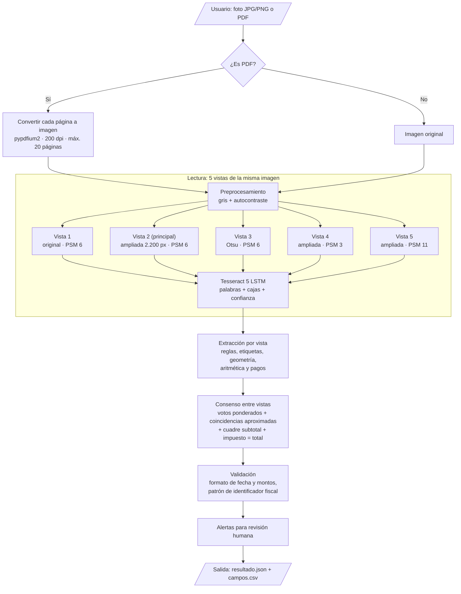
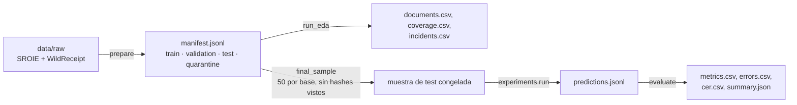

# Arquitectura del sistema

**Proyecto:** Lector de Facturas — extracción y validación de datos de facturas y comprobantes de compra con OCR
**Equipo:** Sebastián Rojas y Jesús Antonio López Barahona
**Última actualización:** 20/10/2026

Este documento explica qué modelo usa el sistema, por qué lo elegimos, cómo está construido por dentro y cómo viajan los datos desde la imagen hasta el JSON final. Describe la versión que está hoy en la rama `main` (lector definitivo V7, configuración [`configs/definitivo.json`](../configs/definitivo.json)).

## Contenido

1. [Tipo de modelo y justificación](#1-tipo-de-modelo-y-justificación)
2. [Diagrama de flujo del sistema](#2-diagrama-de-flujo-del-sistema)
3. [Arquitectura detallada por componente](#3-arquitectura-detallada-por-componente)
4. [Pipeline de datos: de la imagen al JSON](#4-pipeline-de-datos-de-la-imagen-al-json)
5. [Organización del código](#5-organización-del-código)
6. [Tecnologías y versiones](#6-tecnologías-y-versiones)
7. [Reproducibilidad](#7-reproducibilidad)
8. [Limitaciones de la arquitectura](#8-limitaciones-de-la-arquitectura)

---

## 1. Tipo de modelo y justificación

### 1.1 Qué tipo de problema es

Es un problema de **extracción de información clave (Key Information Extraction, KIE)** sobre documentos no estructurados. Tiene dos partes:

1. **Reconocer el texto** de la imagen y su posición (OCR).
2. **Decidir qué texto corresponde a cada campo**: identificador fiscal, fecha, número de comprobante, subtotal, impuesto y total. Esto es, en el fondo, una clasificación de cada palabra o línea en una de siete clases (los seis campos u "otro").

### 1.2 Solución elegida

El sistema combina un **modelo de deep learning preentrenado** para leer el texto con un **extractor basado en reglas y consenso** para asignar los campos:

| Parte | Técnica | ¿Se entrena? |
|---|---|---|
| Lectura del texto | **Tesseract 5** con su reconocedor LSTM preentrenado (modelo `eng` de `tessdata_fast`) | No. Se usan los pesos oficiales, fijados por SHA-256. |
| Asignación de campos | Reglas con expresiones regulares, agrupación espacial de palabras, comprobaciones aritméticas y **votación entre cinco lecturas** del mismo documento | No. Las reglas y pesos se ajustaron a mano con documentos de desarrollo. |
| Validación | Reglas configurables de formato y coherencia | No. |

### 1.3 Por qué esta solución

En la Ficha de Decisión Técnica (Semana 2) comparamos cinco familias de técnicas: OCR con reglas, OCR con ML clásico (CRF, Random Forest), redes de grafos (SDMG-R), Transformers multimodales (LayoutLMv3) y modelos sin OCR (Donut). Elegimos OCR con reglas como modelo base por estos criterios:

| Criterio | Qué pesó en la decisión |
|---|---|
| **Datos disponibles** | Ningún dataset público anota `tax_id` ni `document_number` (ver [Análisis de datos](analisis_datos.md)). Un modelo entrenado no podría aprender esos dos campos; las reglas sí pueden buscarlos por su etiqueta (RUC, NIT, Invoice No.). |
| **Interpretabilidad** | Un usuario de contabilidad necesita saber de dónde sale cada valor. Con reglas, cada campo guarda el texto, la zona de la imagen y la regla que lo produjo. LayoutLMv3 y Donut son menos transparentes, y Donut puede generar valores que no están en la imagen. |
| **Recursos** | Dos personas, seis semanas y Colab gratuito. Tesseract corre en **CPU** y no necesita GPU ni entrenamiento. |
| **Costo** | USD 0. No depende de una API de pago. |
| **Riesgo de sobreajuste** | Al no entrenar pesos no hay curvas de entrenamiento que sobreajustar. El riesgo que sí existe es **ajustar las reglas a los documentos vistos**, y lo controlamos separando desarrollo, selección y test (sección 7). |

El costo de esta elección es que las reglas dependen de que el OCR lea bien y de que las etiquetas del documento ("TOTAL", "IVA", "RUC") aparezcan de alguna forma reconocible. Para reducir esa fragilidad, la versión final lee cada imagen **cinco veces con configuraciones distintas** y combina los resultados.

### 1.4 Cómo llegamos a esta versión

| Versión | Qué cambió | Exactitud |
|---|---|---|
| Línea base V1 (Semana 2) | Una lectura OCR, reglas de cercanía simples; se abstenía ante cualquier duda. | 35,0 % (36/103 campos, 40 documentos de validación) |
| V2–V6 | Más etiquetas reconocidas, agrupación geométrica de líneas, corrección de errores típicos del OCR. | Iteraciones intermedias (historial de Git) |
| **V7 definitiva** | Cinco lecturas OCR, votación ponderada, coincidencias aproximadas, reglas aritméticas y de pago. | **70,53 %** (213/302 campos, 120 documentos usados para seleccionar la versión) |

La cifra de V7 es **retrospectiva**: esos documentos se usaron para elegir la versión, así que no garantiza el mismo resultado en documentos nuevos. El test final congelado está pendiente (ver `docs/resultados.md`).

## 2. Diagrama de flujo del sistema



## 3. Arquitectura detallada por componente

### 3.1 Entrada y conversión de PDF

| Parámetro | Valor | Dónde |
|---|---|---|
| Formatos aceptados | `.jpg`, `.jpeg`, `.png`, `.pdf` | `cli.py` |
| Resolución al convertir PDF | 200 dpi | `ocr.render_pdf` |
| Máximo de páginas por PDF | 20 (si hay más, se rechaza; no se trunca en silencio) | `ocr.render_pdf` |
| Unión de páginas | No: cada página es un resultado independiente | `cli.py` |

### 3.2 Preprocesamiento de imagen

Implementado en [`preprocessing.py`](../src/lector_facturas/preprocessing.py). Cada transformación guarda la escala y el borde aplicados para **devolver las coordenadas al tamaño original**, de modo que la evidencia siempre apunta al lugar correcto de la imagen que subió el usuario.

| Paso | Parámetro | Valor | Motivo |
|---|---|---|---|
| Escala de grises | `grayscale` | `true` | El color no aporta a los campos y añade ruido. |
| Autocontraste | `autocontrast` | `true` | Fotos con poca luz o fondo gris. |
| Ampliación | `target_long_edge` | 2.200 px | La mitad de WildReceipt mide menos de 0,2 MP. |
| Ampliación máxima | `max_scale` | 3× | Evita ampliar de más imágenes muy pequeñas. |
| Tope de píxeles | `max_pixels` | 25.000.000 | Escaneos de hasta 34,8 MP; se reduce la escala con búsqueda binaria en vez de descartar. |
| Borde blanco | `border` | 20 px | Evita perder texto pegado al borde. |
| Binarización | `otsu` (solo en la vista 3) | umbral automático de Otsu | Útil con sombras; puede borrar texto tenue, por eso no se aplica a todas las vistas. |

### 3.3 Reconocimiento de texto: Tesseract LSTM

Tesseract desde la versión 4 reconoce cada línea de texto con una red recurrente LSTM entrenada con CTC. El modelo `eng` de `tessdata_fast` que usamos tiene esta arquitectura, que extrajimos del propio archivo de pesos (`combine_tessdata`), escrita en la notación VGSL de Tesseract:

```
[1,36,0,1 Ct3,3,16 Mp3,3 Lfys48 Lfx96 Lrx96 Lfx192 O1c1]
```

| Capa | Notación | Qué hace |
|---|---|---|
| Entrada | `1,36,0,1` | Una línea de texto en escala de grises, normalizada a **36 px de alto** y ancho variable. |
| Convolución | `Ct3,3,16` | 16 filtros de 3×3 con activación tanh: detecta trazos y bordes de las letras. |
| Max pooling | `Mp3,3` | Reduce 3× el alto y el ancho para quedarse con lo importante. |
| LSTM vertical | `Lfys48` | LSTM de 48 unidades que recorre la columna de arriba abajo y la resume en un solo vector. |
| LSTM horizontal | `Lfx96` | LSTM de 96 unidades, de izquierda a derecha. |
| LSTM horizontal inverso | `Lrx96` | LSTM de 96 unidades, de derecha a izquierda (contexto en ambos sentidos). |
| LSTM horizontal | `Lfx192` | LSTM de 192 unidades que combina el contexto anterior. |
| Salida | `O1c1` | Capa de salida con **CTC** sobre el juego de caracteres del modelo (112 entradas). |

Datos del modelo: versión `4.00.00alpha:eng:synth20170629`, pesos enteros (`fast`, cuantizados para inferencia rápida en CPU), archivo de 4,1 MB, SHA-256 `7d4322bd2a7749724879683fc3912cb542f19906c83bcc1a52132556427170b2`. Además del LSTM, el archivo incluye diccionarios de palabras, números y puntuación que Tesseract usa para corregir la lectura.

**Parámetros de ejecución**

| Parámetro | Valor | Significado |
|---|---|---|
| `language` | `eng` | Modelo en inglés (los datasets están en inglés). |
| `oem` | 1 | Solo el motor LSTM (sin el motor clásico). |
| `psm` | 6, 3 u 11 según la vista | **6** = un bloque de texto uniforme; **3** = segmentación automática de página; **11** = texto disperso, sin orden. |
| `timeout_seconds` | 90 | Tiempo máximo por lectura. |
| Salida | TSV | Una fila por palabra con texto, caja (x, y, ancho, alto), confianza y número de línea. |

### 3.4 Las cinco vistas

Cada imagen se lee cinco veces. Si una vista falla o no devuelve palabras, se registra el error y se sigue con las demás; solo si **todas** fallan el documento se marca como error.

| Vista | Preprocesamiento | PSM | Peso en la votación |
|---|---|---|---|
| 1 | original (sin ampliar) | 6 | 1,0 |
| 2 (principal) | ampliada a 2.200 px | 6 | **1,5** |
| 3 | ampliada + binarización Otsu | 6 | 1,0 |
| 4 | ampliada | 3 | 1,0 |
| 5 | ampliada | 11 | 1,0 |

La idea viene del EDA: el 84 % de los errores de la línea base fueron **omisiones**. Distintas configuraciones de lectura fallan en lugares distintos, así que juntar cinco lecturas da más candidatos correctos.

### 3.5 Extracción de candidatos por vista

Implementada en [`candidate_rules.py`](../src/lector_facturas/candidate_rules.py), [`geometry.py`](../src/lector_facturas/geometry.py) y la función `single()` de [`consensus.py`](../src/lector_facturas/consensus.py). Para cada vista se generan **candidatos** con un puntaje según qué tan confiable es la regla que los encontró:

| Regla | Ejemplo | Puntaje |
|---|---|---:|
| Fila aritmética: tres montos en una fila (o dos filas contiguas) con a + b = c | `100.00  12.00  112.00` → subtotal, impuesto, total | 9 |
| Efectivo − cambio | `CASH 120.00` / `CHANGE 8.00` → total 112.00 | 9 |
| Etiqueta fuerte de total en la misma línea | `GRAND TOTAL 112.00`, `AMOUNT DUE` | 8 |
| Etiqueta en la misma línea (subtotal, impuesto) | `IVA 12% 12.00` | 7 |
| Columna de tabla de impuestos | encabezados `NET  VAT  GROSS` | 7 |
| Resultado de las reglas iniciales (V5): etiqueta + valor, incluidos `tax_id` y `document_number` (`RUC: 1234567890`, `Invoice No. 001-002-000123`) | — | 7 |
| Etiqueta normal de total | `TOTAL 112.00` | 6 |
| Fecha con separadores mezclados o mes mal leído | `27 / 09 / 2026`, `3AN` → `JAN` | 5 |
| Pago exacto con efectivo o tarjeta | `VISA 112.00` | 5 |
| Valor en la línea siguiente a la etiqueta | `TOTAL` ↵ `112.00` | 4 |
| Fecha compacta `AAAAMMDD` | `20180304` | 2 |

Además, la limpieza corrige errores típicos del OCR solo dentro de números con forma de monto (`O`→`0`, `&`→`8`, `TOTA|`→`TOTAL`, `RM7.00` mal leído como `pm7.00`). Los montos sin decimales pierden puntaje, y las fechas fuera de 2000–2035 o junto a palabras como `EXP` o `VALID UNTIL` se descartan.

La **agrupación espacial** (`geometry.grouped`) arma las líneas por la posición vertical de las palabras en lugar de confiar en el número de línea de Tesseract, que se equivoca cuando el recibo está inclinado.

### 3.6 Consenso entre vistas

Para cada campo, los candidatos de las cinco vistas se agrupan por su **valor normalizado** (por ejemplo, `112,00` y `112.00` son el mismo). Cada valor recibe un puntaje final:

```
rank = mejor_puntaje
     + 2 × (votos − 1)            # votos = suma de pesos de las vistas que lo leyeron
     + 0,5 × votos_aproximados    # vistas que leyeron un valor a un carácter de distancia
     + 2   si el total coincide con un monto de pago leído
     + 3   si cuadra subtotal + impuesto = total con valores realmente leídos
```

Reglas de decisión:

- Si para el total existe algún candidato con puntaje ≥ 8, solo compiten esos (`dominance`).
- Gana el valor con mayor `rank`. Si dos valores empatan, **no se elige al azar**: el campo queda vacío con la alerta `<campo>:ambiguous_consensus`.
- Si no hay total ni impuesto pero sí subtotal, se usa el subtotal como total con la alerta `total:from_subtotal`, que pide revisión humana.
- El extractor **nunca inventa montos**: solo elige entre valores que alguna lectura produjo de verdad.

Cada mecanismo tiene un interruptor en `FLAGS` (`fuzzy`, `dominance`, `corroboration`, `balance`, `payment`, `triples`, `dates`, `glyphs`, `total_from_subtotal`) para poder apagarlo y medir cuánto aporta.

### 3.7 Normalización y validación

| Campo | Normalización | Validación disponible |
|---|---|---|
| Fecha | A ISO `AAAA-MM-DD`; si día y mes son ≤ 12 y no se configuró el orden, queda `AMBIGUOUS:` | `valid_format`, `ambiguous_date_order`, `invalid_format` |
| Subtotal, impuesto, total | A decimal con dos cifras; quita símbolos de moneda; detecta separador decimal | `valid_format`, `ambiguous_or_invalid_format` |
| Identificador fiscal | Mayúsculas sin espacios | Patrón configurable (`tax_id_pattern`); por defecto `null` → `not_configured` |
| Cuadre de montos | subtotal + impuesto = total con tolerancia de 0,02 | Activable con `check_amount_balance`; por defecto `false` → `not_applicable` |

El patrón del identificador fiscal y el cuadre vienen **desactivados por defecto** porque dependen del país. Para facturas ecuatorianas, por ejemplo, se puede configurar `"tax_id_pattern": "\\d{13}"` (RUC de 13 dígitos) y activar el cuadre. Estas validaciones revisan formato y coherencia; **no confirman** que el comprobante sea auténtico ni que esté autorizado por una autoridad tributaria.

### 3.8 Alertas de revisión

| Alerta | Significado |
|---|---|
| `<campo>:no_candidate` | Ninguna regla encontró un valor para ese campo. |
| `<campo>:ambiguous_candidates` / `ambiguous_consensus` | Hay dos o más valores con la misma fuerza; se deja vacío. |
| `total:from_subtotal` | El total se tomó del subtotal: confirmar impuestos, cargos y descuentos. |
| `Una o varias lecturas OCR fallaron` | Alguna de las cinco vistas no produjo texto. |

## 4. Pipeline de datos: de la imagen al JSON

### 4.1 Flujo de inferencia (uso real)

```mermaid
flowchart LR
    A["factura.pdf"] -->|render_pdf| B["page_001.png"]
    B -->|prepare_image × 5| C["5 imágenes<br/>transformadas"]
    C -->|tesseract TSV| D["palabras + cajas<br/>por vista"]
    D -->|original_box| E["cajas en coordenadas<br/>originales"]
    E -->|single| F["candidatos con<br/>puntaje y evidencia"]
    F -->|extract consenso| G["6 campos + alertas"]
    G -->|validate| H["estado de validación"]
    H -->|cli.main| I["resultado.json<br/>campos.csv"]
```



| Etapa | Entrada | Salida | Módulo |
|---|---|---|---|
| 1. Conversión | PDF | Una imagen PNG por página | `ocr.render_pdf` |
| 2. Preprocesamiento | Imagen | 5 imágenes + transformación para revertir coordenadas | `preprocessing.prepare_image` |
| 3. OCR | Imagen transformada | Palabras con caja, confianza e id de línea | `ocr.transcribe` |
| 4. Geometría | Palabras | Líneas reconstruidas por posición | `geometry.grouped` |
| 5. Candidatos | Líneas de una vista | Candidatos por campo con puntaje, regla y caja | `consensus.single` |
| 6. Consenso | Candidatos de 5 vistas | Un valor por campo + evidencia + alertas | `consensus.extract` |
| 7. Validación | Campos | Estado de cada validación | `candidate_rules.validate` |
| 8. Exportación | Resultado por página | `resultado.json` y `campos.csv` | `cli.main` |

### 4.2 Ejemplo real de salida

Resultado de `python scripts/leer_documento.py samples/synthetic_receipt.png --out outputs/ejemplo` sobre el recibo sintético del repositorio (extracto de `resultado.json`):

```json
{
  "page": 1,
  "status": "ok",
  "fields": {
    "tax_id": "1234567890",
    "date": "2026-09-27",
    "document_number": "001-002-000123",
    "subtotal": "100.00",
    "tax": "12.00",
    "total": "112.00"
  },
  "alerts": [],
  "validation": {
    "date": "valid_format",
    "subtotal": "valid_format",
    "tax": "valid_format",
    "total": "valid_format",
    "tax_id": "not_configured",
    "amount_balance": "not_applicable"
  },
  "evidence": {
    "total": [
      {"value": "112.00", "score": 7, "rule": "v5_fallback", "view": 0, "normalized": "112.00"},
      "..."
    ]
  },
  "revision": []
}
```

`campos.csv` guarda lo mismo en una fila por página:

```csv
page,status,tax_id,date,document_number,subtotal,tax,total,revision
1,ok,1234567890,2026-09-27,001-002-000123,100.00,12.00,112.00,
```

Los seis campos coinciden con la referencia `samples/synthetic_gold.json`. Es un documento sintético y limpio: sirve para comprobar la instalación, **no** como medida de exactitud.

### 4.3 Flujo de evaluación (desarrollo)



La evaluación compara cada campo normalizado con la referencia. Un valor equivocado cuenta como falso positivo y falso negativo; un campo sin anotación no cuenta; un documento que falla sigue en el denominador.

## 5. Organización del código

```text
src/lector_facturas/
├── cli.py               # Entrada: predict() y comando `lector archivo --out carpeta`
├── ocr.py               # Tesseract (TSV), cinco vistas, caché, PDF → imagen
├── preprocessing.py     # Gris, autocontraste, ampliación, Otsu, coordenadas originales
├── geometry.py          # Agrupación de palabras en líneas por posición
├── candidate_rules.py   # Reglas iniciales y validate()
├── consensus.py         # Extractor V7: candidatos por vista y consenso
├── extraction.py        # Punto único de acceso: extract y validate
├── common.py            # Esquema de 6 campos, normalización de fechas y montos
├── datasets.py          # Adaptadores SROIE / WildReceipt, partición por hash
├── eda.py               # Inventario, cobertura e incidencias
├── evaluation.py        # Exactitud, precisión, recall, F1, CER, latencia
├── experiments.py       # Corridas reproducibles, bootstrap pareado
└── frozen_runtime.py    # Pesos fijados por hash y muestra final de test
```

`extraction.py` expone **una sola implementación**. `candidate_rules.py` y `consensus.py` no son modelos alternativos: trabajan juntos (el primero genera candidatos base que el segundo combina). Las versiones anteriores quedan en el historial de Git. Hay 43 pruebas unitarias en `tests/` (OCR simulado, preprocesamiento, consenso, adaptadores, evaluación y selección del test).

## 6. Tecnologías y versiones

| Tecnología | Versión | Uso |
|---|---|---|
| Python | ≥ 3.10 (verificado en 3.12) | Lenguaje |
| Tesseract OCR | 5.3.4 | Motor OCR (CLI, salida TSV) |
| Modelo `eng` (`tessdata_fast`) | 4.00.00alpha, revisión `87416418` | Pesos LSTM preentrenados |
| Pillow | ≥ 10, < 13 (verificado 12.3.0) | Lectura y transformación de imágenes |
| NumPy | ≥ 1.24, < 3 (verificado 2.3.5) | Binarización Otsu |
| pandas | ≥ 2, < 4 (verificado 2.2.3) | Métricas y tablas |
| matplotlib | ≥ 3.7, < 4 (verificado 3.10.8) | Gráficos |
| pypdfium2 | ≥ 4.25, < 6 (verificado 5.3.0) | PDF → imagen |
| setuptools | ≥ 68 | Instalación del paquete (`pyproject.toml`) |
| Google Colab | CPU | Ejecución del notebook |

Las versiones con rango vienen de `requirements.txt`; las verificadas, del entorno donde se corrieron las pruebas y la línea base.

## 7. Reproducibilidad

- **Pesos fijados:** `frozen_runtime.ensure_model` descarga `eng.traineddata` de una revisión fija de GitHub y verifica su SHA-256 antes de usarlo.
- **Configuración congelada:** el notebook guarda `configuracion_congelada.json` y el hash de cada archivo de `src/` antes de evaluar.
- **Caché de OCR con huella:** la clave de caché incluye el hash de la imagen, las opciones, la versión de Tesseract y el hash del código de OCR y preprocesamiento. Si algo cambia, no se reutiliza una lectura vieja.
- **Partición determinista:** por SHA-256 con semilla 42.
- **Test independiente:** 50 documentos por base del test oficial, elegidos por semilla e identidad (no por dificultad), excluyendo los 350 hashes ya vistos. La configuración queda fija antes de ver los resultados.
- **Huella del experimento:** `experiments.run` se niega a reutilizar una carpeta con otro código, otra configuración u otra muestra.

## 8. Limitaciones de la arquitectura

- **Depende del OCR.** Si Tesseract lee mal un dígito y las cinco vistas cometen el mismo error, el consenso no lo puede corregir.
- **Reglas en inglés y español básico.** Las etiquetas reconocidas cubren inglés y algunas en español y otros idiomas (`IVA`, `RUC`, `factura`, `totaal`, `moms`). Formatos con etiquetas distintas necesitan reglas nuevas.
- **Modelo de idioma `eng`.** Letras como `ñ` o tildes pueden leerse mal en facturas en español.
- **Más lento que una sola lectura.** Cinco lecturas multiplican el tiempo de OCR. En la línea base (una lectura) la mediana fue 0,70 s por documento; el recibo sintético con cinco vistas tomó unos 4 s en un contenedor de prueba con CPU.
- **Sin unión de páginas.** Una factura de varias páginas devuelve un resultado por página.
- **`total:from_subtotal` es una heurística.** Que no se haya detectado impuesto no prueba que no exista.

---

**Documentos relacionados:** [Planificación](planificacion.md) · [Análisis de datos](analisis_datos.md) · [Optimización](optimizacion.md) · [Consideraciones éticas](consideraciones_eticas.md) · [Manual de usuario](manual_usuario.md)
