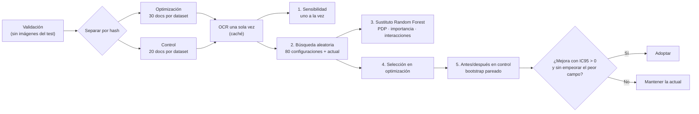
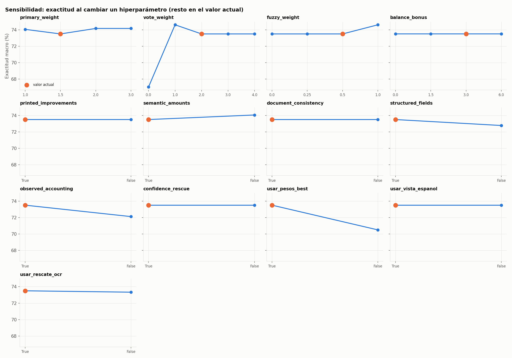
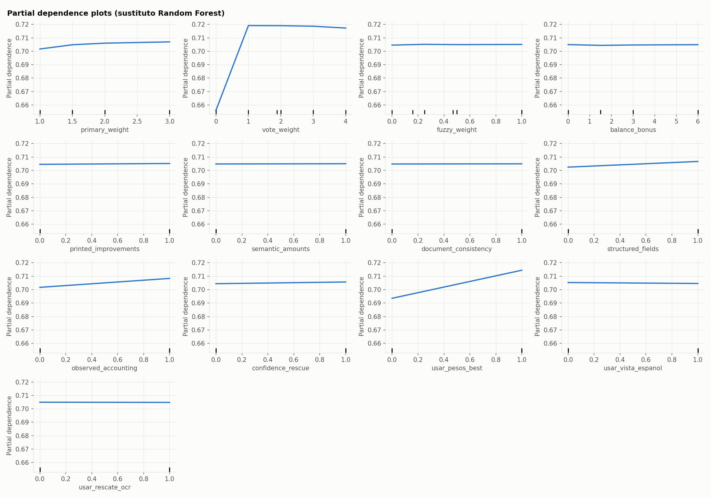
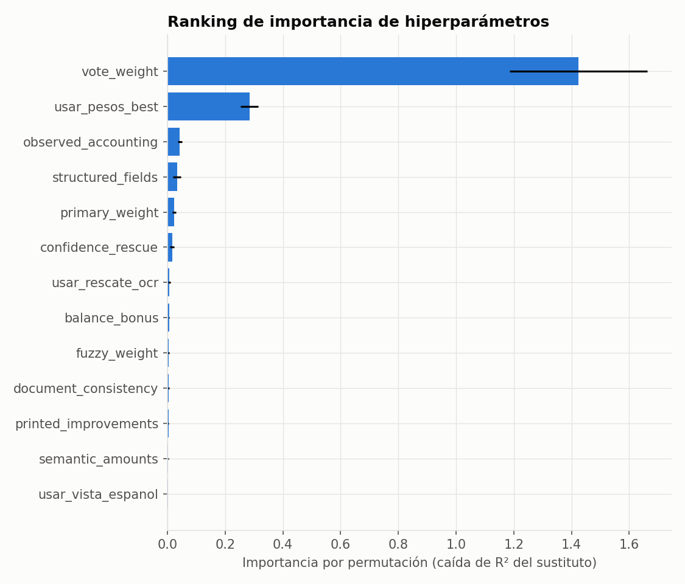
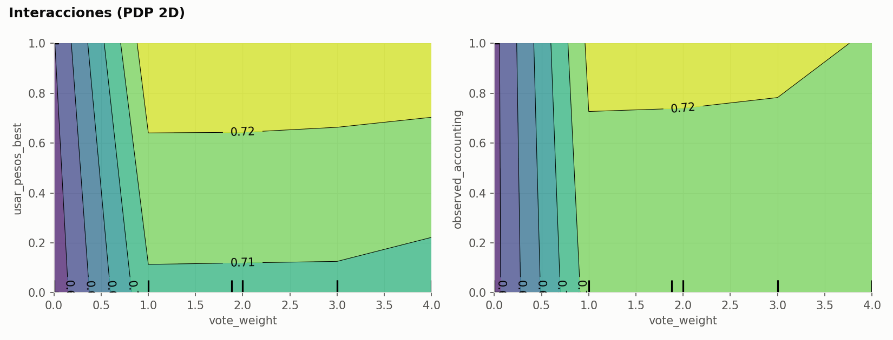
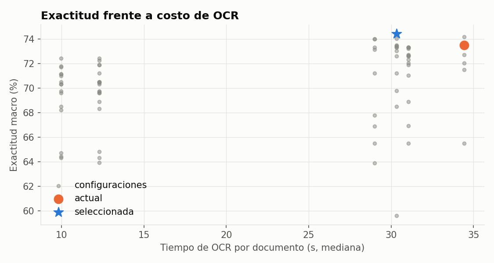

# Optimización del modelo

**Proyecto:** Lector de Facturas — extracción y validación de datos de facturas y comprobantes de compra con OCR
**Equipo:** Sebastián Rojas y Jesús Antonio López Barahona
**Última actualización:** 23/10/2026

Este documento describe cómo se optimizó el lector: primero con iteraciones dirigidas por el análisis de errores (de la línea base al modelo «resumen contable») y después con una **búsqueda sistemática de hiperparámetros** siguiendo el método del Workshop S5, implementada en [`notebooks/04_optimizacion.ipynb`](../notebooks/04_optimizacion.ipynb).

## Contenido

1. [Qué se optimiza en un modelo que no se entrena](#1-qué-se-optimiza-en-un-modelo-que-no-se-entrena)
2. [Optimización iterativa: de la línea base al modelo actual](#2-optimización-iterativa-de-la-línea-base-al-modelo-actual)
3. [Proceso de optimización de hiperparámetros (Workshop S5)](#3-proceso-de-optimización-de-hiperparámetros-workshop-s5)
4. [Hiperparámetros explorados y rangos](#4-hiperparámetros-explorados-y-rangos)
5. [Análisis de sensibilidad](#5-análisis-de-sensibilidad)
6. [Partial dependence plots](#6-partial-dependence-plots)
7. [Ranking de importancia](#7-ranking-de-importancia)
8. [Análisis de interacciones](#8-análisis-de-interacciones)
9. [Configuración final y justificación](#9-configuración-final-y-justificación)
10. [Comparación antes / después](#10-comparación-antes--después)
11. [Limitaciones](#11-limitaciones)

---

## 1. Qué se optimiza en un modelo que no se entrena

El OCR usa pesos preentrenados de Tesseract y no se reentrena, así que no hay tasa de aprendizaje, épocas ni regularización. Lo que sí cambia el resultado son **decisiones de configuración**, que tratamos como hiperparámetros:

| Tipo | Ejemplos | Dónde se configuran |
|---|---|---|
| Lectura OCR | Qué vistas se leen (pesos `fast`/`best`, idioma, preprocesamiento, PSM), cuándo se activa el rescate | `configs/definitivo.json` → `ocr` |
| Consenso | Peso de la vista principal, puntos por voto, por coincidencia aproximada y por cuadre | `consensus_parameters` |
| Etapas del extractor | Activar o no cada etapa posterior al consenso | Interruptores de `configs/definitivo.json` |

La métrica que se optimiza es la **exactitud por campo** (la meta del proyecto), calculada solo sobre campos con referencia. En la búsqueda sistemática se usa la versión **macro** (promedio de las seis combinaciones dataset/campo) para que los campos con mucho soporte no tapen a los débiles.

## 2. Optimización iterativa: de la línea base al modelo actual

Antes de la búsqueda sistemática, el modelo se mejoró en ciclos de *análisis de errores → cambio → medición en desarrollo*. Cada cambio se aceptó solo si mejoraba sin introducir regresiones.

| Paso | Diagnóstico que lo motivó | Cambio | Resultado medido |
|---|---|---|---|
| V1 → V5.1 | 56 de 67 errores de la línea base eran **omisiones** | Más etiquetas, agrupación geométrica de líneas, corrección de errores típicos del OCR | 35,0 % → 51,63 % |
| V5.1 → V6 | Distintas lecturas fallan en sitios distintos | Consenso entre lecturas de Tesseract | 51,63 % → 62,75 % (60 docs de validación) |
| V6 → V7 | Totales confundidos con pagos o totales redondeados | Cinco vistas, votos ponderados, coincidencias aproximadas, reglas de pago y aritméticas | 70,53 % (120 docs de selección) |
| V7 → resumen contable | Campos débiles: subtotal, impuesto y fecha de WildReceipt; total supuesto desde el subtotal | 10 vistas (`best`, iluminación, español), rescate adaptativo, etapas de geometría y consistencia, contabilidad observada, rescate por confianza; se elimina total = subtotal | 74,6–77,1 % → **75,0–77,6 %** en tres grupos del test, sin pérdidas |
| Descartado | — | Variantes de ponderación por confianza que **cambiaban** valores ya leídos | Causaban regresiones: no se entregan activadas |

Detalle en [`results/reports/resultados_desarrollo.md`](../results/reports/resultados_desarrollo.md). Estas mediciones se usaron para decidir, así que son optimistas.

## 3. Proceso de optimización de hiperparámetros (Workshop S5)

1. **Datos.** Solo la partición `validation` (20 % del entrenamiento oficial), separada por hash en **optimización** y **control**, sin imágenes que también estén en el test oficial (`experiments.validation_samples`, semilla 42). El plan (muestras, configuración y hash del código) se guarda **antes** de leer.
2. **OCR una sola vez.** Se leen todas las vistas y cada configuración se evalúa sobre esas lecturas. Apagar un grupo de vistas se simula quitándolas de la lectura. El arnés comprueba que, con los valores actuales, reproduce exactamente al lector entregado (`consensus.extract`).
3. **Sensibilidad** de uno en uno, con el resto en el valor actual.
4. **Búsqueda aleatoria** uniforme sobre todo el espacio (semilla fija), incluida la configuración actual.
5. **Modelo sustituto.** Un Random Forest (400 árboles, hoja mínima 3) predice la exactitud macro desde los hiperparámetros. Se revisa su R² fuera de bolsa antes de interpretar los PDP; la importancia se contrasta con el efecto medido directamente.
6. **Selección** en optimización: mayor exactitud macro; desempates por peor campo, exactitud global, menos cambios respecto a la configuración actual y menor costo de OCR.
7. **Antes/después en control** con `evaluation.evaluate` y bootstrap pareado por documento. **Regla fijada de antemano:** adoptar solo si la mejora es positiva, el límite inferior del IC95 es mayor que 0 y no empeora el peor campo.

## 4. Hiperparámetros explorados y rangos

| Grupo | Hiperparámetro | Qué controla | Valor actual | Rango explorado |
|---|---|---|---|---|
| Consenso | `primary_weight` | Peso del voto de la vista principal (ampliada · PSM 6) | 1,5 | 1, 1,5, 2, 3 |
| Consenso | `vote_weight` | Puntos por cada vista adicional que lee el mismo valor | 2 | 0, 1, 2, 3, 4 |
| Consenso | `fuzzy_weight` | Puntos por vistas que leen un valor a un carácter de distancia | 0,5 | 0, 0,25, 0,5, 1 |
| Consenso | `balance_bonus` | Bono si subtotal + impuesto = total con valores leídos | 3 | 0, 1,5, 3, 6 |
| Etapas | `printed_improvements` | Etiquetas impresas separadas, RFC/folio | sí | sí / no |
| Etapas | `semantic_amounts` | Asociar importes a su etiqueta antes de votar | sí | sí / no |
| Etapas | `document_consistency` | Geometría etiqueta–número y anclas corroboradas | sí | sí / no |
| Etapas | `structured_fields` | Etiquetas explícitas y columnas de encabezado | sí | sí / no |
| Etapas | `observed_accounting` | Resumen contable observado | sí | sí / no |
| Etapas | `confidence_rescue` | Rellenar vacíos con consenso ponderado por confianza | sí | sí / no |
| Vistas | `usar_pesos_best` | 4 vistas con `tessdata_best` y las vistas de rescate | sí | sí / no |
| Vistas | `usar_vista_espanol` | Vista `eng+spa` con filtro de ruido | sí | sí / no |
| Vistas | `usar_rescate_ocr` | Hasta 2 vistas de rescate con binarización local | sí | sí / no |

El espacio completo tiene 4 × 5 × 4 × 4 × 2⁹ = **163.840 combinaciones**; por eso se usa búsqueda aleatoria. `accounting_improvements` queda fijo: es la etapa que impide suponer total = subtotal, una decisión de responsabilidad que no se cambia por exactitud ([Consideraciones éticas](consideraciones_eticas.md)).

## 5. Análisis de sensibilidad

Cada hiperparámetro se recorre en todo su rango con los demás fijos en el valor actual. Muestra de optimización: 60 documentos (30 por dataset), 154 campos anotados. Con la configuración actual la exactitud macro es **73,5 %** (global 74,7 %).

| Hiperparámetro | Rango (pp) | Lectura |
|---|---:|---|
| `vote_weight` | 7,6 | El más influyente. Con 0 (sin votos entre vistas) la exactitud cae a 67,1 % (−6,4 pp); entre 1 y 4 apenas cambia (73,5–74,6 %). El consenso entre vistas es lo que más aporta. |
| `usar_pesos_best` | 3,0 | Sin las vistas `best` la exactitud baja a 70,5 % (−3,0 pp), pero el OCR pasa de 34,4 s a 12,3 s por documento: es el principal compromiso exactitud–costo. |
| `observed_accounting` | 1,4 | Apagar el resumen contable baja a 72,1 % y el peor campo de 60 % a 56 %. |
| `fuzzy_weight` | 1,1 | Subir de 0,5 a 1 suma +1,1 pp en esta muestra. |
| `structured_fields` | 0,7 | Apagarlo resta 0,7 pp. |
| `primary_weight` | 0,7 | Cualquier otro valor (1, 2 o 3) suma +0,6 pp. |
| `semantic_amounts` | 0,6 | Apagarlo suma +0,6 pp en esta muestra. |
| `usar_rescate_ocr` | 0,2 | Efecto mínimo; ahorra unos 3 s por documento. |
| `balance_bonus`, `printed_improvements`, `document_consistency`, `confidence_rescue`, `usar_vista_espanol` | 0 | Sin efecto en esta muestra. Quitar la vista en español ahorra 4 s por documento sin perder exactitud. |

Ningún cambio individual mejora más de 1,1 pp, es decir, uno o dos campos de 154: la configuración actual está cerca de su óptimo y esas pequeñas mejoras pueden ser ruido de muestra. Tabla completa: [`sensibilidad.csv`](../results/metrics/optimizacion/sensibilidad.csv).

## 6. Partial dependence plots

La búsqueda aleatoria evaluó **81 configuraciones** (80 aleatorias más la actual). La exactitud macro va de 59,6 % a 74,4 % (mediana 71,2 %), y solo 5 configuraciones superan a la actual. Sobre esos resultados se ajustó un Random Forest que predice la exactitud macro desde los 13 hiperparámetros, con **R² fuera de bolsa de 0,78**: los PDP son interpretables.

- `vote_weight` muestra un **umbral**: pasar de 0 a 1 sube la exactitud esperada de 65,6 % a 71,9 %, y por encima de 1 la curva es plana.
- `usar_pesos_best` tiene una pendiente clara (+2 pp en promedio), seguido de `observed_accounting`, `structured_fields` y `primary_weight`, con efectos menores.
- El resto de curvas son planas: su efecto depende del caso, no es sistemático.

## 7. Ranking de importancia

| # | Hiperparámetro | Importancia por permutación | Efecto principal (pp) | Rango de sensibilidad (pp) |
|---:|---|---:|---:|---:|
| 1 | `vote_weight` | 1,42 | 6,7 | 7,6 |
| 2 | `usar_pesos_best` | 0,28 | 1,9 | 3,0 |
| 3 | `observed_accounting` | 0,04 | 1,8 | 1,4 |
| 4 | `structured_fields` | 0,03 | 0,2 | 0,7 |
| 5 | `primary_weight` | 0,02 | 1,4 | 0,7 |
| 6 | `confidence_rescue` | 0,02 | 1,5 | 0 |
| 7 | `usar_rescate_ocr` | 0,01 | 0,3 | 0,2 |
| 8–13 | `balance_bonus`, `fuzzy_weight`, `document_consistency`, `printed_improvements`, `semantic_amounts`, `usar_vista_espanol` | < 0,01 | 0,2–2,1 | 0–1,1 |

Las tres medidas coinciden en los dos primeros puestos: **el voto entre vistas y los pesos `best` explican casi toda la variación**. El resumen contable (`observed_accounting`) es la etapa del extractor con más peso, lo que respalda haberla incorporado. Los efectos principales de los hiperparámetros con importancia casi nula (por ejemplo `fuzzy_weight`, 2,1 pp) vienen de pocas configuraciones por valor y no se confirman en el sustituto. Tabla: [`importancia.csv`](../results/metrics/optimizacion/importancia.csv).

## 8. Análisis de interacciones

Para el par más importante se calculó la grilla exacta (sin sustituto), con el resto en el valor actual:

| `vote_weight` | Sin pesos `best` | Con pesos `best` | Diferencia |
|---:|---:|---:|---:|
| 0 | 62,8 % | 67,1 % | +4,3 pp |
| 1 | 71,0 % | 74,6 % | +3,6 pp |
| 2 (actual) | 70,5 % | 73,5 % | +3,0 pp |
| 3 | 70,5 % | 73,5 % | +3,0 pp |
| 4 | 70,5 % | 73,5 % | +3,0 pp |

La interacción es **débil y casi aditiva**: las vistas `best` suman entre 3 y 4,3 pp con cualquier peso de voto, un poco más cuando no hay voto (las vistas extra compensan la falta de consenso). Con `observed_accounting` pasa lo mismo: su aporte se mantiene a partir de `vote_weight` = 1. Por eso los hiperparámetros pueden ajustarse por separado sin riesgo de combinaciones inesperadas.

## 9. Configuración final y justificación

La configuración con mejor exactitud macro en optimización fue:

| Hiperparámetro | Actual | Seleccionada |
|---|---|---|
| `primary_weight` | 1,5 | 2 |
| `fuzzy_weight` | 0,5 | 1 |
| `balance_bonus` | 3 | 0 |
| `semantic_amounts` | sí | no |
| `structured_fields` | sí | no |
| `usar_vista_espanol` | sí | no |
| Resto (`vote_weight` = 2 y demás etapas y vistas) | igual | igual |
| Exactitud macro en optimización | 73,5 % | 74,4 % (+0,9 pp) |
| OCR por documento (mediana) | 34,4 s | 30,3 s |

Su ventaja en optimización es de +0,9 pp, menos de dos campos, y la obtuvo apagando dos etapas del extractor. En la muestra de control (sección 10) **no se sostuvo**, así que, según la regla fijada de antemano, **se mantiene la configuración actual** de [`configs/definitivo.json`](../configs/definitivo.json). El gráfico de costo muestra que ninguna configuración sin pesos `best` (unos 10–12 s por documento) alcanza a la actual: quedan entre 1 y 10 pp por debajo, así que leer más vistas sí justifica su costo. Recomendación registrada en [`configuracion_recomendada.json`](../results/metrics/optimizacion/configuracion_recomendada.json).

## 10. Comparación antes / después

**a) Optimización iterativa (sección 2):** de 35,0 % (línea base) a 75,0–77,6 % en desarrollo, con el resumen contable sumando entre 1 y 2 campos por grupo sin perder ninguno.

**b) Búsqueda de hiperparámetros, en la muestra de control** (40 documentos, 98 campos, no usados para elegir):

| Medida | Actual | Seleccionada |
|---|---:|---:|
| Exactitud global | **77,6 %** | 74,5 % |
| Exactitud macro | **75,4 %** | 72,7 % |
| Peor campo | 57,1 % | 57,1 % |
| SROIE · fecha | 90,0 % | 85,0 % |
| WildReceipt · total | 76,5 % | 64,7 % |
| Resto de campos | igual | igual |

Diferencia pareada (bootstrap por documento): **−3,1 pp, IC95 de −7,1 a 0,0 pp**. La configuración seleccionada empeora en control lo que había ganado en optimización: su ventaja era **sobreajuste a la muestra de optimización**. La regla de decisión cumplió su función y se mantuvo la configuración actual. Métricas: [`control_actual`](../results/metrics/optimizacion/control_actual/evaluation/) y [`control_seleccionada`](../results/metrics/optimizacion/control_seleccionada/evaluation/).

**c) Modelo final frente a las versiones anteriores, en el test** ([`05_evaluacion.ipynb`](../notebooks/05_evaluacion.ipynb), 100 documentos y 244 campos, mismas lecturas OCR para todos):

| Modelo | Exactitud | Mejora del final (bootstrap pareado, IC95) |
|---|---:|---|
| M0 · reglas iniciales (1 vista) | 51,6 % | +29,5 pp (23,9 a 35,5) |
| M1 · V7 (5 vistas `fast`) | 63,9 % | +17,2 pp (12,0 a 22,7) |
| M2 · actual sin resumen contable | 80,7 % | +0,4 pp (0,0 a 1,2) |
| **M3 · resumen contable (final)** | **81,1 %** | — |

La mayor parte de la mejora viene del consenso entre más vistas y de los pesos `best` (M1 → M2). El resumen contable suma poco en promedio (un subtotal de WildReceipt más, de 244 campos) y no empeora ningún otro campo. Detalle de la evaluación en el [reporte de resultados](../results/reports/reporte_resultados.md).

## 11. Limitaciones

- **Muestras pequeñas** (decenas de documentos por dataset): diferencias de 1–2 puntos pueden ser ruido. Por eso decide el intervalo de confianza en control y no la mejor cifra en optimización.
- **Validación ya revisada en parte.** Optimización y control son disjuntos entre sí, pero algunos documentos se miraron durante el desarrollo; el control no es inédito.
- **Muestra de control pequeña.** 40 documentos: el intervalo del cambio (−7,1 a 0,0 pp) es ancho. Basta para rechazar la configuración seleccionada, pero no para afirmar que la actual es la mejor posible.
- **Vistas simuladas.** Apagar vistas se simula sobre lecturas ya hechas; con menos vistas, el rescate adaptativo real podría activarse de otra forma.
- **Sustituto aproximado.** Los PDP y la importancia por permutación describen al Random Forest, no al lector; por eso se contrastan con la sensibilidad y el efecto principal medidos directamente.
- **No se optimiza el OCR en sí** (no se reentrena Tesseract) ni las reglas de extracción, que se ajustaron en la fase iterativa.

---

**Documentos relacionados:** [Planificación](planificacion.md) · [Análisis de datos](analisis_datos.md) · [Arquitectura](arquitectura.md) · [Consideraciones éticas](consideraciones_eticas.md) · [Manual de usuario](manual_usuario.md)
