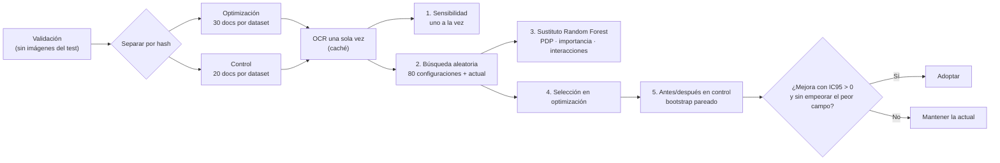

# Optimización del modelo

**Proyecto:** Lector de Facturas — extracción y validación de datos de facturas y comprobantes de compra con OCR
**Equipo:** Sebastián Rojas y Jesús Antonio López Barahona
**Última actualización:** 21/10/2026

Este documento describe cómo se optimizó el lector: primero con iteraciones dirigidas por el análisis de errores (de la línea base al modelo «resumen contable») y después con una **búsqueda sistemática de hiperparámetros** siguiendo el método del Workshop S5, implementada en [`notebooks/04_optimizacion.ipynb`](../notebooks/04_optimizacion.ipynb).

> **Cómo completar este documento.** El método, el espacio de búsqueda y la regla de decisión ya están fijados. Las celdas marcadas con ⏳ se llenan con la salida de la ejecución de 04 en Colab (tablas `sensibilidad.csv`, `importancia.csv`, `seleccion.json` y las figuras que se copian a [`results/figures/optimizacion/`](../results/figures/optimizacion/)). No se escriben cifras que no salgan de esa ejecución.

## Contenido

1. [Qué se optimiza en un modelo que no se entrena](#1-qué-se-optimiza-en-un-modelo-que-no-se-entrena)
2. [Optimización iterativa: de la línea base al modelo actual](#2-optimización-iterativa-de-la-línea-base-al-modelo-actual)
3. [Proceso de optimización de hiperparámetros (Workshop S5)](#3-proceso-de-optimización-de-hiperparámetros-workshop-s5)
4. [Hiperparámetros explorados y rangos](#4-hiperparámetros-explorados-y-rangos)
5. [Análisis de sensibilidad](#5-análisis-de-sensibilidad)
6. [Partial dependence plots](#6-partial-dependence-plots)
7. [Ranking de importancia](#7-ranking-de-importancia)
8. [Análisis de interacciones](#8-análisis-de-interacciones)
9. [Configuración final y justificación](#9-configuración-final-y-justificación)
10. [Comparación antes / después](#10-comparación-antes--después)
11. [Limitaciones](#11-limitaciones)

---

## 1. Qué se optimiza en un modelo que no se entrena

El OCR usa pesos preentrenados de Tesseract y no se reentrena, así que no hay tasa de aprendizaje, épocas ni regularización. Lo que sí cambia el resultado son **decisiones de configuración**, que tratamos como hiperparámetros:

| Tipo | Ejemplos | Dónde se configuran |
|---|---|---|
| Lectura OCR | Qué vistas se leen (pesos `fast`/`best`, idioma, preprocesamiento, PSM), cuándo se activa el rescate | `configs/definitivo.json` → `ocr` |
| Consenso | Peso de la vista principal, puntos por voto, por coincidencia aproximada y por cuadre | `consensus_parameters` |
| Etapas del extractor | Activar o no cada etapa posterior al consenso | Interruptores de `configs/definitivo.json` |

La métrica que se optimiza es la **exactitud por campo** (la meta del proyecto), calculada solo sobre campos con referencia. En la búsqueda sistemática se usa la versión **macro** (promedio de las seis combinaciones dataset/campo) para que los campos con mucho soporte no tapen a los débiles.

## 2. Optimización iterativa: de la línea base al modelo actual

Antes de la búsqueda sistemática, el modelo se mejoró en ciclos de *análisis de errores → cambio → medición en desarrollo*. Cada cambio se aceptó solo si mejoraba sin introducir regresiones.

| Paso | Diagnóstico que lo motivó | Cambio | Resultado medido |
|---|---|---|---|
| V1 → V5.1 | 56 de 67 errores de la línea base eran **omisiones** | Más etiquetas, agrupación geométrica de líneas, corrección de errores típicos del OCR | 35,0 % → 51,63 % |
| V5.1 → V6 | Distintas lecturas fallan en sitios distintos | Consenso entre lecturas de Tesseract | 51,63 % → 62,75 % (60 docs de validación) |
| V6 → V7 | Totales confundidos con pagos o totales redondeados | Cinco vistas, votos ponderados, coincidencias aproximadas, reglas de pago y aritméticas | 70,53 % (120 docs de selección) |
| V7 → resumen contable | Campos débiles: subtotal, impuesto y fecha de WildReceipt; total supuesto desde el subtotal | 10 vistas (`best`, iluminación, español), rescate adaptativo, etapas de geometría y consistencia, contabilidad observada, rescate por confianza; se elimina total = subtotal | 74,6–77,1 % → **75,0–77,6 %** en tres grupos del test, sin pérdidas |
| Descartado | — | Variantes de ponderación por confianza que **cambiaban** valores ya leídos | Causaban regresiones: no se entregan activadas |

Detalle en [`results/reports/resultados_desarrollo.md`](../results/reports/resultados_desarrollo.md). Estas mediciones se usaron para decidir, así que son optimistas.

## 3. Proceso de optimización de hiperparámetros (Workshop S5)

1. **Datos.** Solo la partición `validation` (20 % del entrenamiento oficial), separada por hash en **optimización** y **control**, sin imágenes que también estén en el test oficial (`experiments.validation_samples`, semilla 42). El plan (muestras, configuración y hash del código) se guarda **antes** de leer.
2. **OCR una sola vez.** Se leen todas las vistas y cada configuración se evalúa sobre esas lecturas. Apagar un grupo de vistas se simula quitándolas de la lectura. El arnés comprueba que, con los valores actuales, reproduce exactamente al lector entregado (`consensus.extract`).
3. **Sensibilidad** de uno en uno, con el resto en el valor actual.
4. **Búsqueda aleatoria** uniforme sobre todo el espacio (semilla fija), incluida la configuración actual.
5. **Modelo sustituto.** Un Random Forest (400 árboles, hoja mínima 3) predice la exactitud macro desde los hiperparámetros. Se revisa su R² fuera de bolsa antes de interpretar los PDP; la importancia se contrasta con el efecto medido directamente.
6. **Selección** en optimización: mayor exactitud macro; desempates por peor campo, exactitud global, menos cambios respecto a la configuración actual y menor costo de OCR.
7. **Antes/después en control** con `evaluation.evaluate` y bootstrap pareado por documento. **Regla fijada de antemano:** adoptar solo si la mejora es positiva, el límite inferior del IC95 es mayor que 0 y no empeora el peor campo.

## 4. Hiperparámetros explorados y rangos

| Grupo | Hiperparámetro | Qué controla | Valor actual | Rango explorado |
|---|---|---|---|---|
| Consenso | `primary_weight` | Peso del voto de la vista principal (ampliada · PSM 6) | 1,5 | 1, 1,5, 2, 3 |
| Consenso | `vote_weight` | Puntos por cada vista adicional que lee el mismo valor | 2 | 0, 1, 2, 3, 4 |
| Consenso | `fuzzy_weight` | Puntos por vistas que leen un valor a un carácter de distancia | 0,5 | 0, 0,25, 0,5, 1 |
| Consenso | `balance_bonus` | Bono si subtotal + impuesto = total con valores leídos | 3 | 0, 1,5, 3, 6 |
| Etapas | `printed_improvements` | Etiquetas impresas separadas, RFC/folio | sí | sí / no |
| Etapas | `semantic_amounts` | Asociar importes a su etiqueta antes de votar | sí | sí / no |
| Etapas | `document_consistency` | Geometría etiqueta–número y anclas corroboradas | sí | sí / no |
| Etapas | `structured_fields` | Etiquetas explícitas y columnas de encabezado | sí | sí / no |
| Etapas | `observed_accounting` | Resumen contable observado | sí | sí / no |
| Etapas | `confidence_rescue` | Rellenar vacíos con consenso ponderado por confianza | sí | sí / no |
| Vistas | `usar_pesos_best` | 4 vistas con `tessdata_best` y las vistas de rescate | sí | sí / no |
| Vistas | `usar_vista_espanol` | Vista `eng+spa` con filtro de ruido | sí | sí / no |
| Vistas | `usar_rescate_ocr` | Hasta 2 vistas de rescate con binarización local | sí | sí / no |

El espacio completo tiene 4 × 5 × 4 × 4 × 2⁹ = **163.840 combinaciones**; por eso se usa búsqueda aleatoria. `accounting_improvements` queda fijo: es la etapa que impide suponer total = subtotal, una decisión de responsabilidad que no se cambia por exactitud ([Consideraciones éticas](consideraciones_eticas.md)).

## 5. Análisis de sensibilidad

⏳ *Figura pendiente (`sensibilidad.png`, notebook 04). Al copiarla a `results/figures/optimizacion/`, reemplazar esta línea por* ``

| Hiperparámetro | Mín. (pp) | Máx. (pp) | Rango (pp) |
|---|---:|---:|---:|
| ⏳ (de `resumen_sens` en la sección 5 de 04, ordenado por rango) | | | |

**Lectura:** ⏳ qué hiperparámetros mueven más la exactitud y en qué dirección; si el valor actual está cerca del óptimo de cada curva.

## 6. Partial dependence plots

⏳ *Figura pendiente (`pdp.png`, notebook 04). Al copiarla a `results/figures/optimizacion/`, reemplazar esta línea por* ``

- R² fuera de bolsa del sustituto: ⏳ (si es menor que 0,5, los PDP solo orientan y manda el efecto medido directamente).
- **Lectura:** ⏳ forma de cada curva (monótona, con óptimo interior o plana).

## 7. Ranking de importancia

⏳ *Figura pendiente (`importancia.png`, notebook 04). Al copiarla a `results/figures/optimizacion/`, reemplazar esta línea por* ``

| Ranking | Hiperparámetro | Permutación | Efecto principal (pp) | Rango de sensibilidad (pp) |
|---:|---|---:|---:|---:|
| ⏳ | (de `importancia.csv`) | | | |

**Lectura:** ⏳ si las tres medidas coinciden en los más importantes.

## 8. Análisis de interacciones

⏳ *Figura pendiente (`interacciones_pdp2d.png`, notebook 04). Al copiarla a `results/figures/optimizacion/`, reemplazar esta línea por* ``

⏳ *Figura pendiente (`interaccion_grilla.png`, notebook 04). Al copiarla a `results/figures/optimizacion/`, reemplazar esta línea por* ``

- Par más importante: ⏳.
- Variación del efecto de uno según el otro: ⏳ pp (cerca de 0 = poca interacción).

## 9. Configuración final y justificación

| Hiperparámetro | Actual | Seleccionada en optimización | Recomendada |
|---|---|---|---|
| ⏳ (de la sección 10 de 04 y `configuracion_recomendada.json`) | | | |

⏳ *Figura pendiente (`exactitud_vs_costo.png`, notebook 04). Al copiarla a `results/figures/optimizacion/`, reemplazar esta línea por* ``

**Justificación:** ⏳ la configuración recomendada es la seleccionada solo si cumplió la regla de la sección 3 en control; si no, se mantiene la actual de [`configs/definitivo.json`](../configs/definitivo.json). Indicar también el cambio en costo de OCR por documento.

## 10. Comparación antes / después

**a) Optimización iterativa (sección 2):** de 35,0 % (línea base) a 75,0–77,6 % en desarrollo, con el resumen contable sumando entre 1 y 2 campos por grupo sin perder ninguno.

**b) Búsqueda de hiperparámetros (muestra de control, no usada para elegir):**

| Configuración | Optimización · macro | Control · macro | Control · global | Control · peor campo |
|---|---:|---:|---:|---:|
| Actual (`definitivo.json`) | ⏳ | ⏳ | ⏳ | ⏳ |
| Seleccionada | ⏳ | ⏳ | ⏳ | ⏳ |

| Cambio en control | Δ (pp) | IC95 inferior | IC95 superior | Decisión |
|---|---:|---:|---:|---|
| Seleccionada − actual | ⏳ | ⏳ | ⏳ | ⏳ adoptar / mantener |

La exactitud en la muestra de optimización está inflada por la propia selección; la cifra que cuenta es la de control. El efecto final en el test se mide en [`05_evaluacion.ipynb`](../notebooks/05_evaluacion.ipynb) (opción `USAR_CONFIG_OPTIMIZADA`).

## 11. Limitaciones

- **Muestras pequeñas** (decenas de documentos por dataset): diferencias de 1–2 puntos pueden ser ruido. Por eso decide el intervalo de confianza en control y no la mejor cifra en optimización.
- **Validación ya revisada en parte.** Optimización y control son disjuntos entre sí, pero algunos documentos se miraron durante el desarrollo; el control no es inédito.
- **Vistas simuladas.** Apagar vistas se simula sobre lecturas ya hechas; con menos vistas, el rescate adaptativo real podría activarse de otra forma.
- **Sustituto aproximado.** Los PDP y la importancia por permutación describen al Random Forest, no al lector; por eso se contrastan con la sensibilidad y el efecto principal medidos directamente.
- **No se optimiza el OCR en sí** (no se reentrena Tesseract) ni las reglas de extracción, que se ajustaron en la fase iterativa.

---

**Documentos relacionados:** [Planificación](planificacion.md) · [Análisis de datos](analisis_datos.md) · [Arquitectura](arquitectura.md) · [Consideraciones éticas](consideraciones_eticas.md) · [Manual de usuario](manual_usuario.md)
