# Planificación del proyecto

**Proyecto:** Lector de Facturas — extracción y validación de datos de facturas y comprobantes de compra con OCR
**Equipo:** Sebastián Rojas y Jesús Antonio López Barahona
**Curso:** MIAR0545 – Proyecto Integrador en IA · Docente: Gladys María Villegas Rugel
**Última actualización:** 21/10/2026

Este documento resume cómo planificamos el proyecto y cómo se ejecutó en la práctica. Parte del Documento de Alcance (Semana 1), la Ficha de Decisión Técnica (Semana 2) y el Reporte de Diagnóstico de Overfitting (Semana 3), y lo contrasta con lo que hoy está en el repositorio.

## Contenido

1. [Definición del problema](#1-definición-del-problema)
2. [Objetivos](#2-objetivos)
3. [Justificación y relevancia](#3-justificación-y-relevancia)
4. [Alcance](#4-alcance)
5. [Cronograma: planificado vs. real](#5-cronograma-planificado-vs-real)
6. [Recursos necesarios](#6-recursos-necesarios)
7. [Riesgos identificados y mitigación](#7-riesgos-identificados-y-mitigación)
8. [Lecciones de planificación](#8-lecciones-de-planificación)

---

## 1. Definición del problema

En muchas pequeñas y medianas empresas los datos de una factura o recibo todavía se copian a mano: alguien mira el documento y escribe en una hoja o en el sistema contable la fecha, el RUC o identificador fiscal, el número del comprobante y los montos. Es un trabajo lento y es fácil equivocarse en un dígito.

El problema no es de un país en particular. Cada proveedor usa su propio formato, pone los campos en lugares distintos y a veces escribe en otro idioma, así que una regla fija que funciona con un emisor deja de funcionar con el siguiente.

El proyecto busca automatizar esa primera captura: a partir de una **foto o un PDF** de una factura o recibo, el sistema lee el texto con OCR y devuelve seis campos estructurados, junto con alertas para que una persona revise lo dudoso:

| Campo | Nombre en el sistema | Ejemplo |
|---|---|---|
| Identificador fiscal del emisor | `tax_id` | RUC, NIT, GST |
| Fecha de emisión | `date` | 06/07/2016 |
| Número de comprobante | `document_number` | 001-002-000123456 |
| Subtotal | `subtotal` | 41.42 |
| Impuesto | `tax` | 2.48 |
| Total | `total` | 43.90 |

Desde el punto de vista de IA, el problema es de **extracción de información clave (KIE)** sobre documentos no estructurados: primero hay que reconocer el texto (OCR) y después decidir qué palabra o línea corresponde a cada campo.

## 2. Objetivos

### 2.1 Objetivo general (SMART)

Desarrollar, en seis semanas y con un equipo de dos personas, un sistema que extraiga y valide automáticamente los seis campos clave de facturas y recibos a partir de fotografías o PDF, que alcance **al menos 70 % de exactitud por campo** sobre documentos no usados para ajustar el sistema, que procese sin error **al menos el 90 %** de los documentos, y que pueda usarse desde una interfaz sencilla.

### 2.2 Objetivos específicos

| # | Objetivo | Cómo se verifica |
|---|---|---|
| OE1 | Construir un módulo de preprocesamiento y OCR que transcriba facturas y recibos y conserve la posición de cada palabra. | CER del OCR medido sobre SROIE y WildReceipt. |
| OE2 | Implementar la extracción de los seis campos con reglas y combinación de varias lecturas del OCR. | Exactitud y F1 por campo. |
| OE3 | Implementar reglas de validación configurables: cuadre de montos, formato de fecha y estructura del identificador fiscal. | Pruebas unitarias con casos válidos e inválidos. |
| OE4 | Evaluar el sistema en documentos que no se usaron para ajustarlo (test reservado y muestra propia). | Reporte de métricas del test final. |
| OE5 | Documentar resultados, limitaciones y consideraciones éticas, y dejar una interfaz de uso. | Carpeta `docs/` y `app/` del repositorio. |

### 2.3 Métricas y umbrales de éxito

| Nivel | Umbral | Origen |
|---|---|---|
| Mínimo aceptable | Exactitud de campos ≥ 70 % y procesamiento sin error ≥ 90 % | Documento de Alcance, sección 4.3 |
| Objetivo de excelencia | Exactitud ≥ 85–90 % | Resultados reportados en SROIE y WildReceipt |
| Techo de referencia | > 95 % de precisión en campos | Servicios comerciales de Document AI (solo referencia, no meta) |

Métricas secundarias: precisión y recall por campo, CER del OCR y tiempo de procesamiento por documento (referencia: menos de 2 s por documento en lote).

## 3. Justificación y relevancia

- **Problema real y frecuente.** La digitación de comprobantes es una tarea repetitiva en contabilidad. Tomando como referencia 2 a 3 minutos por documento digitado a mano, automatizar aunque sea una parte de los campos libera tiempo para revisar en vez de transcribir.
- **Menos errores de transcripción.** Un dígito mal copiado en un total o un RUC genera descuadres que después cuesta encontrar. El sistema no solo extrae: también revisa la coherencia (por ejemplo, que subtotal + impuesto = total) y marca lo que no cuadra.
- **Vacío en la literatura.** En el estado del arte (Semana 1) encontramos dos huecos: (1) poca evidencia de cómo generalizan los modelos a formatos de factura distintos de los de entrenamiento, y (2) pocos trabajos que incluyan una capa de validación de reglas de negocio dentro del pipeline evaluado. El proyecto apunta a ese segundo punto con un pipeline aplicado y auditable, no a superar el estado del arte del modelo.
- **Viable con pocos recursos.** Se usan modelos ya entrenados (Tesseract) y datasets públicos, sin costo y en CPU, lo que lo hace replicable por una PYME o por otro estudiante.
- **Trazabilidad.** Para un usuario de contabilidad es importante saber de dónde sale cada valor. Por eso se priorizó una solución en la que cada campo se puede rastrear hasta el texto y la zona de la imagen de donde salió.

## 4. Alcance

### 4.1 Qué incluye

- Lectura de facturas y recibos en **imagen (JPG/PNG) o PDF** (cada página se procesa por separado).
- Preprocesamiento de imagen (escala de grises, autocontraste, ampliación, binarización Otsu y local, corrección de iluminación) y OCR con **Tesseract 5 preentrenado** (pesos `fast`, `best` y español).
- Extracción de los **seis campos** clave con reglas, agrupación espacial de palabras, resumen contable observado y consenso entre 10 lecturas del OCR (más un rescate adaptativo).
- **Validaciones configurables**: cuadre de montos, fechas válidas y patrón del identificador fiscal.
- Salida estructurada en **JSON y CSV** con el texto de origen, la posición y las alertas de cada campo.
- Evaluación con métricas por campo sobre **SROIE** y **WildReceipt**, y diseño de una muestra propia de 30–50 comprobantes para el test final.
- Interfaz de usuario para cargar un documento y ver los resultados.
- Documentación técnica, ética y manual de usuario.

### 4.2 Qué NO incluye

- Documentos **manuscritos** o comprobantes impresos con **campos completados a mano** (fecha, montos o RUC escritos con bolígrafo): el OCR no los reconoce de forma confiable.
- Integración con sistemas contables reales o despliegue en producción.
- **Entrenar** una red de deep learning desde cero (se usan modelos preentrenados).
- Lectura de archivos **XML firmados** de comprobantes electrónicos; solo se trabaja con la imagen o el PDF.
- Procesamiento en tiempo real o a gran escala.
- **Validación legal o fiscal vinculante**: las reglas revisan formato y coherencia, no confirman que el comprobante sea auténtico ni que esté autorizado por una autoridad tributaria (por ejemplo, el SRI).
- Unir automáticamente varias páginas de un mismo PDF en una sola factura.

## 5. Cronograma: planificado vs. real

Trabajamos con **Scrum en cuatro sprints** durante seis semanas. El Product Owner fue la docente; el rol de Scrum Master se rotó entre los dos integrantes, y ambos formamos el equipo de desarrollo. En lugar de un daily usamos reuniones cortas de coordinación dos o tres veces por semana.

### 5.1 Plan original (Documento de Alcance, Semana 1)

```mermaid
gantt
    title Plan original por sprints (6 semanas)
    dateFormat  X
    axisFormat  Sem %s
    section Sprint 1
    Investigación, datasets y arquitectura      :s1, 1, 2
    section Sprint 2
    OCR, preprocesamiento y extracción          :s2, 2, 4
    section Sprint 3
    Validación, comparación OCR e integración   :s3, 4, 6
    section Sprint 4
    Métricas finales y documentación            :s4, 6, 7
```

### 5.2 Comparación planificado vs. real

| Semana / Sprint | Planificado | Real | Estado | Evidencia |
|---|---|---|---|---|
| **S1 · Sprint 1** | Estado del arte, datasets descargados y arquitectura definida. | Documento de Alcance con 24 referencias, análisis de SROIE, WildReceipt, DocILE y CORD, y diagrama del pipeline. Estructura inicial del repositorio (21/09). | ✅ Cumplido | Documento de Semana 1; commit `281a046` |
| **S2 · Sprint 2** | OCR funcionando y primer módulo de extracción (≥ 4 de 6 campos). | Pipeline inicial con Tesseract 5.3.4, adaptadores de SROIE y WildReceipt, EDA de 2.712 documentos, 14 pruebas unitarias y línea base: **35,0 %** de exactitud (36/103) en 40 documentos de validación. Ficha técnica con la elección Tesseract + reglas, LayoutLMv3 como comparación y Document AI como referencia. | ✅ Cumplido, por debajo de la meta | Ficha Semana 2; commits `24d7375`, `1c643f7` |
| **S3 · Sprint 3** | Reglas de validación, comparación de OCR e integración de extremo a extremo. | Diagnóstico de overfitting/underfitting con un clasificador de líneas (versión reducida de LayoutLMv3). Mejora iterativa del extractor (versiones V1 a V7) y consolidación del **lector definitivo V7**: consenso de cinco lecturas, **70,53 %** (213/302) en 120 documentos usados para seleccionar la versión. Limpieza del repositorio (05/10). | ⚠️ Parcial | Reporte Semana 3; commit `1636f65`; [`resultados_desarrollo.md`](../results/reports/resultados_desarrollo.md) |
| **S4–S5 · Sprint 3 (cont.)** | Comparación Tesseract vs. Document AI y pipeline integrado. | Pipeline integrado en `src/` con CLI y notebook único. Carpeta `data/` documentada (19/10). Nuevas versiones del extractor hasta el modelo **resumen contable**: pesos `best`, rescate adaptativo y contabilidad observada; en tres grupos del test con reutilización pasó de 74,6–77,1 % a 75,0–77,6 % frente a la misma versión sin resumen contable. La comparación con Document AI y LayoutLMv3 se reprogramó para el cierre del proyecto. | ⚠️ Parcial | commit `9dbe8b2`; [`resultados_desarrollo.md`](../results/reports/resultados_desarrollo.md) |
| **S6 · Sprint 4** | Métricas finales, documentación y presentación. | Modelo **resumen contable** integrado (10 vistas, rescate adaptativo, contabilidad observada). Interfaz pública `src/` con configuración YAML, logging y 153 pruebas (22/10). Repositorio reorganizado con la estructura final, notebooks 01–05 y los seis documentos de `docs/` (21/10). En curso: ejecución de 04 y 05 en Colab, interfaz de usuario y videos. | 🔄 En curso | Este documento; [`results/`](../results/) |

### 5.3 Desviaciones y por qué ocurrieron

| Desviación | Causa | Decisión tomada |
|---|---|---|
| La línea base quedó en 35 % frente a una meta de 70 %. | Reglas de cercanía muy simples y abstención cuando había varios totales o fechas candidatas. | Se iteró sobre las reglas con datos de desarrollo: consenso de cinco lecturas OCR (V7) y luego 10 lecturas con resumen contable observado. |
| La comparación con Google Document AI y LayoutLMv3 se movió al último sprint. | Se priorizó llevar la ruta principal (Tesseract + reglas) hasta la meta de exactitud. En Semana 3 se trabajó con un clasificador reducido para practicar el diagnóstico de curvas antes de ajustar LayoutLMv3. | La comparación se ejecuta en el Sprint 4 sobre los mismos documentos que la ruta principal. |
| La muestra propia (30–50 comprobantes) se incorporó tarde. | Se priorizaron SROIE y WildReceipt, que ya tenían etiquetas. | Se definió el formato de anotación y el ZIP de prueba externa en [`anotacion_propia.md`](anotacion_propia.md); el notebook 05 la evalúa por separado. |
| El test oficial dejó de ser inédito. | Para mejorar fecha, subtotal e impuesto se revisaron grupos aleatorios del test (1.461 documentos registrados en total). | Se declara en el README y en 05; la evidencia de generalización pasa a ser la prueba externa anotada. |
| La interfaz no estaba en el plan de Semana 1. | El Alcance original se limitaba al pipeline; la entrega final del curso exige interfaz. | Se agrega como entregable del Sprint 4. |

## 6. Recursos necesarios

### 6.1 Datos

| Recurso | Uso | Costo |
|---|---|---|
| SROIE (ICDAR 2019) — 626 train + 347 test | Desarrollo y evaluación de `date` y `total` | Gratis, uso académico |
| WildReceipt — 1.267 train + 472 test (descargados) | Desarrollo y evaluación de `date`, `subtotal`, `tax`, `total` | Gratis, uso académico |
| DocILE y CORD | Referencia metodológica (no se usan para evaluar) | Gratis |
| Muestra propia (30–50 comprobantes, ≥ 3 emisores) | Test final de los seis campos, incluidos `tax_id` y `document_number` | Gratis; requiere anonimización |
| Ejemplos sintéticos (`samples/`) | Comprobar la instalación | Gratis |

### 6.2 Hardware

| Recurso | Uso |
|---|---|
| Google Colab (CPU) | Ejecución de los notebooks 01–05 y evaluación |
| Google Colab (GPU T4 gratuita) | Experimentos puntuales de Semana 3 |
| Computadoras personales del equipo | Desarrollo local y pruebas |

El sistema final **no necesita GPU**: Tesseract corre en CPU.

### 6.3 Software

| Herramienta | Versión verificada | Uso |
|---|---|---|
| Python | 3.12 y 3.13 (requiere ≥ 3.10) | Lenguaje principal |
| Tesseract OCR | 5.3.4, pesos `eng` de `tessdata_fast` y `tessdata_best` y `spa` de `tessdata_fast` (SHA-256 fijado) | Reconocimiento de texto |
| Pillow | 12.3 | Preprocesamiento de imagen |
| NumPy | 2.x | Binarización, iluminación y cálculos |
| pandas | 2.x y 3.0 | Tablas de métricas |
| matplotlib | 3.10–3.11 | Gráficos |
| pypdfium2 | 5.x | Conversión de PDF a imagen |
| scikit-learn | 1.x | Sustituto, PDP e importancia en la optimización |
| Git / GitHub | — | Control de versiones |

### 6.4 Recursos humanos y financieros

- **Equipo:** 2 personas, unas 8–10 horas por semana cada una (96–120 horas en total).
- **Presupuesto estimado:** USD 0 a 50. Todo se ha hecho con capas gratuitas; la reserva es solo por si se supera la cuota gratuita de la API de Document AI.

## 7. Riesgos identificados y mitigación

Probabilidad e impacto: A = alta, M = media, B = baja.

| # | Riesgo | Prob. | Impacto | Mitigación | Estado al cierre |
|---|---|:-:|:-:|---|---|
| R1 | Los datasets públicos no representan las facturas reales del equipo (formatos ecuatorianos, RUC, IVA). | A | A | Reservar una muestra propia de 30–50 comprobantes solo para el test final. | Abierto: formato de anotación y evaluación externa listos en 05; falta reunir la muestra completa. |
| R2 | Las reglas se ajustan demasiado a los documentos que vimos (sobreajuste de reglas). | A | A | Separar optimización, control y test; inventario por hash de los documentos ya vistos; configuración congelada antes de leer. | Ocurrió en parte: 1.461 documentos revisados, incluido casi todo el test oficial. Se reporta así y se usa la prueba externa. |
| R3 | Errores del OCR se propagan a la extracción. | A | A | Preprocesamiento, 10 lecturas con distintas configuraciones y pesos, rescate adaptativo y consenso; alertas cuando algo no cuadra. | Mitigado parcialmente. |
| R4 | No alcanzar la meta de 70 %. | M | A | Iterar sobre datos de desarrollo y reportar el resultado real del test sin cambiar el modelo para forzar la meta. | En desarrollo, 75,0–77,6 % en tres grupos del test con reutilización; medición final en 05. |
| R5 | Fuga de datos entre entrenamiento y prueba. | M | A | Partición por SHA-256 con semilla fija (42); duplicados a cuarentena; test oficial nunca explorado. | Mitigado. |
| R6 | Límites de la capa gratuita de Colab o de las APIs. | M | M | Lotes pequeños y caché de OCR; Document AI limitado a un lote. | Abierto hasta ejecutar la comparación. |
| R7 | Falta de tiempo por compromisos laborales de ambos integrantes. | A | M | Dividir el trabajo por frentes (OCR / extracción y evaluación) y documentar desde el Sprint 1. | Ocurrió: la comparación con Document AI y LayoutLMv3 se movió al último sprint. |
| R8 | Publicar datos personales de facturas reales. | M | A | No versionar imágenes ni facturas; `.gitignore` excluye datos, credenciales y documentos privados. | Mitigado. |
| R9 | Licencias de los datasets no permiten redistribuir imágenes. | M | M | No subir imágenes de terceros; cada usuario descarga desde la fuente original. | Mitigado. |
| R10 | Usuarios suben comprobantes con campos escritos a mano y confían en la lectura. | M | A | Declararlo fuera de alcance en README, manual e interfaz; alertas de revisión y cobertura; nunca rellenar un campo sin evidencia leída. | Mitigado con advertencias; el modelo no lo resuelve. |

## 8. Lecciones de planificación

- **La línea base temprana fue lo más útil del plan.** Tener el 35 % en la Semana 2 nos mostró a tiempo que el problema estaba en la selección de campos y no solo en el OCR.
- **Las comparaciones toman más tiempo del previsto.** Tres rutas (reglas, LayoutLMv3 y Document AI) para dos personas a tiempo parcial obligaron a mover parte del trabajo al último sprint.
- **Separar los datos desde el inicio ahorra problemas, y hay que cuidar esa separación hasta el final.** El inventario de documentos vistos permitió detectar que, al mejorar el modelo, se había revisado casi todo el test oficial; por eso la prueba externa debió reservarse desde el Sprint 1.
- **La interfaz debió estar en el backlog desde el Sprint 1**, porque es parte de la entrega final del curso.

---

**Documentos relacionados:** [Análisis de datos](analisis_datos.md) · [Arquitectura](arquitectura.md) · [Optimización](optimizacion.md) · [Consideraciones éticas](consideraciones_eticas.md) · [Manual de usuario](manual_usuario.md)
