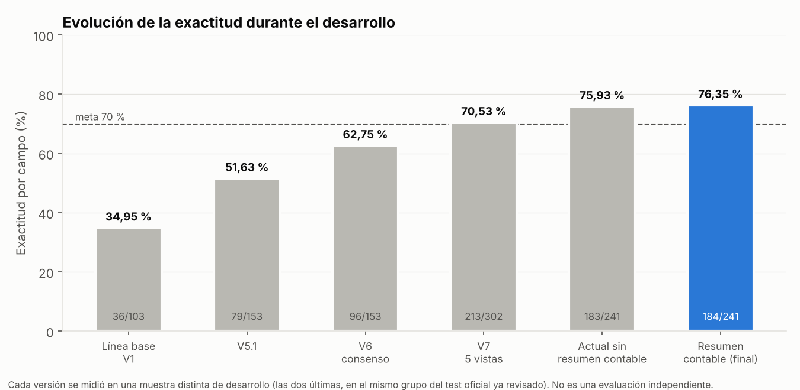

# results/ — resultados y visualizaciones

Figuras, tablas de métricas y reportes del proyecto. No contiene imágenes de facturas, texto OCR, predicciones ni documentos propios.

```text
results/
├── figures/
│   ├── desarrollo/        # Evolución de la exactitud: línea base V1 → modelo «resumen contable»
│   ├── eda/               # Análisis exploratorio: particiones, resolución, regiones, cobertura, correlaciones, posición de campos
│   ├── preprocesamiento/  # Calidad del OCR (CER) frente al tamaño de la imagen
│   ├── optimizacion/      # Optimización de hiperparámetros (notebook 04)
│   └── evaluacion/        # Evaluación final (notebook 05)
├── metrics/
│   ├── desarrollo/        # Exactitud por versión y por grupo de test
│   └── eda/               # Particiones, cobertura de etiquetas, estadísticas, correlaciones, formatos de fecha, outliers, incidencias
└── reports/
    ├── resultados_desarrollo.md   # Mediciones usadas para elegir el modelo, con su contexto
    └── reporte_resultados.md      # Resumen de las métricas de esta carpeta
```

## Origen de cada resultado

| Contenido | Origen |
|---|---|
| `figures/eda/`, `metrics/eda/` | [`01_exploracion.ipynb`](../notebooks/01_exploracion.ipynb) sobre los 1.881 documentos de desarrollo de SROIE y WildReceipt. |
| `figures/preprocesamiento/` | [`02_preprocesamiento.ipynb`](../notebooks/02_preprocesamiento.ipynb), 30 documentos de validación. |
| `figures/desarrollo/`, `metrics/desarrollo/` | Mediciones de desarrollo descritas en [`reports/resultados_desarrollo.md`](reports/resultados_desarrollo.md). Cada versión se midió en una muestra distinta; no es una evaluación independiente. |
| `figures/optimizacion/`, `figures/evaluacion/` | [`04_optimizacion.ipynb`](../notebooks/04_optimizacion.ipynb) y [`05_evaluacion.ipynb`](../notebooks/05_evaluacion.ipynb). |
| `reports/reporte_resultados.md` | Generado a partir de `metrics/` con [`src/evaluate.py`](../src/evaluate.py). |

## Figura principal


